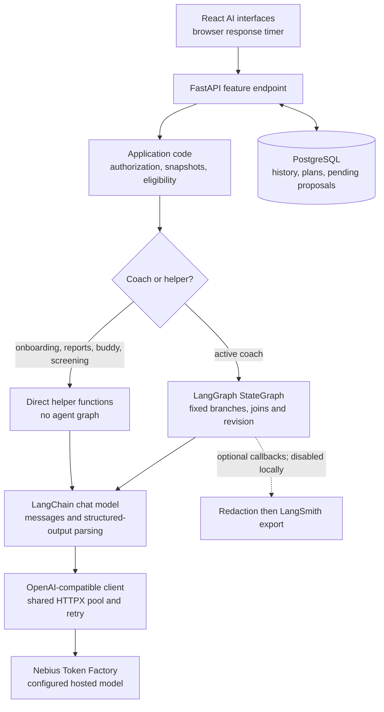
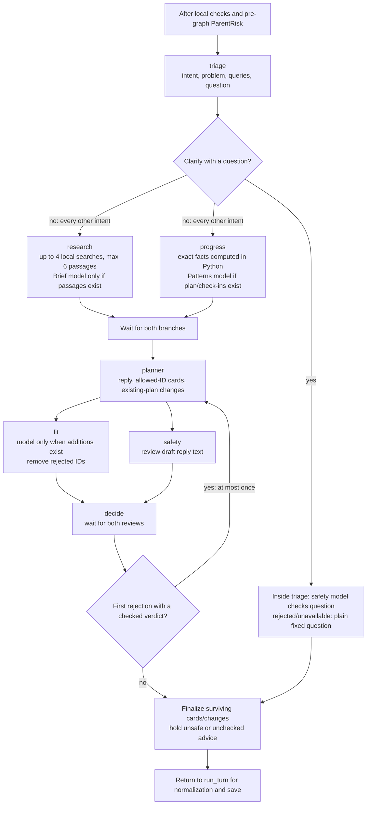
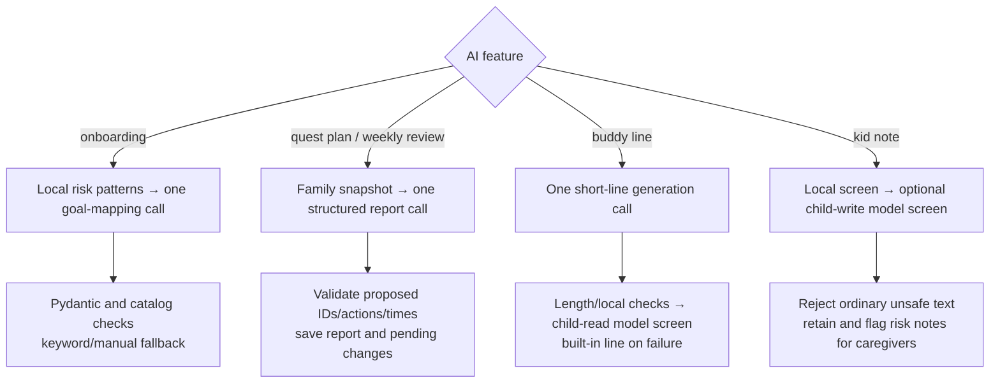
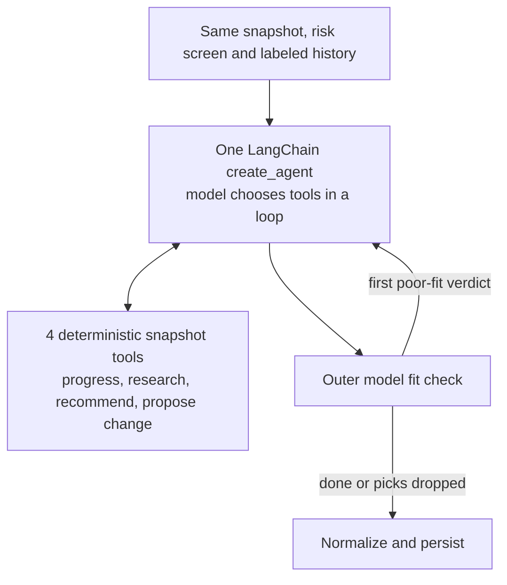
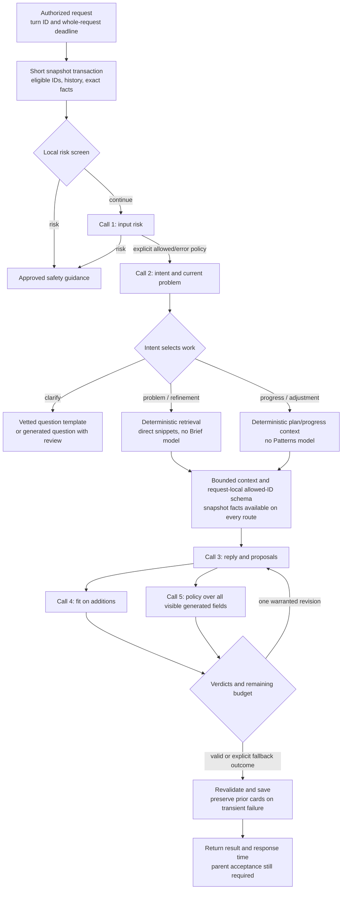
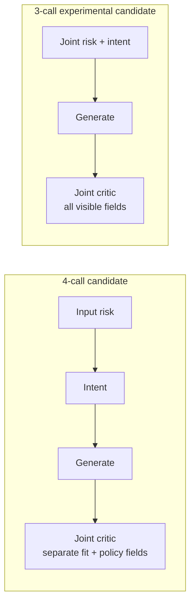

# HabitQuest AI system: agents, guardrails and latency

The latest implementation direction is the [one-call streamlined plan](streamlined-ai-implementation-plan.md),
with reviewed advice and explicitly initiated planning. The five-call alternative below remains an audit
comparison, not the chosen target.

For a concrete explanation of each stage's code, inputs, model requests and outputs, see the
[plain-language request walkthrough](coach-request-walkthrough.md), added November 4.

**Reviewed November 3, 2026.** Source baseline: `831f4617acd5b36e67b1e431089a5f381f9dfd7e`, with the local
bootstrap configuration and frontend response timers. Three parallel investigations covered workflow, guardrails
and optimization. This document describes the current implementation and proposes changes; it does not change
the running AI configuration.

## The short answer

| Question | Finding |
|---|---|
| How many agents? | **Six model-backed roles** in the active coach, plus a separate parent-risk classifier. They form a fixed workflow, not six autonomous tool-using agents. |
| How many graph nodes? | **Seven application nodes:** six roles and one deterministic decision node. `START`/`END` are markers. The risk classifier is outside the graph. |
| How many model calls? | A populated-plan recommendation turn can use **seven logical calls**, or **ten** with one full revision. Clarification uses three. Transport retries can add HTTP attempts. |
| What is slow? | The successful recorded synthetic turn took **45.08 seconds / nine calls**. Its research brief took 14.20 seconds; the revision added 10.47 seconds. Framework overhead was not measured. |
| What looks excessive? | A model summarizes a handful of tiny guidance passages; another interprets already computed progress facts; every non-clarifying intent runs both branches. |
| First optimization? | Keep the input-risk, fit and policy checks. Feed retrieved snippets and exact facts directly to the planner: the populated add-card path becomes **five calls**, or eight with a revision. Measure quality and latency before adopting it. |

**Recommendation:** retain LangChain/LangGraph as the integration and workflow layer. Simplify remote model work
before replacing frameworks or adding infrastructure. A six-role design is not inherently wrong, but the current
workload does not yet justify every role on every turn.

### Reading map

- [What LangChain and LangGraph do](#1-what-langchain-and-langgraph-do)
- [Agent inventory and call counts](#2-agent-inventory-and-call-counts)
- [Full current coach workflow](#3-full-current-coach-workflow)
- [State, memory and data boundaries](#4-state-memory-and-data-boundaries)
- [Guardrails and failure behavior](#5-guardrails-and-failure-behavior)
- [Other AI workflows and the alternative coach](#6-other-ai-workflows-and-the-alternative-coach)
- [Where time goes](#7-where-time-goes)
- [What is overkill](#8-what-is-overkill)
- [Optimization designs](#9-optimization-designs)
- [Implementation order and acceptance checks](#10-implementation-order-and-acceptance-checks)

## 1. What LangChain and LangGraph do



| Layer | What this application uses it for |
|---|---|
| LangChain | `init_chat_model`, message objects, Pydantic structured-output wrappers; also tools and `create_agent` in the alternative engine |
| LangGraph | `StateGraph`, conditional routing, parallel branches, joins and one revision loop |
| LangSmith | Optional trace collection and redacted export after a coach graph completes |
| HabitQuest code | Prompts, catalog eligibility, policy decisions, retries/fallback semantics, quotas, masking, persistence and approval |

The active crew calls `with_structured_output(..., method="json_schema", strict=True)` directly on a model.
It does **not** instantiate a LangChain agent for each specialist. LangChain distinguishes predetermined workflows
from agents that choose their own process/tool usage; this implementation belongs to the workflow category.
[Official workflow/agent distinction](https://docs.langchain.com/oss/python/langgraph/workflows-agents),
[model structured output](https://docs.langchain.com/oss/python/langchain/models#structured-output).

The installed local versions are LangChain **1.4.7**, LangChain OpenAI **1.7.3**, LangGraph **1.2.19** and LangSmith
**0.14.16**. These are local versions, not claims about the latest releases. The project has no CrewAI dependency.
There is no vector database, AI background worker, graph checkpointer or model-controlled specialist delegation.
Sources: [dependencies](../backend/pyproject.toml), [adapter](../backend/src/habitquest_backend/llm.py),
[crew request wrapper](../backend/src/habitquest_backend/crew.py#L187),
[audit evidence](evidence/2026-11-03/ai-system-audit.json).

## 2. Agent inventory and call counts

### The six crew roles

| Role | Work performed | Configured size / effort | When it calls a model |
|---|---|---|---|
| **Triage** | Intent, current problem, search queries or a clarifying question | Small / low | Once on each allowed AI coach turn |
| **Research** | Retrieve local passages, then extract a brief with citation refs | Small / low | Once if any passages were retrieved |
| **Progress** | Interpret exact plan/check-in/approval facts into patterns | Small / low | Once if plan or check-ins are nonempty |
| **Planner** | Draft reply, new habit cards and existing-plan changes | Large / medium | Once; at most one revision |
| **Fit** | Check whether proposed new habit titles directly address the problem | Large / low | Once per planner pass that produces additions |
| **Safety** | Check generated reply against the app's policy | Safety / low | Once per draft; also checks a generated clarifying question |

`decide` is deterministic control code, not another model. `checked_question` can call the safety model **inside
the triage node**; a model call and a graph node are different units. Before the graph, `parent_risk_model` is a
seventh LLM responsibility, classifying input risk rather than generating coaching.

Local `COACH_ENGINE=crew` selects this workflow. Small and safety model settings are empty and `CREW_ROLES` has no
overrides, so **all roles currently resolve to the same primary model**, `deepseek-ai/DeepSeek-V4.1-Flash-1017`.
Role names provide prompt specialization but currently no smaller-model speed benefit.
Sources: [role map](../backend/src/habitquest_backend/crew.py#L58),
[model resolution](../backend/src/habitquest_backend/crew.py#L187),
[input risk](../backend/src/habitquest_backend/safety.py#L203).

### Count model invocations, not names on a diagram

For a non-clarifying turn, before any revision:

`calls = 4 + R + P + F`

The fixed four are **parent risk + triage + planner + reply safety**. `R` is one when the brief model runs, `P`
when the progress model runs, and `F` when additions need fit review. A revision adds **planner + safety + optional
fit**, or up to three calls. Research/progress are reused rather than rerun during revision.

| Path | Logical model calls, excluding transport retries |
|---|---:|
| Fake mode / local word-list risk stop | 0 |
| Model risk classifier stops coaching | 1 |
| Generated clarifying question with safety check | 3 |
| No brief, no progress data, no additions | 4 |
| Empty plan/no check-ins, with guidance and additions | 6 |
| Same, with a full revision | 9 |
| Populated plan, with guidance and additions | 7 |
| Same, with a full revision | 10 |

These counts assume calls are reached and complete; failures/timeouts can stop or alter a path. One SDK retry is
allowed per model request, so the provider's HTTP-request count can exceed logical model calls. The family's
100-request daily quota counts **feature requests**, not these internal calls or tokens.

## 3. Full current coach workflow

### Request and persistence boundaries

```mermaid
sequenceDiagram
    participant UI as Coach UI
    participant API as FastAPI
    participant PG as PostgreSQL
    participant Run as run_turn
    participant Model as Provider
    UI->>API: POST child coach message; start response timer
    API->>API: Validate body and caregiver token
    API->>PG: Transaction 1: ownership, usage, retention, snapshot, history
    PG-->>API: Commit short transaction
    API->>Run: Snapshot, history and request-local working objects
    Run->>Run: Word-list risk screen; prepare child labels
    Run->>Model: Parent-risk classifier before graph deadline
    Run->>Run: Build graph; start optional collector and timed future
    Run->>Model: Graph stages and optional revision
    Model-->>Run: Final structured results
    Run-->>API: Checked/normalized reply or fallback
    API->>PG: Transaction 2: save messages and pending proposals
    PG-->>API: Commit; return thread
    API-->>UI: Complete JSON; freeze response time
    Note over UI,Model: No model tokens or unreviewed draft are streamed to the UI
    UI->>API: Later: caregiver accepts a pending proposal
    API->>PG: Revalidate authorization, PIN if set, status and plan constraints
    PG-->>API: Apply accepted change in a transaction
```

The first transaction loads eligible habits, non-removed plan entries, 14-day approvals/check-ins, previously
shown IDs and recent messages. No database transaction stays open while a model runs. Risk-guidance responses
do not save the submitted conversation message, although the earlier quota/retention transaction has committed.
Sources: [send endpoint](../backend/src/habitquest_backend/coach.py#L480),
[snapshot](../backend/src/habitquest_backend/coach.py#L347),
[acceptance](../backend/src/habitquest_backend/coach.py#L574).

### The complete crew graph



The two joins are explicit: `add_edge(["research", "progress"], "planner")` and
`add_edge(["fit", "safety"], "decide")`. Parallel latency is the **slower branch**, not their summed durations.
The outer one-worker executor hosts the graph; it does not serialize the graph's own parallel branches.
[Graph construction](../backend/src/habitquest_backend/crew.py#L463),
[LangGraph execution semantics](https://docs.langchain.com/oss/python/langgraph/graph-api).

Triage identifies `new_problem`, `refine`, `adjust_plan`, `progress` and `clarify`. Only `clarify` changes topology.
For example, a simple retiming request still enters guidance research and progress analysis. The intent otherwise
changes the planner's prompt rather than selecting a cheaper workflow.

### What each stage passes forward

1. **Research:** lexical BM25 over bundled `guidance.json`, using up to three generated queries plus the problem.
   Up to six distinct passages become a model-written brief. This is local retrieval, not live web research.
2. **Progress:** Python produces exact counts, titles/times/status and check-in summaries. The model adds at most
   three interpreted patterns. The planner receives **both** the raw facts and these patterns.
3. **Planner:** builds a request-specific schema. Card IDs are enums from eligible habits excluding plan/shown IDs.
   New-card capacity is `max(0, min(3, 6 - len(plan)))`; active and paused habits occupy slots. Change IDs must
   belong to the existing plan. Code validates retiming strings and truncates reasons/cards after generation.
4. **Fit:** sees parent words and habit titles, deliberately excluding the planner's persuasive reasons. Rejected
   IDs are removed and marked shown in the request-local snapshot. Existing-plan changes skip this fit check.
5. **Safety:** sees the draft reply text, not card/change reasons. It checks policy rather than recommendation fit.
6. **Decision:** one fit or policy rejection can regenerate the entire reply/cards and rerun reviews. A reviewer
   outage behaves differently from a negative verdict; see the failure matrix below.

After the graph, the application normalizes citation markers, removes unsupported refs, restores child labels,
caps the reply at 4,000 characters and computes the outcome. `no_habit_match` currently means “research ran and
no additions/changes survived,” not a verified catalog absence. That flag can dismiss older pending coach/add
cards. This error-contract issue must be repaired before interpreting empty-result rates as model quality.
[Planner/reviews](../backend/src/habitquest_backend/crew.py#L342),
[postprocessing](../backend/src/habitquest_backend/coach.py#L283),
[save behavior](../backend/src/habitquest_backend/coach.py#L514).

## 4. State, memory and data boundaries

There are three separate working representations:

| Object | Contents and lifetime |
|---|---|
| `Snapshot` | Age, eligible catalog, plan, approvals, shown IDs and check-ins; constructed per request |
| `CrewState` | Messages, triage result, brief, exact facts, patterns, draft, reviewer verdicts and revision flag; passed between graph nodes |
| `Turn` | Mutable recommendations, changes, sources and researched flag; captured by node closures and later saved by the API |

`messages` uses LangGraph's `add_messages` reducer; most other state fields are replaced by a node's returned
updates. `Turn`/`Snapshot` mutations are **outside the formal graph state**. The current branches write different
fields, but this design complicates tracing, cancellation and future replay. Both graphs compile with no
checkpointer: PostgreSQL history is loaded manually on the next turn. LangGraph's persistence capabilities are
not automatically active just because `StateGraph` is used.
[State definitions](../backend/src/habitquest_backend/crew.py#L159),
[working objects](../backend/src/habitquest_backend/coach_tools.py#L22),
[framework persistence](https://docs.langchain.com/oss/python/langgraph/persistence).

| Consumer | Actual context window |
|---|---|
| Database history loaded for a turn | Last 20 stored rows, including app notes, plus the current message |
| Parent-risk model | Last two prior parent messages plus current text |
| Triage/planner conversation text | Last eight messages, including current text |
| Fit reviewer | All parent words in loaded history/current message, excluding text treated as app notes |
| Shown-habit exclusion | Every shown ID in the retained thread, not only the loaded 20 rows |
| Approvals/check-ins | Last 14 days |
| Retention | 90-day message cleanup on send; New Chat deletes the child's conversation |

These windows are not aligned: the fit reviewer can judge a broader mix of topics than the planner sees, while
shown-ID exclusions can outlast the visible model context. A topic-aware current-problem representation would be
clearer than treating the whole loaded parent history as one problem.

Known child names are replaced with labels for coach calls, and custom plan titles are masked by goal. This is
not a general PII filter. Caregiver names are used for trace redaction, not the coach's provider-name substitution.
Onboarding passes the parent's supplied text directly; a typed name/contact detail there is not covered by coach
masking. An accepted custom-habit change can also write a raw title into an app note, later included in history.
[Name substitution](../backend/src/habitquest_backend/coach.py#L250),
[onboarding text](../backend/src/habitquest_backend/onboarding.py#L234),
[acceptance note](../backend/src/habitquest_backend/coach.py#L597).

**Do not globally cache the current compiled graph instance.** Its closures capture one request's mutable
`Snapshot` and `Turn`; reuse could mix family/turn state. Reusable compilation first requires explicit request-local
state/context. Public guidance indexes and pooled HTTP connections are already reused safely.

## 5. Guardrails and failure behavior

### What is enforced, and what is only judged

| Guardrail | Current protection | Boundary or gap |
|---|---|---|
| JWT roles and PostgreSQL RLS | Caregiver/kid separation and scoped family data | Protects data access, not generated advice quality |
| Proposal-only model capabilities | No database, shell or arbitrary web tool; changes wait for parent acceptance | Advice/reasons are displayed before any acceptance |
| Eligibility and allowed-ID schemas | Active shared catalog, age/tier, plan/shown exclusions; bounded additions | A valid ID can still be irrelevant or have an unsafe explanation |
| Local input-risk patterns | Zero-call stop for detected risk | Non-exhaustive lexical check |
| Model input-risk classifier | Detects indirect risk before coaching | Unavailable classifier falls back to lexical checks; outside graph deadline/trace |
| Prompt boundaries | Messages described as data; classifier wrapper tags stripped | Instructions in a prompt are not an unforgeable security boundary |
| Pydantic / strict JSON schema | Parses expected fields; dynamic enums constrain IDs/refs | Does not prove factuality, direct relevance, policy compliance or citation entailment |
| Fit reviewer | Separate relevance judgment on new-addition titles | Does not review existing-plan changes; can reject useful matches |
| Reply policy reviewer | Checks diagnoses, punishment, medical advice, blame, false claims of applied changes and internal details | Receives reply text only; card/change reasons bypass this policy check |
| Citation membership checks | Removes refs absent from retrieved brief | A real reference can still accompany an unsupported assertion |
| Parent approval and optional PIN | Rechecks pending state, duplicate/age/tier/capacity before applying changes | Current active-catalog flags are not rechecked; concurrent capacity checks can race |
| Quotas and timeouts | Request quota, HTTP timeout/retry, graph deadline and recursion bound | Not one total deadline or per-token budget; not all AI entrypoints use the quota |
| Optional trace scrubbing | Redacts names/contact/address patterns or replaces strings with lengths before export | Separate from provider-input masking; not comprehensive de-identification |

Sources: [authorization/database](../backend/src/habitquest_backend/db.py),
[schemas and reviewers](../backend/src/habitquest_backend/crew.py#L187),
[safety policy](../backend/src/habitquest_backend/crew.py#L118),
[acceptance constraints](../backend/src/habitquest_backend/coach.py#L424),
[trace boundary](../backend/src/habitquest_backend/tracing.py#L23).

Input risk, fit and output policy address **different questions**: “is this a risk situation?”, “does this habit
help?” and “is this advice acceptable?”. They are not duplicate checks. Likewise, a parent's approval protects
plan mutation; it does not make immediately displayed advice safe.

Some limits are generation instructions followed by code truncation, rather than schema generation bounds.
Examples include three search queries/patterns, a card-count description and “under 120 words.” The final hard
reply cap is 4,000 **characters**, not 120 words. Appropriate schema/output caps can prevent excess generation;
they still require compatibility checks with the hosted model.

### Failure policy is different at each layer

| Event | Actual behavior |
|---|---|
| Parent-risk model unavailable | Continue after lexical checks: **fail open** at this model layer |
| Triage unavailable | Treat current message as a new problem and continue |
| Research brief unavailable | Pass up to three raw retrieved passages to planner |
| Progress model unavailable | Keep exact facts; omit interpreted patterns |
| Planner error / outer graph failure / graph timeout | Keyword fallback; late graph result is not saved |
| Fit unavailable | Drop additions, preserve changes; no poor-fit verdict. Does not itself trigger revision or outer fallback; a parallel safety rejection still can. |
| Fit rejects additions | Remove rejected IDs; revise once when safety was checked and revision budget remains; second rejection drops remaining poor picks |
| Reply policy rejects advice | Regenerate once; second rejection uses plain reply or generic question |
| Reply policy unavailable | Suppress unchecked draft immediately; built-in reply may accompany surviving cards/changes |
| Clarifying-question policy rejects/fails | Use a fixed plain question |
| Child-written note model unavailable | Use local check result: **fail open**, preserving the child's ability to communicate |
| Child-facing buddy text screen unavailable | **Fail closed** to an approved built-in line |
| Report model unavailable | HTTP 503; no report saved, but request quota was already consumed |
| Onboarding model unavailable/bad result | Keyword goals or manual selection |

“Coach safety fails closed” therefore applies to **unchecked draft advice**, not the whole returned payload.
Surviving card/change reasons were never supplied to that reviewer. Fit errors can also be mislabeled as
`no_habit_match` with `mapped_by=ai`, hiding reviewer failure behind a catalog-sounding message.
[Crew failure paths](../backend/src/habitquest_backend/crew.py#L278),
[child screening policy](../backend/src/habitquest_backend/safety.py#L239),
[outer fallback](../backend/src/habitquest_backend/coach.py#L273).

### Cross-feature gaps to close

- **Output coverage:** reports and onboarding lack the crew's independent prose-policy review. Coach card/change
  reasons also bypass it. Review the complete user-visible generated payload rather than only one field.
- **Origin preservation:** any `HumanMessage` beginning `[App]` is rendered as an app status note and excluded from
  fit input. A parent can type that prefix. Preserve trusted note provenance as structured metadata; do not infer
  it from text. This is a prompt-boundary weakness, not a demonstrated authorization or database-write bypass.
- **Privacy consistency:** coach masking is not a universal model gateway. Onboarding input, typed PII and accepted
  custom-title notes need explicit handling if the intended policy is broader.
- **Cost consistency:** onboarding goal mapping and child-note screening do not use the coach/report/buddy quota.
  A coach request consumes one slot even when several model calls or a local/fallback path follow.
- **State integrity:** concurrent sends/reset can finish out of order; distinct acceptance requests can race on
  the six-habit cap. The snapshot is not a turn-wide lock or version check.

Sources: [app-note interpretation](../backend/src/habitquest_backend/crew.py#L202),
[history conversion](../backend/src/habitquest_backend/coach.py#L259),
[onboarding](../backend/src/habitquest_backend/onboarding.py#L223),
[child notes](../backend/src/habitquest_backend/checkins.py#L68),
[report validation](../backend/src/habitquest_backend/insights.py#L182).

## 6. Other AI workflows and the alternative coach

### The other features are direct helpers



| Feature | Maximum usual logical calls before SDK retries | Distinctive behavior |
|---|---:|---|
| Onboarding pain point | 1 | Primary model, JSON-object mode; validates catalog IDs; model also supplies its own `at_risk` flag |
| Family quest planner | 1 | Primary structured report; up to four checked proposals |
| Weekly review | 1 | Primary structured report; up to two checked proposals |
| Buddy line | 2 | Small generation followed by small child-read screening; line is at most 160 characters |
| Child check-in with note | 1 | Small child-write screening; no note means zero calls |

These do not call the coach crew graph. `OPENAI_SAFETY_MODEL` affects parent-risk and crew policy review;
**child screening still uses `OPENAI_SMALL_MODEL`**. A cheaper small-model substitution also changes moderation.
The direct report/onboarding helpers are already relatively lean; adding agent loops would add complexity without
an established need. An approved buddy-template library could remove its two sequential calls, trading novelty
for predictable latency and vetted text.
Sources: [onboarding](../backend/src/habitquest_backend/ai.py#L88),
[reports](../backend/src/habitquest_backend/insights.py#L212),
[buddy generation](../backend/src/habitquest_backend/insights.py#L263),
[screening](../backend/src/habitquest_backend/safety.py#L221).

### The alternative `COACH_ENGINE=agent` path



This path contains **one actual `create_agent` object** inside a two-node outer graph. Its four tools have no
database/network/model access: they return snapshot facts/local guidance or collect proposals in `Turn`. It lacks
the crew's separate generated-reply policy reviewer. The two engines are alternatives, not two teams running for
each request.

`MODEL_CALLS=6` limits **each nested agent invocation**, not the whole turn. An in-memory mock-transport probe
reproduced six agent calls, a fit rejection, six more agent calls and a second fit review: **12 agent + two fit
calls**. With the ordinary separate risk classifier, that constructed path can reach 15 logical calls. This is not
a measured production turn. The inactive engine does not add latency to a crew request; its cost is maintenance
and uneven guardrail coverage.
[Alternative graph](../backend/src/habitquest_backend/coach.py#L161),
[four tools](../backend/src/habitquest_backend/coach_tools.py#L61).

## 7. Where time goes

### Observed provider work

The existing synthetic probe used an empty plan/no check-ins, so the progress-model branch skipped. All nine
recorded provider responses were HTTP 200. Completion timestamps are cumulative; the table below converts them
into contributions to the **critical path**.

| Phase | Critical-path contribution |
|---|---:|
| Input risk | 1.08 s |
| Triage | 4.60 s |
| **Research brief** | **14.20 s** |
| First planner | 5.23 s |
| First parallel fit/policy reviews | 9.49 s until both completed |
| Revised planner | 5.97 s |
| Second parallel reviews | 4.50 s until both completed |
| **Whole run** | **45.08 s**, including small orchestration gaps |

The revision added **10.47 seconds**. The first policy review finished 5.20 seconds after planning; fit took 9.49,
so the join waited for fit. Do not add both branches' durations. The request sequence proves a revision occurred,
but does not retain which verdict triggered it. A separate 50-second graph-budget probe returned fallback at
51.68 seconds. These are individual synthetic runs, not representative median/P95 measurements.
[Recorded timing evidence](evidence/2026-11-03/provider-probes.json).

### The “research” input is already small

Static inspection found **16 guidance documents / 56 section chunks**. Chunk bodies range from 97 to 333
characters, with a median of 179. Even the largest six bodies total only **1,829 characters**, before titles/refs.
That makes a separate compression/brief call a strong simplification candidate. It adds another paraphrasing step
before the planner cites the source. The existing error fallback already demonstrates that the planner can be
given raw passages, although quality still needs comparison.
[Guidance construction/search](../backend/src/habitquest_backend/guidance.py#L114),
[brief fallback](../backend/src/habitquest_backend/crew.py#L323),
[static audit evidence](evidence/2026-11-03/ai-system-audit.json).

BM25 indexes are built once at module import. There is no evidence that embeddings, a vector database or a new
retrieval service would solve the observed delay. Removing a 14.20-second stage from this recorded path is not a
promise of 14.20-second end-to-end savings: planner behavior may change, and progress could become the slower
parallel branch on populated plans.

### Deadlines and hidden extra work

| Mechanism | Current limit | Implication |
|---|---|---|
| Model HTTP client | 30-second HTTPX timeout per network phase | Not a 30-second total model/turn budget |
| SDK retries | One retry | Retry/backoff can expand stage time and provider attempts |
| Coach graph | Local 65 seconds | Starts after the model input-risk call; not an end-to-end API deadline |
| Browser AI call | 75 seconds | Risk + graph + persistence can exceed browser patience |
| Graph recursion | 30 | Scheduling/loop bound, not a provider-call or token budget |
| Legacy agent | Six calls per nested invocation | A fit-triggered reinvocation resets that run budget |
| Quota | 100 family feature requests/day locally | Does not bound exact provider requests, tokens or spend |

On graph timeout, keyword fallback returns, but `shutdown(wait=False, cancel_futures=True)` cannot stop an already
running thread. The graph may continue scheduling later model stages; its late result is not persisted. Browser
abort also does not cancel provider work. Cooperative deadline checks are needed before each new call/revision,
with bounded HTTP attempts; external inference already accepted by a provider may still run.
[Timeout implementation](../backend/src/habitquest_backend/coach.py#L273),
[HTTP adapter](../backend/src/habitquest_backend/llm.py#L15),
[Python cancellation semantics](https://docs.python.org/3/library/concurrent.futures.html#concurrent.futures.Executor.shutdown).

The new frontend timer measures the API promise, including network/server work, JSON parsing and client retries,
while excluding initial reset, PIN and later refresh work. It cannot identify which model stage is slow. Cold-state
ambiguous network failures may retry POSTs without a turn idempotency key, duplicating work. A late send can also
race a reset or another turn.
[Timer](../frontend/src/components/AiParts.tsx#L33),
[network retry](../frontend/src/lib/api/client.ts#L139).

**Not demonstrated bottlenecks:** graph compilation, schema construction, LangChain wrappers, local retrieval,
database query time and trace export. Trace collection is disabled locally. When enabled, scrub/traversal/enqueue
still performs inline CPU work before return, even though upload uses the client's background queue. Measure these
costs before optimizing them; the recorded remote stages already explain tens of seconds.

## 8. What is overkill

These are engineering judgments grounded in this workload, not claims that a component can be removed without
quality evaluation.

| Candidate | Assessment | Better first experiment |
|---|---|---|
| Brief model over at most six tiny snippets | Strong simplification candidate | Pass source snippets directly, preserving refs and age filters |
| Progress-pattern model whenever any plan exists | Often duplicative; planner also receives exact facts | Deterministic simple patterns or planner interpretation of raw counts |
| Same heavy topology for every non-clarify intent | Unnecessary work for progress questions/simple plan adjustments | Make intent control retrieval, data and review needs |
| Full regeneration for one poor-fit card | Can discard/recompute useful advice and valid picks | Retain sufficient reviewed content or use a bounded targeted repair; keep reply/cards consistent |
| Same primary model and 4,000-token allowance for every role | Logical specialization without resource specialization | Validated role models and per-role budgets; measure reasoning/output usage |
| Two engines with different policy guarantees | Maintenance complexity; no active-request overhead from dormant engine | Choose and maintain a supported path after comparative evidence |
| Adding more agent managers, vector search or background infrastructure now | No demonstrated need for this small synchronous workflow | Simplify current work and measure before expanding architecture |

**Keep the strong boundaries:** no autonomous writes, RLS/auth, age/tier/catalog validation, parent approval,
input-risk policy and reviewed output. Fit and policy critics are not checking the same property. Merging them is
an optional experiment, not an automatic improvement: they already run in parallel.

## 9. Optimization designs

### First redesign: five calls, preserving separate checks



For a populated add-card turn, this changes **seven → five logical calls**, or **ten → eight** with a full revision.
The five-call count does not apply to every branch: a fixed vetted clarifying question can avoid generation/review,
and no-addition paths can skip fit. No latency or quality outcome for this redesign has been measured.

The first implementation should retain the independent reviews and extend policy review to card/change reasons.
Use direct snippets and deterministic facts before changing models, so the comparison has fewer moving parts.
Then evaluate intent-specific routing and targeted repair. Fixed question templates must be approved text;
silently treating an unchecked generated question as a template would remove a safeguard.

### Optional later simplifications



Both candidates use deterministic retrieval/facts between routing and generation. A single revision makes the
four-call design at most six calls and the three-call design at most five. The joint critic sacrifices independent
reviewer roles and may have a larger/slower prompt. Combining risk and intent also changes a pre-coaching safety
boundary and error policy. Neither should replace the conservative design without risk/fit/policy parity checks.

### Keep framework and model changes separate

The [model-selection analysis](model-selection.md) proposes Qwen30 Instruct for routine roles and GPT-OSS120 as a
documented planner/reviewer comparison, with current DeepSeek as the reference. Exact schema/parameter behavior
and child-screening quality remain to be evaluated. Model names alone cannot resolve unnecessary stages or
misleading no-match outcomes. Likewise, switching synchronous calls to async improves concurrency/cancellation
control; it does not make the provider's inference inherently faster.

Cache only with a clear ownership/invalidation rule. Public guidance is already indexed; progress-derived caches
would need invalidation on plan/check-in/completion/date/age/tier changes. Do not share conversation-answer caches
between families or freeze allowed-ID schemas across eligibility changes.

## 10. Implementation order and acceptance checks

| Order | Work | Evidence required before calling it successful |
|---|---|---|
| 1 | Record turn ID, snapshot/risk/node/save durations, actual model/schema/attempt/status, token/reasoning usage and candidate/slot/card counts | An empty turn is attributable to eligibility, abstention, rejection, reviewer outage or timeout; no raw family text needed in timing logs |
| 2 | Fix outcome semantics, pending-card preservation, note provenance and complete output-policy coverage | Reviewer outage cannot claim catalog absence or erase good cards; all displayed generated fields are covered |
| 3 | One end-to-end deadline, bounded retries/admission, idempotent sends and thread/capacity concurrency rules | No new stage/revision is scheduled after expiry; duplicate delivery produces one turn; reset/accept invariants hold |
| 4 | Remove the brief/progress model stages; preserve separate risk, fit and policy checks | Compare the five-call design against identical synthetic cases, including populated and full plans |
| 5 | Tune model assignment, reasoning and output caps; make intent routing effective | Lower useful-response latency/cost with no unacceptable drop in direct-fit, policy or child-screening results |
| 6 | Consider targeted repairs, joint critics, fixed buddy templates and reusable graph definitions | Each change has independent measurements and an explicit quality/maintenance tradeoff |

Evaluate direct habit relevance, useful-card rate where a valid match exists, correct abstention, citation fidelity,
invented facts, policy violations and child-risk false negatives/benign false positives. Repeat/interleave the same
cases and report median/tail latency, failures, retries, revision rate and cost per useful response. Include errors
and timeouts rather than scoring only successful fast requests. The current evaluation runner's regex safety
grading and a single live timing sample do not establish these guarantees.

Existing crew tests cover conditional schemas, one revision, second rejection, fit/research/progress/safety failures
and risk handling. Add regressions for generated reasons, app-note provenance, accepted custom-title history,
quota/privacy coverage, reviewer-outage outcomes, concurrency and deadline admission. Use synthetic snapshots and
the dedicated `_test` database only when persistence behavior actually needs testing.
[Crew tests](../backend/tests/test_crew.py), [evaluation runner](../backend/scripts/eval_coach.py).

Streaming **stage status** could improve feedback while preserving review. Streaming unreviewed advice would
change the output-safety boundary and is not an appropriate substitute for reducing completion latency.

### Scope and evidence

This deeper review made no live model inference requests and did not replay family conversations, change source
logic/configuration or mutate the database. It used source and installed-package inspection, existing sanitized
timings, public guidance-size counts and an in-memory mock probe for the legacy call limit. Proposed call counts
are structural comparisons, not promised response times. The exact stage responsible for the earlier real
no-match replies remains unknown because historical per-stage outcomes were not recorded.

Related documents: [overall system design](system-design.md),
[HabitCoach incident investigation](habitcoach-investigation.md),
[model shortlist](model-selection.md), [evidence index](evidence/2026-11-03/README.md).
