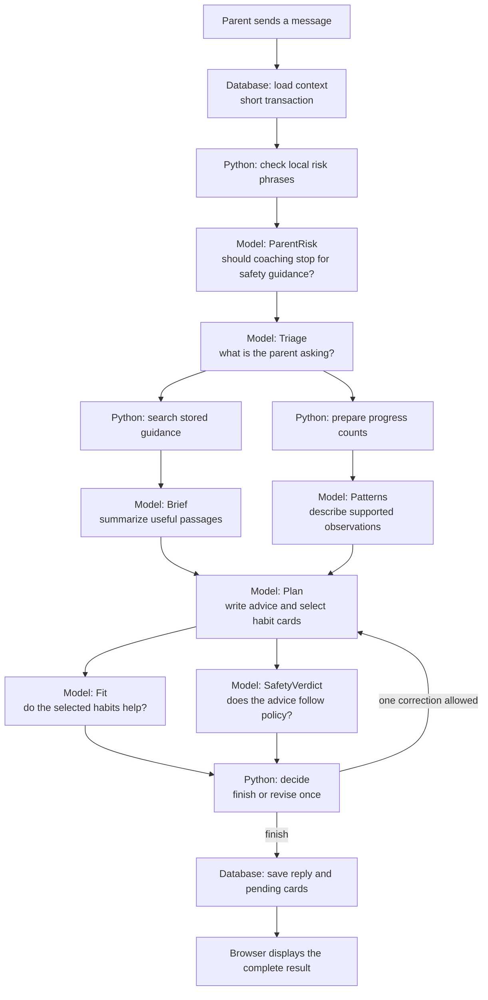
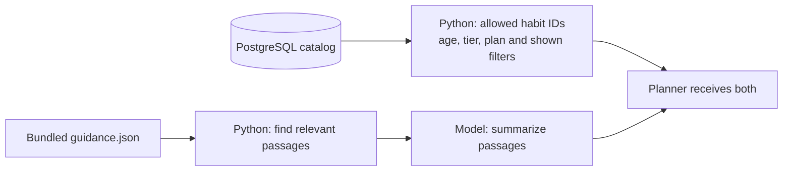

# What actually happens when you send a HabitCoach message

Reviewed **November 4, 2026**, against source baseline `831f4617acd5b36e67b1e431089a5f381f9dfd7e`.
This is the plain-language companion to the [AI architecture deep dive](ai-system-deep-dive.md).

One message triggers a small production line:

1. PostgreSQL supplies the child's plan, allowed habits, progress and conversation context.
2. Several separate requests ask the model different questions about that information.
3. Python checks the answers, allows one revision and saves the result.

The recorded **45.08 seconds was nine model requests**, including a second writing/review pass. “Research” means
searching our stored guidance and asking a model to summarize it. “Patterns” means asking a model to describe
progress counts already calculated by Python. Neither stage queries PostgreSQL while it runs.

## The route through the code



This shows the ordinary recommendation path. Risk detection can stop coaching early. A vague request can end
with a reviewed clarifying question. Brief, Patterns and Fit skip their model calls when they have no relevant
input. Paired branches run in parallel, and the next step waits for both.

The entry point is [coach.send()](../backend/src/habitquest_backend/coach.py#L480), which calls
[run_turn()](../backend/src/habitquest_backend/coach.py#L233), which builds
[crew.build_crew()](../backend/src/habitquest_backend/crew.py#L274).

## What a model call really is

Each model-backed step sends a separate HTTP `POST /v1/chat/completions` through LangChain. It contains a **system prompt**
describing that stage's job, a **user message** assembled by Python, a **JSON schema** for the answer, and model
settings. The common crew wrapper does this:

```python
model = chat_model(settings, model=name, reasoning_effort=found.effort)
runnable = model.with_structured_output(schema, method="json_schema", strict=True)
answer = runnable.invoke([("system", system), ("user", user)])
```

The backend explicitly passes information between calls. A later call sees an earlier answer only when our code
includes it in the next prompt. A stage name does not give the model database access or separate persistent
memory. In the previously verified local configuration, all roles use the same primary DeepSeek model because
small/safety settings are empty. They are different prompts, not different specialist services.

The adapter allows 4,000 output tokens and one SDK retry. The installed integration serializes the limit as
`max_completion_tokens: 4000`; application code supplies LangChain's `max_tokens` argument. Planner requests
`medium` reasoning effort; other crew calls request `low`. These are requested settings, not measurements of
actual reasoning tokens or inference time.
[Wrapper](../backend/src/habitquest_backend/crew.py#L187),
[adapter](../backend/src/habitquest_backend/llm.py#L26).

## 1. Which database lookups happen?

**Yes, the API reads PostgreSQL—but it gathers context before running the crew.** It closes that transaction,
runs the model workflow from Python objects, then opens another transaction to save/return the result. No database
connection is passed into the crew stages.

Before model work, the normal send path issues **14 application SQL statements**:

| Order | Read or write | Purpose |
|---|---|---|
| 1 | Read child ID, family ID, name and age | Check visibility and identify child |
| 2 | Update family AI-use counter | Consume one feature-request quota slot |
| 3 | Delete conversation rows older than 90 days | Retention cleanup |
| 4 | Aggregate lifetime Sparks and journey bonus | Determine progress/unlocked tier |
| 5 | Read child's tier override | Apply caregiver override if configured |
| 6 | Read non-removed plan habits | Titles, times, active/paused status |
| 7 | Count approved completions per habit over 14 days | Progress facts |
| 8 | Read all retained shown habit IDs | Avoid repeating suggestions |
| 9 | Read recent check-in fields | Mood, trickiest/favourite habits and stickers; raw notes excluded |
| 10 | Read active goals | Goal labels, descriptions and keywords |
| 11 | Read active shared habits within age/tier limits | Allowed new-habit menu |
| 12 | Read sibling names | Known child-name substitution |
| 13 | Read caregiver display names | Optional trace redaction |
| 14 | Read last 20 conversation rows | Recent messages, including app notes |

That is **12 reads and two writes**, plus three role/timeout/session setup statements per transaction. Stored
functions, row-level security and timezone helpers can perform additional work inside those statements. This is
not a count of table scans, and the old timing probe did not measure these queries.

The result is a `Snapshot`: age, allowed catalog, current plan, approval counts, shown IDs and check-ins.
[Snapshot SQL](../backend/src/habitquest_backend/coach.py#L347),
[Sparks/tier](../backend/src/habitquest_backend/journey.py#L134),
[catalog filters](../backend/src/habitquest_backend/onboarding.py#L107),
[transaction setup](../backend/src/habitquest_backend/db.py#L21).

After coaching, the API inserts the parent/reply, updates/inserts pending suggestions and reads the returned
thread/cards. This normally uses `4 + D + 2N` application statements: `D` is one if the blanket pending-card
dismissal runs; `N` is the number of saved additions/changes. A safety-guidance response skips message inserts,
but the first quota/retention transaction already committed.
[Save and return](../backend/src/habitquest_backend/coach.py#L514).

## 2. ParentRisk: should ordinary coaching proceed?

Python scans the latest message for known risk phrases. A match returns built-in safety guidance. Otherwise, a
model reads the current message plus the last two prior parent messages, with known child names changed to labels.

Its question is: **“Does this describe a child at risk, rather than an ordinary parenting struggle?”**

```json
{"risk": false, "reason": ""}
```

Risk stops coaching. An unavailable model check currently lets coaching continue after local checks. This call
happens **before** the graph's 65-second deadline begins.
[Risk code](../backend/src/habitquest_backend/safety.py#L203),
[caller](../backend/src/habitquest_backend/coach.py#L244).

## 3. Triage: understand the request

Triage means **“turn the parent's words into a task for the rest of the pipeline.”** It gets the child's label/age
and last eight formatted messages. It does not get the catalog, progress counts or guidance.

For a teaching example, suppose a parent says:

> Alex keeps asking for one more thing and getting out of bed at bedtime.

A possible answer is:

```json
{
  "intent": "new_problem",
  "problem": "Child A stalls at bedtime with repeated requests and getting out of bed.",
  "queries": ["bedtime stalling", "predictable bedtime routine"],
  "question": ""
}
```

This is an illustrative result, not the recorded 45-second run's output. The available intents are `clarify`,
`new_problem`, `refine`, `adjust_plan` and `progress`.

A meaningful `clarify` question is safety-checked and ends the turn. Every other intent starts **both Research
and Progress**, including “move this habit to 7 PM.” On error, Python treats the latest message as a new problem.
[Triage and routing](../backend/src/habitquest_backend/crew.py#L278).

## 4. Research: find stored guidance, then summarize it

### A. Python searches the local guidance library

The source is [guidance.json](../backend/src/habitquest_backend/guidance.json), bundled with the backend. At process
startup, Python splits it into sections, assigns references such as `G3`, and builds word/title indexes.

For each query, Python:

1. Lowercases/tokenizes words and simplifies word endings.
2. Expands a small synonym map, such as device words matching screen guidance.
3. Filters sections to the child's age.
4. Scores matching sections using BM25, a word-based relevance score.
5. Keeps strong matches, then combines/deduplicates results across queries.

Triage supplies up to three queries; its summarized problem is a fourth search. Each returns up to three sections,
and the combined result is capped at six. This executes local Python over memory: no SQL, web browsing or
embedding-model call.
[Search code](../backend/src/habitquest_backend/guidance.py#L149),
[combining searches](../backend/src/habitquest_backend/crew.py#L236).

### B. A model turns the selected text into a brief

Python makes the `Brief` request with the summarized problem and the selected section refs/titles/bodies. It asks:

> Keep only passages that directly help. Write a practical sentence from each, keeping its reference.

Illustrative answer:

```json
{
  "points": [
    {"ref": "G3", "point": "Use a predictable routine and one agreed last request."}
  ]
}
```

`G3` really refers to “Sleep for growing kids: Bedtime resistance and stalling.” The model returns `ref` and
`point`; Python supplies the correct title. A valid ref does not prove the generated point accurately represents
the source. No retrieved passages means no Brief call. On Brief failure, Python passes the first three original
passages to Planner. An empty brief is also allowed.
[Research implementation](../backend/src/habitquest_backend/crew.py#L308).

### Where the habit recommendations come from



**Research searches guidance, not the habit catalog.** The habit menu was loaded separately from PostgreSQL.
Research helps write grounded advice; Planner chooses cards from the allowed menu.

The library is small: **16 documents / 56 sections**, with bodies of 97–333 characters. The six largest bodies
total **1,829 characters**, excluding titles/refs. The long recorded research window surrounds remote
summarization, rather than a large external research operation.
[Static counts](evidence/2026-11-03/ai-system-audit.json).

## 5. Progress / Patterns: describe existing counts

“Patterns” is a list of model-written observations, not a training job or a statistical trend-mining system.

First, `progress_facts(snapshot)` uses Python dictionaries and `Counter` to prepare exact facts. Our synthetic
example already has `brush-teeth` in the plan, three approved days and two check-ins:

```json
{
  "days": 14,
  "plan": [{
    "habit": "Brush teeth morning and night",
    "time": "19:30",
    "status": "active",
    "approved_days": 3
  }],
  "checkins": 2,
  "moods": {"hard": 1, "okay": 1},
  "trickiest": {"Brush teeth morning and night": 2},
  "favourite": {"Brush teeth morning and night": 2}
}
```

The model receives that JSON—not the parent's problem or raw child notes—and is asked for up to three supported
observations. For example:

```json
{
  "patterns": [
    "Brush teeth has three approved days in the last fourteen.",
    "Both check-ins named brush teeth as the trickiest habit."
  ]
}
```

Python counts; the model puts counts into words. Planner receives **both** the facts and generated patterns. Any
existing plan/check-ins activates the call, even if the question does not concern progress. With neither, it skips.
Failure leaves facts intact and uses `patterns=[]`.

Despite the field name `approved_days`, its SQL source counts approved completion rows grouped by habit; it does
not explicitly count distinct calendar days.

A limitation: the supplied approval totals omit individual completion dates and scheduled-opportunity counts.
They cannot establish consecutive-day streaks or reliable completion percentages. The prompt mentions a “strong
streak,” but this input does not support calculating one.
[Facts code](../backend/src/habitquest_backend/crew.py#L247),
[Patterns request](../backend/src/habitquest_backend/crew.py#L330).

## 6. Planner: write the answer and select proposals

Planner creates the actual advice and cards. Before asking it, Python excludes planned/shown habits from the
menu, computes available additions as `min(3, 6 - plan_count)` floored at zero, and builds a schema restricting
habit IDs to allowed choices. Paused habits also occupy plan slots.

The model receives the problem, last eight messages, guidance brief, exact facts, generated patterns, allowed
habit menu and any correction notes from reviewers. Its task is:

> Write brief practical advice and select directly relevant new habit cards or propose existing-plan changes.

Illustrative answer:

```json
{
  "reply": "Try a predictable routine and one agreed last request. [G3] The suggested quest gives the routine a clear finish. Tell me if it feels too hard.",
  "cards": [{
    "habit_id": "bedtime",
    "reason": "A clear finish to bedtime directly targets stalling."
  }],
  "changes": []
}
```

The public bedtime catalog includes `bedtime`, `brush-teeth`, `story-time` and tier-two `screen-sunset`. For our
age-eight, tier-one example with `brush-teeth` already planned, new bedtime choices are `bedtime` and `story-time`.
The planned and locked choices are excluded before the model chooses.

Python then limits card/reason length, validates retiming strings and removes unsupported citation refs. Planner
proposes; it does not update the actual plan. `changes` exists in the schema only when a plan exists; `cards`
exists only when choices and slots are available.
[Planner code](../backend/src/habitquest_backend/crew.py#L342), [catalog](../backend/db/seed.sql#L29).

## 7. Fit: check whether the selected habit helps

Fit asks: **“Would doing this habit directly address the parent's problem? Reject a weak connection.”**

It receives parent words from loaded history and the selected habit titles/goals. It does not receive guidance,
progress facts, draft advice or Planner's reasons. Excluding reasons is deliberate: a persuasive explanation
should not make a weak habit look useful.

```json
{"poor_fit": []}
```

An empty list means additions passed. Python removes returned IDs. No additions means no Fit call; existing-plan
changes skip this review. A failed Fit call drops additions but does not itself request revision or keyword
fallback. A simultaneous Safety rejection can still request revision.
[Fit code](../backend/src/habitquest_backend/crew.py#L414).

## 8. Safety: check the draft advice's policy

Safety asks: **“Does this reply diagnose, recommend punishment/medical treatment, shame/blame, claim changes were
already applied, or expose internal details?”**

It gets the **draft reply string only** plus a policy prompt. It does not get parent context, facts, catalog,
card reasons or change reasons.

```json
{"safe": true, "problems": []}
```

Fit checks usefulness; Safety checks policy. Neither queries the database. The omitted reasons are an existing
coverage gap: passing Safety does not mean every generated field was reviewed. If review is unavailable, the
unchecked draft is held back and Python substitutes built-in text.
[Safety code](../backend/src/habitquest_backend/crew.py#L435),
[policy](../backend/src/habitquest_backend/crew.py#L118).

## 9. Decision: Python chooses finish or revision

There is **no model call** in `decide()`. The important condition is:

```python
if (state["poor_fit"] or state["unsafe"]) and not state["retried"] and not unchecked:
    return {"retried": True}
```

The router sends work back to Planner once. It receives correction notes, rewrites the complete reply/cards, and
the applicable reviews run again. Research/Patterns are reused rather than repeated.

Unavailable Safety sets `unchecked`; that path uses built-in text without another planning pass. After the allowed
revision, rejected additions stay removed and unsafe advice becomes plain text. Good verdicts finish the turn;
the API saves reply/pending cards. Later caregiver acceptance applies an actual plan change.
[Decision and routing](../backend/src/habitquest_backend/crew.py#L447).

## 10. Where the 45 seconds went

The November 3 artifact records **completion timestamps**, not independently measured request starts/ends.
Windows below are inferred from ordering and include small local/scheduling gaps. Calls 5/6 and 8/9 are parallel.

| Call | Model task | Completed at | Approximate window |
|---|---|---:|---:|
| 1 | ParentRisk | 1.08 s | 1.08 s |
| 2 | Triage | 5.68 s | 4.60 s |
| 3 | Brief: summarize guidance | 19.88 s | **14.20 s** |
| 4 | Plan: first answer/cards | 25.11 s | 5.23 s |
| 5 | Safety: first draft | 30.31 s | 5.20 s after first Plan |
| 6 | Fit: first cards | 34.60 s | 9.49 s after first Plan |
| 7 | Plan: revised answer/cards | 40.57 s | 5.97 s |
| 8 | Safety: revised draft | 42.73 s | 2.16 s after revised Plan |
| 9 | Fit: revised cards | 45.07 s | 4.50 s after revised Plan |

```text
Risk 1.08 + Triage 4.60 + Brief 14.20 + first Plan 5.23
  + slower first review 9.49 + revised Plan 5.97 + slower second review 4.50
  ≈ 45.08 seconds
```

The first review pair costs about **9.49 seconds**, not 5.20 + 9.49. The correction pass adds **10.47 seconds**.
The sequence proves revision occurred but does not retain which reviewer requested it.

**Patterns did not call a model in this timed run:** its fixture had no plan/check-ins. Six initial requests plus
three revision requests explain the nine. A populated-plan turn can add Patterns and reach ten.
[Timing evidence](evidence/2026-11-03/provider-probes.json).

The workflow waited through several provider requests, with the largest window around Brief, then wrote/reviewed
the answer again. The artifact cannot separate provider queueing, hidden reasoning, token generation, network or
framework overhead. It has no SQL timings, usage/token counts, request-start timestamps or review verdict bodies.
It does not retain the original synthetic prompt either. The teaching examples above are **not reconstructions
of that conversation or its model answers**. One run also does not establish typical-user median/P95 latency.

## 11. Inspect exact requests without another paid run

I ran the actual `run_turn()`/crew code against an in-memory mock transport, supplying scripted answers for the
bedtime example. It produced **seven serialized requests**, including Patterns because that fixture has a plan.
No live model or database was used. This demonstrates serialization/data flow, not model quality or speed.

- [Captured requests and scripted replies](evidence/2026-11-04/coach-offline-example.json): full system/user
  messages, schemas, requested settings, retrieved passages, facts and final result. Headers are excluded.
- [Offline script](examples/trace-coach-offline.py): dummy credentials, no `.env` loading, in-memory
  `httpx.MockTransport` replacing the model client.

From the repository root:

```bash
backend/.venv/bin/python docs-detailed/examples/trace-coach-offline.py
```

In this reduced example the Brief user message is **1,186 characters**, Patterns facts **273 characters**, and
Planner user message **920 characters**. Counts exclude system prompts/schemas and are not token counts. They
describe this scripted example, not the historical timed request.

## What to measure and simplify next

The chosen implementation direction is now the [one-call streamlined plan](streamlined-ai-implementation-plan.md),
using reviewed advice and separate explicit planning. The five-call reduction below is an earlier comparison.

First test giving Planner the short original guidance snippets directly, removing Brief's remote summary call.
Then test providing exact progress facts without the extra Patterns interpretation. This retains input risk, Fit
and Safety and changes a populated recommendation path from seven to five model calls. Actual latency/quality
improvements require comparison; subtracting 14.20 seconds from the old run is not a reliable prediction.

Record a per-turn timeline separating SQL snapshot, local search, each provider request, local facts, decision
and SQL save. Include model/schema, attempt, token usage, revision reason and cards before/after review. That
would answer “which part was slow?” for each real request. The browser timer is the separate user-visible wait.

Broader guardrail gaps, deadlines, model choices and optimization tradeoffs remain in the
[AI deep dive](ai-system-deep-dive.md) and [model-selection analysis](model-selection.md).
