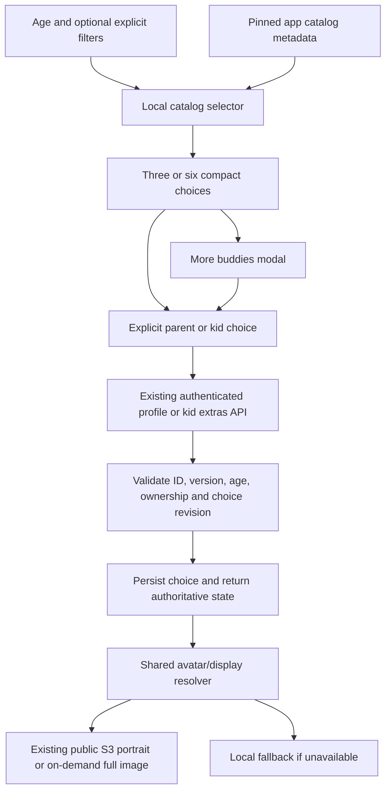
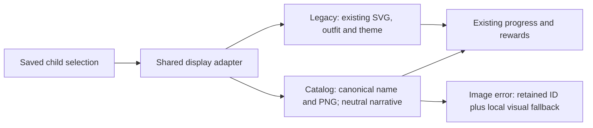

# Buddy catalog integration: analysis and implementation plan

**November 5, 2026 — owner approved, implemented and enabled locally.** The
application database was backed up and migrated with existing rows preserved.
The [execution record](execution.md) records full-suite, browser, artwork and local
rollout results, plus the existing mobile login limitation. No S3 configuration
change or new provider operation is part of this work.

## What exists

There are **24 catalog buddies**, with **48 published consumer PNGs**: one portrait
and one full-body illustration per character. These are two views of each buddy,
not 48 characters or separate age-specific image versions.

| Primary discovery band | Count | Characters |
|---|---:|---|
| 3–5 | 6 | Pippin, Nori, Momo, Tilly, Sprig, Pebble |
| 6–8 | 6 | Ember, Pip, Kiki, Otto, Dot, Lumi |
| 9–10 | 6 | Juniper, Orbit, Moss, Pixel, Ripple, Scout |
| 11–13 | 6 | Nova, Echo, Koa, Flux, Fern, Cove |

**All 24 have supported ages 3–13.** A primary age band is a soft recommendation,
not an eligibility rule or a tested preference claim. A child can choose another
catalog character within the supported range. Hard-locking children to their six
primary-band characters would contradict the existing catalog.

The records include stable IDs, names, character kind/theme, interests, tone,
visual complexity, supported ages, descriptions, alt text, selection guidance,
and asset references. These attributes describe the characters; they do not
classify a child's personality, diagnosis or needs.

**Latest owner metadata direction:** visible character details belong in the buddy
chooser: name, brief characteristics and suggested age. Local theme/interest filters
help people choose; they do not create a child profile. Do not add metadata panels
elsewhere or use these records to change AI prompts, coaching, habit selection,
scoring or rewards. The selected avatar/name and shared neutral event copy remain
available in the existing app surfaces.

**Owner product decision, November 5:** every child always has a buddy. The source
catalog treats companion presence as optional; the owner explicitly overrides that
policy for HabitQuest. New-child setup automatically preselects a deterministic
age-based default that the parent can change. There is no empty or hidden-buddy
selection. Existing children's current buddies remain unchanged.

| Source | Purpose |
|---|---|
| [Canonical records](../../../../hq-buddies-catalog/data/buddies.json) | All 24 IDs, age bands and public attributes |
| [Existing selector](../../../../hq-buddies-catalog/scripts/select_buddies.py) | Deterministic ranking/filter precedent |
| [Selection guide](../../../../hq-buddies-catalog/docs/selection-guide.md) | Choice and cross-age policy |
| [Art manifest](../../../../hq-buddies-catalog/art/asset-manifest.json) | Dimensions, hashes, completeness and provenance |
| [Asset overlay](../../../../hq-buddies-catalog/data/asset-references.json) | Canonical-record-to-published-art linkage |
| [Published map](../../../../hq-infra-setup/asset-publishing/record-asset-map.json) | Exact permanent S3 image/icon URLs |
| [Public-access evidence](../../../../hq-infra-setup/asset-publishing/PUBLIC-ACCESS.md) | Existing scoped public delivery |

The catalog also retains 48 native masters and four correction drafts locally.
Those are authoring assets, not additional characters or runtime downloads.
The inventory agent verified all 96 current consumer/master files against the
manifest hashes and sizes and confirmed all 24 IDs match the publication map.

## S3 is ready

Published prefix:

```text
s3://habbit-quest-assets/buddies/catalog-0.1.0/art-0.1.0/9717ad52fb16/
```

Each ID has `<id>/icon.png` and `<id>/image.png`. For example,
[Pippin's portrait](https://habbit-quest-assets.s3.us-east-1.amazonaws.com/buddies/catalog-0.1.0/art-0.1.0/9717ad52fb16/pippin-bear/icon.png).

A fresh anonymous HTTPS check on November 5 at 18:16 America/New_York confirmed
**48/48** image reads: HTTP 206, PNG signatures, expected object sizes,
`image/png`, cross-origin access and
`Cache-Control: public,max-age=31536000,immutable`.
See the [aggregate check](s3-access-check.json). This verifies those published
objects; it is not an audit of every unrelated object or account policy.

| Runtime artwork | Count | Dimensions | Total bytes |
|---|---:|---|---:|
| Portraits | 24 | 128 × 128 | 715,669 |
| Full-body images | 24 | 768 × 768 | 13,374,498 |

No new upload, bucket policy, presigned URL or AWS credential is needed for the
approved app integration. Only PNGs are published at this prefix; the public
catalog metadata is packaged with the app rather than discovered by
listing S3 at runtime. Older November 1 publication notes saying public access
was untested are superseded by the November 5 verification.

## Implemented parent and child experience

| Surface | Initial display | Expanded display |
|---|---|---|
| Dashboard child card | Current buddy only, in the existing avatar space | Edit in Child Details; no catalog grid on the card |
| Add child / first setup | Three portrait/name choices with an age-based default selected, plus More buddies | Modal with the full eligible catalog |
| Child Details | Current selection plus alternatives, at most six small tiles | Same modal with filters and a selected-character preview |
| Kid Journal: My buddy | Current selection and two alternatives, plus More buddies | Same age-aware catalog in a kid-friendly modal |

Use roughly 42–48px parent portraits and 64px kid-picker portraits. Keep names
visible. A selected-character preview can show the larger illustration and a
short description without expanding every tile or the dashboard.

The modal keeps the best-ranked choices first, allows all 24 supported characters,
and includes a separate **Original buddies** group for Fox, Owl, Bear and Bunny.
Theme/interest filters live inside the modal, keeping the main form short. These
filters stay local to the current interaction; save the actual choice, not an
inferred child profile. Tiles show the name, brief character characteristics and
suggested age, and explain that every current catalog buddy supports ages 3–13.

Reuse the existing [CatalogDialog](../../../frontend/src/components/CatalogDialog.tsx)
for focus trapping, Escape, background inertness, scrolling and return focus.
Keep keyboard-operable radio choices, selected-state labels and touch targets.
Opening, closing, filtering or previewing the modal must not save a selection.

## Local recommendation and choice rules

1. Filter by published availability, supported age range and explicitly selected
   exclusions/detail preferences. Do not relax explicit filters to fill a shortlist.
2. Rank with the existing selector's public attributes: +3 per explicit interest
   match, +2 for an explicitly selected character tone, +1 for the primary age band.
   Use stable-ID tie-breaking and the existing group-diversity behavior. Port the
   same behavior into local application code and keep parity fixtures.
3. Without additional preferences, age is the only ranking input. The current app
   has no structured buddy-interest profile. Do not infer preferences from the
   child's name, gender, habit problems, diagnosis, missed tasks or model output.
4. A new-child form automatically selects its first deterministic recommendation.
   The parent can keep it or choose another buddy, and confirms the assignment by
   submitting Add child. Changing age updates that provisional default until a
   deliberate buddy choice is made. A parent's assignment is not labelled an
   inferred child preference. This is the owner's explicit override to the source
   catalog's optional-companion policy.
5. Existing saved choices take precedence over recommendations. Age or filter
   changes do not replace an explicit choice. Keep a saved choice visible even
   when it falls outside the initial shortlist.
6. A later explicit kid choice replaces the parent's initial assignment. A parent
   can deliberately reassign later. Routine/name edits and stale open forms must
   not replace a newer choice. Do not introduce a permanent parent lock.
7. Always retain a valid selection. An empty filtered shortlist does not clear the
   current or provisional buddy and does not relax explicit filters. If catalog
   data is unavailable during new-child setup, use the existing Fox default;
   catalog/image failure for a saved choice uses its retained legacy visual
   fallback without changing the saved identity.



The selection path uses code and ordinary profile persistence. It makes no LLM,
embedding, Pinecone, research, safety-model or generation-budget call.

## Preserve the working four-buddy app

The current `children.buddy` is checked against `fox`, `owl`, `bear`, `bunny`.
Frontend types, SVG faces, outfits, themes, footprints and celebrations index those
four values directly. The catalog's IDs are different: for example `ember-fox`
is not an alias for `fox`, and 19 characters have no legacy analogue at all.

**Use an additive identity adapter, not an expansion of the legacy union.**

Implemented persisted contract:

| Field | Purpose |
|---|---|
| Existing `buddy` | Retained four-value legacy identity/theme fallback |
| `buddy_selection_mode` | Explicit `legacy` or `catalog`; default `legacy` |
| `catalog_buddy_id` | Nullable canonical ID for catalog mode |
| `buddy_catalog_version` | Pinned catalog version when a catalog buddy is selected |
| `buddy_selection_revision` | Optimistic guard against stale explicit choice writes |

The app-owned `hq.buddy_catalog` reference table holds valid ID/version, supported
ages and availability so the database's kid-write function validates without
network access. The same pinned release is packaged as a slim frontend manifest. The public
24-record reference import is separate from goal retrieval/import rules.

Existing children remain in legacy mode with their exact current identity and
inventory. Do not auto-convert them to an analogue or change their choice during
migration. Old create requests keep their current defaults. Unrevisioned flat
`buddy` writes can change an untouched revision-0 legacy record. Once any deliberate
revisioned choice is saved, ignore that flat field on old compatibility payloads,
apply their unrelated profile edits, and return the authoritative current selection.
This protects newer legacy choices as well as catalog choices. New clients change a
buddy through the explicit selection object and expected revision.
Enforce complete mode fields: catalog mode requires a valid ID/version pair;
legacy mode clears that optional pair and retains a valid original buddy. Reject
requests that would leave a child without a buddy.



### Save correctly across parent and kid sessions

- The existing `PATCH /v1/kid/extras` self-change path now accepts explicit choices.
  Child identity and age come from the authenticated session. The narrow
  security-definer path validates choices without granting direct child-table updates.
- Validate canonical ID/version and availability, supported age, exclusive mode
  fields and expected selection revision. Reject unknown/conflicting fields.
  Lock/update atomically so age edits and kid selections cannot race validation.
- Caregiver age+selection updates now validate the final merged state under one
  row lock and save in one update, including SQL-null clearing on mode switches.
  This replaces the previous per-column update loop for profile edits.
- Forms submit selection fields only after a deliberate picker edit, replacing the
  earlier unconditional flat `buddy` resubmission. A stale explicit selection gets
  a recoverable conflict instead of silently winning.
- Return the authoritative selection/revision from the mutation, extras and Today
  reads. Update local state after success; show a save error and retain the last
  saved choice on failure. The kid picker now reports failures and offers an explicit retry.
- Guard read reconciliation as well: an older Today/extras/poll response must not
  overwrite newer saved selection fields. Merge choice fields only when their
  revision is current or newer; treat old snapshots without a revision as revision 0.
- Propagate the selection through child create/list/read/update, kid login/me,
  family-code avatar projections, Today, extras, export and browser reconciliation.
  Do not put optional private preferences into public avatar/catalog projections.

### Wardrobe, narrative and optional AI messages

The existing eight accessories—party hat, crown, shades, bow, wizard hat, flower,
headphones and halo—are separate SVG overlays, not clothing baked into the buddy
image. The existing four SVG faces supply the eye/head coordinates used to align
them. Catalog portraits and full-body pictures have different crops and geometry;
the implementation adds independent app-owned anchors for both representations.

An equipped-item badge would preserve ownership and the equipped-item value, but
would **not preserve visual dress-up** on the selected catalog buddy. The owner
prioritizes keeping the current capability. The approved implementation composes
worn SVG accessories over the PNGs. Final visual QA remains a rollout gate.

The implemented compatibility work uses the existing PNGs and SVG accessory art:

- Keep all eight original accessories, earned inventory, equipped-item values and
  working legacy dress-up behavior.
- Rename the wardrobe's Nothing label to No accessory for clarity. Removing an
  accessory never removes or hides the child's buddy.
- App-owned anchor metadata is provided per character **and per representation**
  (portrait and full body). The SVG overlay composes above the PNG using head/eye
  positions and accessory placement transforms. Some shapes require accessory-specific
  offsets, scale, rotation or vector fitting; a single inherited eye coordinate
  is not enough for all characters.
- Regenerating the buddy illustrations is not required for this approach. Do not
  modify or republish the existing PNGs merely to test accessory alignment.
- The pre-implementation review used side-by-side screenshots of the current SVG
  behavior and representative catalog PNG overlays, including unadapted alignment
  and trial anchor placement. Those review-only compositions do not establish that
  every final character/accessory combination is ready.
- The [comparison screenshots](previews/README.md) now show actual original SVG
  rendering beside draft catalog portrait/full-body compositions, and compare a
  badge with a worn crown. Crown/shades illustrate fitting; Dot's headphones expose
  overlap with existing ear hardware. Some pairs may need an accessory-specific
  SVG variant or mask, beyond moving/scaling the original vector.
- Gate rollout on visual QA for every supported character, accessory and rendered
  representation at the actual display sizes, including clipping and responsive
  scaling. Keep legacy presentation available if an arrangement fails review; do
  not silently replace visual dress-up with badges or drop an equipped item.

Narrative and message behavior remains additive:

- Use the adapter for character names and neutral catalog narrative/footprints;
  a robot must not acquire Fox's den, paws or animal sounds. Keep factual progress,
  bonus, landmark and reward behavior intact.
- Use a small shared deterministic event-copy set for new catalog characters,
  plus approved public names/welcome text. Submission copy acknowledges sending
  to a grown-up; it does not claim approval or achievement before the actual event.
- Keep existing legacy optional AI messages on their current path and family
  toggle. Catalog mode skips that animal-only prompt. Immediately hide
  cached/in-flight legacy lines when switching mode, without invalidating or
  refetching the legacy line cache. Picking a character never triggers a model call.
- Keep a buddy present in both modes. Quiet/static presentation remains valid;
  speech and motion settings do not clear the selected character.

## Efficient asset delivery

Generate a slim, validated manifest from the canonical catalog plus verified asset
overlay. Include only public runtime fields, dimensions, pinned versions and URLs;
exclude research, authoring prompts, native-master paths and private child data.
Do not maintain a second hand-edited list of names or image links.

Use the 128px portrait for inline choices, child-card avatars and modal tiles.
Three portraits total roughly 76–106KB from the current files; all 24 total about
716KB. Full images total about 13.4MB, so load only the selected preview's full
image. Use explicit dimensions, `object-fit: contain`, async decoding and lazy
loading for off-screen modal tiles. Load the currently displayed avatar promptly.

The existing versioned URLs and immutable cache headers support normal browser
cache reuse. Avoid app-load prefetching of all full images, base64 image storage,
runtime bucket listing or a new service worker. Keep a local fallback; network
failure must not erase or replace the saved identity.

Public access is already scoped to published artwork. Use the existing HTTPS
URLs and least-privilege delivery pattern; this phase makes no access-policy
change or exposure of private profile data. Retain bucket encryption and HTTPS
delivery. See [S3 access control](https://docs.aws.amazon.com/AmazonS3/latest/userguide/access-management.html)
and [security guidance](https://docs.aws.amazon.com/AmazonS3/latest/userguide/security-best-practices.html).

There is no model/token cost or coaching-credit debit for this feature. Existing
S3 request and outbound-transfer charges can apply; demand loading and caching
reduce delivered data. No new storage service/CDN is required for this first
integration. This is not an invoice estimate; see [S3 pricing](https://aws.amazon.com/s3/pricing/).

## Execution ownership and current gates

| Phase | Owner | State and completion gate |
|---|---|---|
| 1. Freeze contract and catalog | Root + catalog agent | Implemented: pinned 24-record release, generated public frontend projection/backend reference seed and selector parity fixtures |
| 2. Persistence and authorization | Backend agent | Implemented and scoped checks passed: additive migration, explicit modes/revision, atomic owned writes and all read projections |
| 3. Shared display adapter and outfits | Root + catalog/art agent | Complete: legacy adapter, portrait/full anchors and all 384 outfit/view combinations reviewed |
| 4. Parent and kid pickers | UI agent | Implemented: three/six/modal choices, deliberate saves, visible errors and existing dialog accessibility; frontend tests passed |
| 5. Integrated verification | Root + agents | Passed: 1,051 backend tests at 100% statement/branch coverage, 202 frontend tests, build, static checks, three final actual-API browser scenarios and an additional reduced-motion mobile flow; see [execution](execution.md) |
| 6. Local rollout | Root | Complete: private backup, additive migration, preservation checks across all 35 existing tables, API restart/readiness and served frontend chooser flag |

Phases 1 and 2 establish the identity contract before UI integration. Backend
work and pure catalog/selector work can proceed in parallel on separate files;
rendering and pickers integrate after the contract is frozen. Do not let multiple
agents independently redefine identity, always-present defaults or the legacy adapter.

Primary files include `ChildForm.tsx`, `Buddy.tsx`, `Journey.tsx`,
`CatalogDialog.tsx`, `KidExtras.tsx`, `Kid.tsx`, parent/child avatar call sites,
frontend API/store/sync types, backend `onboarding.py`, `extras.py`, `accounts.py`,
`daily.py`, and one new migration. Avoid changing unrelated AI orchestration,
goal/habit assignment, points or rewards calculations.

## Acceptance and rollback

- Existing four-buddy children, outfits, plans, points, Sparks, discoveries,
  multipliers and logs remain the same after migration and refresh.
- New-child defaults follow age until a deliberate choice; edits never silently
  replace a saved choice. Parent/kid selections persist and appear everywhere.
- Every child keeps a valid buddy through setup, saves, refresh, age changes,
  empty filter results and unavailable catalog data. No empty selection is offered.
- Preserve visual dress-up with the original eight accessories. Review both PNG
  representations with their own anchors; badges alone do not pass this gate.
- Cross-child/family writes, wrong-role/expired tokens, unknown IDs/versions and
  invalid explicit filter conflicts are rejected. Direct kid table UPDATE stays denied.
- A stale parent form cannot overwrite a newer kid choice during an unrelated save.
  Delayed read responses cannot roll back the choice. Explicit conflicts and failed
  saves remain recoverable; old flat-buddy writes respect the revision boundary.
- Selector parity tests cover stable ordering, group diversity, explicit preferences,
  exclusions, primary-band softness and ages 3/5/6/8/9/10/11/13.
- Provider clients fail the test if ranking, list, preview or choice operations
  dispatch AI, embedding or Pinecone requests. Catalog-specific kid messages are local.
- Test every child data projection and old browser snapshots; missing art/catalog
  keeps a recoverable identity fallback without mutation on read.
- Verify parent setup/add/edit and kid choice on desktop/390px mobile, dialog
  keyboard/focus behavior, long names, image failures and reduced motion.
- Run required frontend checks/build and backend checks with full coverage. Prove
  the additive migration on a fresh disposable `_test` DB before local application.

Roll out with backend `BUDDY_CATALOG_ENABLED=true` (its default) and frontend
`VITE_BUDDY_CATALOG_ENABLED=true` after the migration and verification gates. The
frontend template defaults to `false` until rollout. Disabling the frontend switch
hides expanded catalog choices while retaining saved selections and the read adapter.
Disabling the backend switch blocks new catalog writes with 409 but retains reads,
unrelated profile edits and explicit original-buddy choices. Missing metadata/art
uses the retained legacy visual fallback, including its SVG outfit. Keep the additive
columns/reference data; do not delete selections or reset family data. Preserve the
pre-migration backup and existing public asset versions. See [execution](execution.md).

## Approved scope

The owner approved the 24-character pinned catalog, an always-present deterministic age-based
default confirmed by Add child, soft age ranking with explicit local filters,
three/six/modal presentation, an additive identity/migration contract, free parent/kid
switching with last deliberate saved choice, and preservation of visual dress-up
through per-character/per-representation anchors using the existing SVG accessories.
The implemented outfit approach must pass final visual QA before catalog rollout;
badges are not an equivalent default. Approval includes deterministic catalog event
messages while keeping the existing legacy AI-message setting/path. The latest owner
direction keeps character metadata in the chooser for names, brief characteristics
and suggested ages, with no AI/personality inference. S3 access changes, regenerated
artwork, animation, new wardrobe inventory and new AI-persona generation are outside
this implementation.
