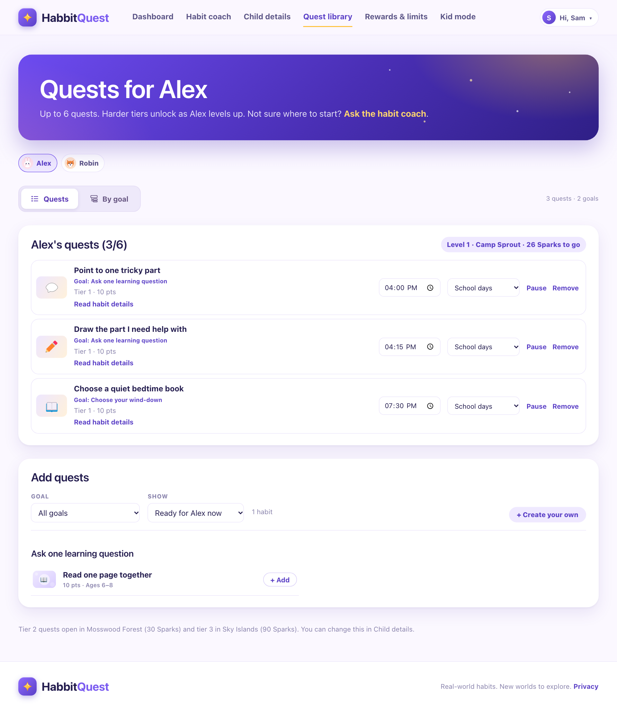
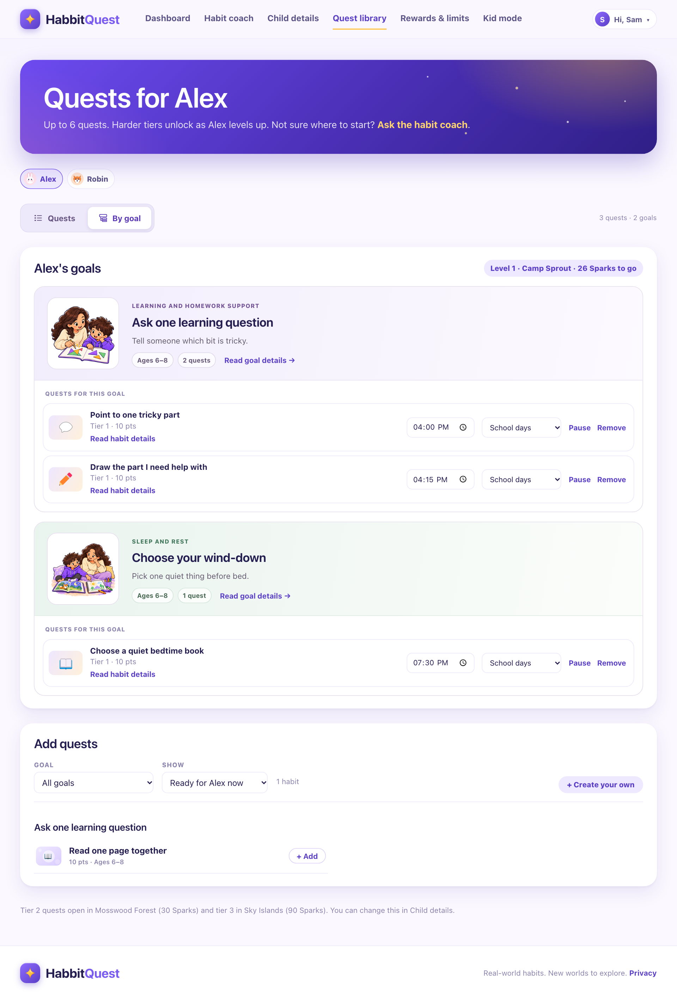
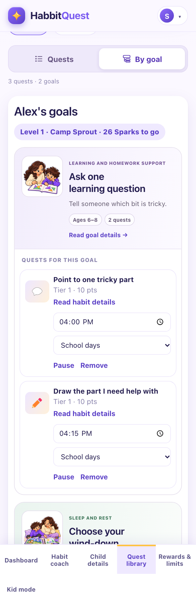

# Quest Library view proposal

Status: approved by the owner and implemented. The screenshots below preserve the
original proposal; see the [implementation notes](../../sys-design-update/quest-library-views.md)
for the delivered behavior and current screenshots.

Prepared November 5, 2026. The screenshots use synthetic children and sample quests,
the existing app styles, and the original 512px goal illustrations. No application
source or family data was changed. The new view was rendered only in an isolated
browser session with mocked API responses.

## Proposed views

- **Quests** is selected by default. Preserve the current flat list, goal links,
  scheduling, pause/resume, removal, habit details, and Add quests section.
- **By goal** shows each goal's illustration, category, title, brief description,
  age range, quest count and Read goal details control. Its assigned quests appear
  immediately below, with the existing scheduling and management controls.
- Keep the child selector above the two view tabs. Both views use only the selected
  child's plan and the same assignments.
- Group by the exact saved `goal_id`, never by a similar title or category. Include
  saved active goals with no quests, using a short empty state. Preserve quests
  whose goal metadata is missing with a clearly labeled fallback; do not assign
  them to an unrelated goal.
- Keep Add quests below the plan in both views. Goal and habit details continue to
  use the existing dialogs. Opening the grouped view does not generate content.

## Screenshots

Default desktop view:

Desktop grouped view:

Mobile grouped view, scrolled to the view tabs and first goal:

## Implementation after approval

Keep this change within the Quest Library page and its styles, reusing the existing
catalog artwork lookup and goal/habit detail controls. No schema, provider, budget
or generation changes are needed. Preserve existing goal-specific links.

Verify the default view, tab keyboard navigation, child isolation, exact goal
grouping, missing metadata, empty goals, schedule changes, pause/resume and removal
in both views. Run the affected frontend tests and build, then check desktop and
mobile rendering.

## Preview verification

Both screenshot sizes have no horizontal overflow or missing images. The browser
reported no page errors. All 12 API requests were mocked reads; no real API or paid
provider calls were made. Frontend and backend source hashes matched before and
after rendering. See [verification.json](verification.json).
