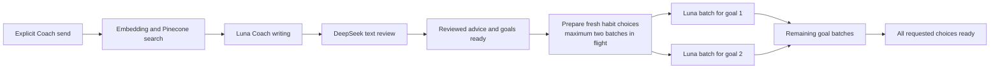

# Economics baseline and strategy

Reviewed **November 5, 2026** against the current local configuration, source code,
saved synthetic runs and official provider pricing. Dollar values below are USD.
The goal is predictable family usage and auditable operator costs, without changing
models or adding generation calls.

## Current models and prices

Prices are per **one million tokens**, Standard processing, short-context text requests.
Configured values are from a safe allowlist; secrets and full environment files were
not copied. A configured model is not proof that a particular capability invoked it.

| Exact configured model | Provider | Used for | Input | Cached input | Output |
|---|---|---|---:|---:|---:|
| `gpt-6-luna` | OpenAI | Coach writing and habit batches | $0.10 | $0.01 | $0.50 |
| `deepseek-ai/DeepSeek-V4.1-Flash-1017` | Nebius, US north endpoint | Coach text review; planner, weekly review, buddy, screening, onboarding | $0.30 | $0.006 | $1.20 |
| `text-embedding-3-small` | OpenAI | Query embedding, 512 dimensions | $0.02 | Not assumed | Not applicable |

Sources checked today: [OpenAI Luna model pricing](https://developers.openai.com/api/docs/models/gpt-6-luna),
[OpenAI pricing by service tier](https://developers.openai.com/api/docs/pricing),
[Nebius public model catalog metadata](https://tokenfactory.nebius.com/api/public/models_info),
and [OpenAI embedding model pricing](https://developers.openai.com/api/docs/models/text-embedding-3-small).
Nebius catalog throughput is not used as an application-latency benchmark.

The illustrative costs below assume uncached inputs. Tariffs must also distinguish
cache writes, service tier, region and context band when applicable; the model ID alone
is insufficient. For example, OpenAI lists Luna cache-write prices separately from
cache reads. Never apply a discount without matching usage metadata and tariff rules.

The effective main/small/Safety fallback currently resolves to the same DeepSeek model
because `OPENAI_SMALL_MODEL` and `OPENAI_SAFETY_MODEL` are empty. The dedicated output
Safety override is DeepSeek. `PARENT_RISK_MODEL` is also configured, but normal refined
Coach does **not** call that model for input screening. Coach and habit writing use
Responses API with low reasoning; other helpers use the existing Chat Completions adapter.

Pinecone search is a service operation, not a chat model. Its returned read units,
account plan, region and tariff are needed for marginal search cost. Shared storage,
minimum commitments and egress belong in operator economics separately. Account billing
was not inspected, and unknown search cost is **not zero**. See [Pinecone cost dimensions](https://docs.pinecone.io/guides/cost/understand-cost)
and [current plans/pricing](https://www.pinecone.io/pricing/).

## Activities and their actual calls

| User activity | Normal calls | Extra work allowed | Current cost/latency evidence |
|---|---|---|---|
| Coach / Get more goals | One embedding, one Pinecone search, one Luna writer, one DeepSeek text review | One rewrite + review if necessary; SDK retries are separate attempts | Recent successful Coach sample below; mixed token totals prevent exact model allocation |
| Three habit choices under a goal | One Luna call for the entire batch | One local-validation correction; writer SDK retries currently zero | Two recent useful batch samples |
| Automatic habit preparation after Coach | One batch under each of up to four newly returned goals | At most two concurrent batches; usable saved batches reused | Separate endpoint samples only; full browser timing not yet measured |
| More habit choices | One additional batch | Same batch rules | Same workload class; keep explicit/automatic origin in metrics |
| Quest planner / proposed schedule | One DeepSeek structured generation | Legacy SDK retry allowance | Current task benchmark not measured |
| Weekly review | One DeepSeek structured generation | Legacy SDK retry allowance | Not measured |
| Buddy encouragement | One DeepSeek writer, then one child-output screen when generated text passes local shape checks | Built-in fallback on failure/limit | Not measured |
| Nonempty child check-in note | One DeepSeek safety screen after local checks, when eligible | Existing bounded retry behavior | Not measured; account cost without charging family credits |
| Legacy onboarding pain-point mapping | One DeepSeek mapping call plus local checks | Keyword/manual fallback | Not measured |
| Change a quest time/day; accept/remove a habit; read goal/habit details | **No model call** | Normal API/database work only | AI generation cost is zero; infrastructure still has operating cost |

There is no independent background LLM “scheduler” running continuously. The Quest
planner is explicitly invoked; changing a time or calendar field is code/database work.
Legacy agent/crew engines are fallback configurations, not the active economics baseline.

The usual Coach flow makes **two logical chat calls**, not ten. A full new-goal screen
also includes the separately requested habit batches. With four fresh goals, that is
normally six chat generations/reviews in total, plus embedding/search. Do not mistake
these separate outputs for an internal Coach agent loop.



Sum the costs of every dispatched child operation. Measure full readiness by elapsed
wall time through the queue; adding overlapping call durations overstates latency.

## Measured evidence, with limits

| Workload / evidence date | Endpoint elapsed | Model-generation stage | Review stage | Retrieval | Sample size and boundary |
|---|---:|---:|---:|---:|---|
| Coach, three goals, Nov 5 | 11.727s | Luna 4.806s | DeepSeek 4.637s | 2.131s, including embedding 1.494s and Pinecone 0.630s | **n=1**, local HTTP; excludes browser rendering and later batches |
| Three-habit batch, Nov 5 | 10.708s | Luna 10.605s | None | None | **n=1**, local HTTP |
| Three-habit device-parking batch, Nov 5 | 10.347s | Luna 10.142s | None | None | **n=1**, in-process ASGI |
| Earlier initial Coach, Nov 4 | 6.692s | Luna 2.892s | DeepSeek 1.729s | 1.875s | **n=1**, narrower output, ASGI |
| Earlier follow-up / topic switch, Nov 4 | 4.336s / 3.996s | 2.245s / 2.455s | 1.118s / 0.707s | 0.831s / 0.718s | One of each, ASGI |
| Earlier single-habit generation, Nov 4 | 4.612s | Luna 4.509s | None | None | **n=1**, one habit, ASGI |

Sources: [November 5 Coach and first batch](../../evidence/2026-11-05/reliability-live-coach.json),
[second batch](../../evidence/2026-11-05/reliability-live-device-parking.json),
[November 4 narrower benchmark](../../evidence/2026-11-04/refinement-latency-benchmark.json).
All contain synthetic fixtures. No new live calls were made for this analysis.

Do not average different output sizes, transports and pipeline versions into a current
production benchmark. There is no support here for a reliable p95 or a five-second
promise. The recent two batch observations average **10.528s** arithmetically, but their
mixed measurement boundaries make that an illustration rather than a dashboard baseline.

An illustrative all-choices-ready time for three/four fresh goals at concurrency two is
`11.7s Coach + two waves × about 10.5s = about 32.7s`. This helps explain why a user can
experience 20–30+ seconds while an isolated earlier endpoint was reported near four seconds.
It is not an instrumented combined measurement. Browser first-reviewed-answer latency
and all-choices-ready latency both need recording.

## Generation cost arithmetic

Provider usage × the applicable tariff yields a **token-priced cost**, not an invoice.
Reasoning tokens must follow the provider's billing definition; do not add them twice
when they are already included in output usage. Missing usage is null, not zero.

For an uncached text call:

```text
cost_usd = (input_tokens × input_usd_per_million
          + output_tokens × output_usd_per_million) / 1,000,000
```

| Sample / scenario | Calculation | Result |
|---|---|---:|
| Three-habit batch A | 2,751 Luna input + 1,085 output | **$0.00081760 per batch** |
| Three-habit batch B | 2,728 Luna input + 969 output | **$0.00075730 per batch** |
| Mean of those two batch costs | ($0.00081760 + $0.00075730) / 2 | **$0.00078745 per batch** |
| Per choice within those successful three-choice batches | Batch cost / 3 | $0.00025243–$0.00027253 |
| Earlier one-habit batch | 2,646 input + 419 output | $0.00047410 |
| Latest Coach, two chats combined | 4,783 input + 609 output; all-Luna versus all-DeepSeek assignment | **$0.00078280–$0.00216570**, uncached allocation bound |
| Illustrative embedding, **assumed** 100 input tokens | 100 × $0.02 / 1M | $0.000002, not measured usage |
| Fresh three-goal request plus nine choices | Coach bound + 3 × two-batch mean | $0.00314515–$0.00452805 in chats |
| Fresh four-goal request plus twelve choices | Coach bound + 4 × two-batch mean | $0.00393260–$0.00531550 in chats |

The Coach bound is not an exact price: historical tokens were combined across models.
Cache discounts could lower it; unknown retries could add cost. Embedding and Pinecone
are omitted from this historical table because usage was not retained. The
[retrieval supplement](04-retrieval-cost-and-credits.md) adds verified embedding/search
list rates, explicit usage assumptions and combined operation/session estimates, and
uses them to derive credits. Scenario rows also omit corrections and infrastructure.
New telemetry must capture the model-specific usage before aggregation.

### Why the current cap runs out early

The current three-habit reservation is:

```text
2 allowed passes × ((120,000 input bytes + 4,096 margin) × $0.10
                  + 4,100 maximum output tokens × $0.50) / 1M
= $0.02891920
```

Input bytes are deliberately a conservative token bound. This is roughly **35–38×**
the two observed successful batch token-cost estimates. Reservations are not settled
back down after known usage. Nebius costs are not included in that dollar ledger.
The configured 2,800 writer token limit is a **floor**; the count-three calculation uses
4,100. Labels and telemetry must reflect the effective per-request limit.

Preserve the old ledger as **legacy reserved/accounted usage**. Do not reset it, assign
it arbitrarily to families or relabel it as historical actual cost. New accounting must
settle known usage while retaining uncertainty for requests whose outcome is unknown.

## Family economics and allowance strategy

Use credits as the product allowance; keep dollar cost as a separate operator metric.
A model price change updates cost reporting, not what a family is unexpectedly charged
for an otherwise identical action. Credit weights and allowance are admin-configurable.
Recommended weights now use the combined writer/review/embedding/search/egress reference
cost divided by a configurable $0.0015 reference cost per credit, rounded up once.
An admin accepts a policy revision before the configured activity quote changes; the
[retrieval supplement](04-retrieval-cost-and-credits.md) specifies the derivation.

Initial policy: **100 credits/family/local day; Coach 2; a useful batch of up to three
habits 1; planner/review/onboarding 2 each.** No credit charge for manual operations,
reading saved results, idempotent replays, built-in/local responses, rejected content
or unsuccessful generations. A bounded correction belongs to the same operation and
does not charge a second family credit fee; all provider costs still count internally.

An illustrative five-Coach-turn/four-batch session uses 14 credits and costs roughly
**$0.0071–$0.0140 in chat tokens** at the observed shapes. Seven such sessions cost roughly
**$0.049–$0.098/day**, or **$1.48–$2.94 over 30 equally active days**, before retrieval,
failures, corrections, infrastructure and other helpers. These are scenarios, not measured
average family usage or a subscription-price recommendation. With the supplement's
$0.000022/lookup assumption, the same five-turn session is $0.0071738–$0.0140883;
seven/day over 30 days is approximately $1.51–$2.96. These remain planning estimates.

For internal planning, provisionally earmark **$0.03 per such session** (about twice the
upper chat estimate), and a **$0.25/family/day variable-AI envelope**. These are capacity
assumptions, not user spending limits or guaranteed total cost. They need revision once
Pinecone, helper usage, retries and real family activity are measured. Shared fixed costs
must be allocated separately rather than hidden in each model's token price.

In the prototype, **Enforce coaching budgets = Off**. Usage and pending work remain
visible, even above the allowance. The meter says “Demo mode — limits are not enforced.”
When enforcement is enabled, atomic server admission checks each operation across all
caregivers and children; queue requests cannot spend the same remaining credit twice.

## Source map

- [Model adapters and routing](../../../backend/src/habitquest_backend/llm.py),
  [settings](../../../backend/src/habitquest_backend/config.py).
- [Refined workflow](../../../backend/src/habitquest_backend/refined.py),
  [Coach and daily quota](../../../backend/src/habitquest_backend/coach.py),
  [retrieval](../../../backend/src/habitquest_backend/retrieval.py).
- [Habit writer and batch metrics](../../../backend/src/habitquest_backend/generated_habits.py),
  [current reservation formula](../../../backend/src/habitquest_backend/planning_budget.py).
- [Planner/review/buddy](../../../backend/src/habitquest_backend/insights.py),
  [child screening](../../../backend/src/habitquest_backend/safety.py),
  [onboarding mapping](../../../backend/src/habitquest_backend/ai.py).
- [Automatic batch queue](../../../frontend/src/components/GoalRecommendations.tsx),
  [current browser timing history](../../../frontend/src/lib/generationPreferences.ts).
