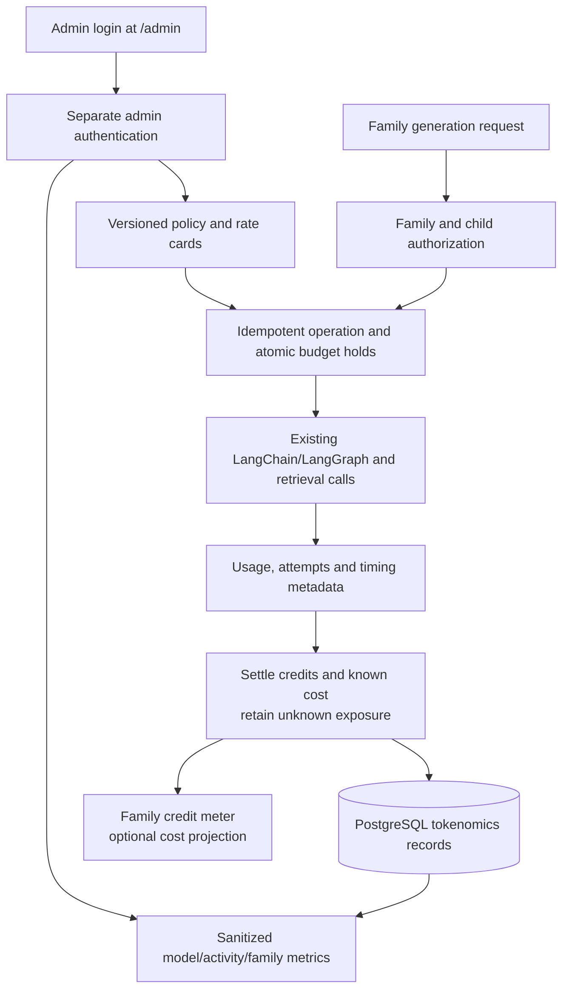

# Execution plan: accounting, /admin and family coaching budgets

**Approved for implementation, November 5, 2026.** The owner approved the accounting,
authentication and persistence changes after reviewing retrieval costs. It does not change AI routing, prompts, safety
policy, accepted habits or the existing six-quest plan capacity.

**Approved navigation/history follow-up, November 5:** Admin login is now linked
below Developer login on the sign-in page, superseding the original unlinked-route
requirement below. The same isolated authentication remains. Generation history
also exposes existing input/output token counters and their completeness; see
[current operations](06-operations.md).

## Intended result

- An unlinked literal **`http://localhost:5180/admin`**, not merely `#/admin`.
- A separate operator login named **admin**, requiring a generated complex password.
- Dynamic effective-model information, versioned cost assumptions and measured metrics.
- Configurable family credits and optional user-visible generation costs.
- A prototype tracking-only switch that bypasses application AI spending/count limits
  while continuing to record usage.
- Family Settings retains recent generation history and the seconds/stage-details preference.

## Architecture



Use PostgreSQL and the current service. No separate analytics warehouse, new AI agent,
background planner or additional generation pass is required.

## 1. Model-aware accounting and pricing

One effective-role resolver must serve both model invocation and the admin model table.
Expose the resolved provider, requested/returned model, API mode, effort and effective
output cap. The model table is **read-only runtime configuration**: provider credentials
and model routing remain in `.env`; admin edits pricing and budget policy, not secret
keys or provider URLs. Runtime configuration changes must appear after service reload.

A rate card is keyed by provider + exact model/snapshot + API/service tier + region/context
band + effective date. It records input/cache/output or embedding/read-unit rates,
source URL, verified date, currency and verified/manual status. New/unrecognized models
show **Unpriced**, with no inherited prior-model average and no zero-cost fallback.

Each invocation retains its model/configuration and price snapshot. Editing a rate card
changes forward estimates; it does not silently rewrite historical cost. In-flight work
settles using its admitted snapshot. Display both measured usage-priced cost and current
forecast assumptions, with clear labels and coverage.

Capture all active paths: refined Coach writing/review, habit writing/correction, legacy
planner/review/onboarding, buddy and child screening, embedding, and Pinecone. Count
logical calls separately from HTTP attempts. Do not log bodies from transport hooks.
Capture embeddings usage and Pinecone billing metadata instead of discarding them.

Capture OpenAI embedding input tokens and Pinecone REST `usage.read_units` plus
`usage.egress_bytes` before vector extraction/card hydration. Store reported RUs with
their rounded precision status; precise account/index totals are separate reconciliation
evidence. Use NUMERIC with at least 12 decimal places for USD, not cents, and decimal
read units. The same operation owns writer, review, embedding, search and attributable
egress costs exactly once. Cost is retained even when no goals survive local filtering.

Admin distinguishes request list-price equivalent, payable estimate after verified
allowances and allocated overhead. An unknown plan/rate/usage stays incomplete, not
zero. Provision the [retrieval reference profile](04-retrieval-cost-and-credits.md)
as explicitly assumed planning data, separate from measured records and verified
account tariffs. Do not infer extra Pinecone embedding or reranking charges: neither
is invoked by the current supplied-vector search.

### Proposed schema

New additive migrations should implement a small set of related tables/functions:

| Record | Purpose |
|---|---|
| `tokenomics_policy` and `tokenomics_policy_audit` | Revisioned allowance, weights, enforcement, visibility and operator cap; actor/time and sanitized changes |
| Credit reference profiles (versioned policy data) | USD/credit conversion, per-activity component estimates, usage assumptions, evidence coverage and suggested versus accepted weight |
| `ai_price_versions` | Immutable provider/model tariff versions with source/date and verified/manual/unpriced state |
| `ai_operations` | Family/child/activity ownership, stable idempotency key, HMAC input fingerprint, parent/session, result status/count, timestamps and configuration snapshots |
| `ai_provider_attempts` | Invocation/attempt IDs, model/provider, nullable usage, timing, sanitized error class, provider request ID and priced/unknown cost |
| `family_ai_windows` and credit entries/holds | Atomic family-local daily usage, reserved/charged/released credits; unique settlement events |
| Operator exposure and carryover reference | New settled cost and outstanding uncertainty, separate from the untouched legacy reservation balance |

Operations can own their credit-hold fields to avoid a redundant reservation subsystem.
Use Decimal/NUMERIC for dollars and integer credits. Family metadata stays behind RLS;
operator metrics use a constrained view/function. No raw family content is added.

## 2. Credit admission, settlement and demo mode

Default policy: 100 credits/family/day, Coach 2, batch 1, planner 2, review 2, onboarding 2,
child helper/screening 0. These weights apply to useful logical operations, not every
provider attempt. A correction/retry belongs to its original operation. All actual
provider work, including failures and zero-credit helpers, contributes to operator cost.

Initial configurable reference conversion: **$0.0015 per credit**, for planning rather
than cash billing. Recommend `ceil(total_direct_reference_cost / reference_usd_per_credit)`
once per useful activity, with a minimum of 1 for credit-bearing parent activities.
Include writer, review, embedding, search and attributable egress before rounding.
Keep fractional component equivalents; never round embedding/search to zero dollars or
separately to whole credits. With the documented assumptions this still recommends
Coach 2 and batch 1. Other weights remain provisional until benchmarked.

The accepted activity quote, not actual fluctuating tokens, determines the family debit.
Expose it before dispatch. Admin can compare the dynamic recommendation and its evidence
with the configured quote, then accept an audited policy revision. Snapshot that quote,
reference and policy on parent/child holds; no mid-interaction reprice. Model changes
update the recommendation/evidence state without silently changing existing quotes.
Historical records retain their own references. Failure costs inform future calibration
but do not create a second family fee on a completed operation.

A reviewed, substantive Coach response costs 2 credits even when it provides useful
advice or clarification without new goals. Unavailable, timed-out, invalid-output and
local fallback responses cost 0. A habit batch costs 1 credit only when usable choices
are ready. Result status, rather than HTTP success alone, determines the debit.

For each operation:

1. Authorize family/child, validate input and resolve policy/model/price snapshots.
2. Atomically create/reuse the operation and reserve allowance/exposure; commit before
   contacting a provider. Reusing an idempotency key with changed input returns conflict.
3. Record each actual dispatch and observed response usage independently of content saves.
4. Settle family credits once when a useful result is committed. A failed/no-useful-result
   operation releases its credit hold; known provider expenditure is still retained.
5. Settle known dollar usage and release unused headroom. Missing usage on a dispatched
   attempt retains provisional exposure; never refund it solely because the client timed out.
6. Replays return the same operation/result/budget debit. New chat, login, child change,
   model change, restart or a reset fence does not erase costs or replenish daily credits.

Use separate short accounting transactions so rollback of a chat/habit write does not
erase paid usage. If durable admission cannot commit, do not dispatch. After a dispatched
call, keep its precommitted exposure until settlement succeeds or an audited reconciliation
resolves it. Do not claim exact costs after lost usage metadata.

### Automatic habit batches

Treat Coach advice and subsequent batches as one parent interaction with child operations.
Reserve Coach's 2 credits plus slots for up to 4 eligible batches atomically. In enforced
mode, if fewer than 6 credits remain but at least 2 are available, allow the Coach response
and reserve only the affordable batch slots. Return the approved slots to the client;
show clearly when some choices could not be prepared due to the allowance. Do not dispatch
unfunded batches and then report them as provider failures.

After reviewed goals are known, bind each slot to its exact family/child/goal and unique
batch operation. Release unused slots for fewer goals or reused usable drafts. Child
requests claim a slot once, without a second debit. A client cannot fabricate a parent
ID, claim another family's slot or reuse it for extra choices. Explicit More habit choices
reserves a new 1-credit operation. Existing two-request concurrency and retry bounds remain.

Release unused, undispatched slots after a bounded expiry; never release dispatched unknown
USD exposure by the same rule. Reconnecting/replaying reuses durable operation state.
This linkage supplies both correct usage totals and all-choices-ready timing.

### Daily window

Use the family's timezone, storing UTC start/end and timezone snapshot. DST days may be
23 or 25 hours. A timezone change takes effect for the next budget window and does not
create another allowance immediately. All children/caregivers share the same window.
A session is only analytics grouping (e.g. New chat or 30 minutes inactivity); it grants
no separate refill.

Automatic batches inherit the parent hold's exact `budget_window_id`, including when
they finish after midnight or a timezone change. Settlement and release always post
to that original window. New independent requests use the current window.

### One effective enforcement switch

| Setting | Behavior |
|---|---|
| **Enforce coaching budgets Off** | Admit beyond family credits and the existing cumulative provider cap; continue metadata, holds/settlement, overage and cost tracking. Old `ai_daily_limit` must not quietly block demos. |
| **Enforce coaching budgets On** | Enforce family credits atomically and the configured operator exposure ceiling; do not reset prior usage. |

Replace the old independent 100-request business quota for migrated flows with this credit
policy. Preserve historical counters but avoid a second invisible business limit. The
old imported-provider cap becomes an admin-visible legacy carryover plus a versioned
operator exposure ceiling, initially retaining the configured $5 value; it is inactive
in tracking-only mode. It is separate from the proposed $0.25/day planning envelope.

The switch does not disable authentication, PIN checks, login throttles, safety, bounded
retry/concurrency/deadlines, request-size controls or provider-side quotas. Child safety
checks remain required; when paid screening is unavailable, preserve the existing safe
failure/fallback behavior. Never skip review to fit a credit allowance.

If a strict dollar ceiling is enabled, every routed model needs a rate or an explicit
conservative admin price bound before dispatch. In tracking-only mode unpriced calls may
run and are marked incomplete. Credit arithmetic alone must not masquerade as complete
financial protection.

## 3. Separate admin identity

The current router parses hash paths and mounts the family store on every page. Add an
entry at `frontend/src/main.tsx` for normalized `/admin` or `/admin/` **before** mounting
`StoreProvider`. Render an isolated admin login/app there. No family preload, caregiver
login, kid PIN gate or family account is required. Preserve existing hash routes.
Verify Vite and production SPA fallback for direct navigation/reload. Add no public,
parent, kid or Settings navigation link to admin.

Admin is a separate operator principal. `parent:admin`, caregiver display name admin,
and ordinary caregiver/kid JWTs grant no operator rights. Admin tokens likewise cannot
call family/kid APIs. Use a separate signing secret, exact role, audience, issuer, expiry
and auth-version checks; no fallback to development-parent credentials.

For the prototype, hold a 30-minute admin bearer token **in memory only** in a dedicated
client. Refresh requires login; logout clears only that session. This works with the
current localhost frontend and 127.0.0.1 backend without cross-site cookie changes.
Persistent HttpOnly-cookie sessions would require a later deliberate same-origin proxy
and CSRF design. Use HTTPS when deployed.

### Private configuration after approval

| Backend variable | Planned value |
|---|---|
| `ADMIN_ENABLED` | false by code/example default; true in approved local setup |
| `ADMIN_USERNAME` | `admin` |
| `ADMIN_PASSWORD` | Cryptographically random 32-byte URL-safe password, generated directly into ignored `.env` |
| `ADMIN_JWT_SECRET` | Independently generated signing secret |
| `ADMIN_TOKEN_TTL_MINUTES` | 30 |
| `ADMIN_SIGN_IN_LIMIT` | 5 attempts/minute per direct client address |
| `ADMIN_AUTH_VERSION` | 1; increment with password/session revocation changes |

Use SecretStr, hidden validation inputs, constant-time credential comparisons and generic
login errors. Persist no plaintext admin password in the database. Keep secrets out of
`VITE_*`, API responses, logs, screenshots and commits. Write only approved keys while
preserving the rest of `.env`, with restrictive file permissions. The final handoff will
identify the local file; it will not print the password in chat. Nothing is generated now.

Throttle by `request.client` in local development. Ignore client-supplied
`X-Forwarded-For` and `CF-Connecting-IP`; forwarded addresses may be used only behind an
explicitly trusted proxy with a verified forwarding policy.

Use a dedicated `hq_admin NOLOGIN` database role with access only to tokenomics config,
audit and sanitized aggregate functions/views. It is not a blanket family-table reader.
Keep separate admin transactions and strict SQL grants.

## 4. API and UI contracts

| Endpoint | Access | Contract |
|---|---|---|
| `POST /v1/admin/auth/login` | Admin credential exchange + sign-in throttle | Token/expiry; no automatic write retry |
| `GET /v1/admin/me` | Admin | Operator identity and expiry |
| `GET/PATCH /v1/admin/tokenomics/config` | Admin | Policy and carryover; writes require expected revision |
| `GET/POST /v1/admin/tokenomics/prices` | Admin | Immutable tariff versions; source and verification status |
| `GET /v1/admin/models` | Admin | Sanitized effective role/model routing; read-only |
| `GET /v1/admin/metrics` | Admin | Bounded time-window/model/activity/family aggregates with sample and coverage counts |
| `GET /v1/admin/generations` | Admin | Paginated metadata, attempts, timing, pricing status; no generated text |
| `GET /v1/admin/audit` | Admin | Sanitized configuration-change history |
| `GET /v1/families/{family_id}/ai/budget` | Authorized caregiver | Family credits used/pending/remaining, reset time, enforcement and visibility policy |
| `GET /v1/families/{family_id}/ai/operations/{id}` | Authorized caregiver | Reconnect/replay status and budget debit for that family's operation |
| `POST /v1/families/{family_id}/ai/operations/{id}/observation` | Authorized caregiver | Optional bounded numeric browser timing; diagnostic only, never cost authority |

Generation JSON/SSE responses gain operation/parent IDs, credit summary and final status;
existing fields remain compatible. Browser observations are idempotent, size/range
validated and stored separately from trusted server timing. Ownership is checked on
all metadata routes.

Move global cap editing out of Family Settings **and remove its old authority**: retire
caregiver `PATCH /v1/ai/budget`, revoke `hq_api` execution of `hq.set_planning_budget_cap`
in a new migration, and move global reads behind admin. An old open tab gets a clear
configuration-moved response, not continued write permission. Family Settings keeps its
history/seconds toggle and may show the read-only family allowance. Old browser history
stays labeled browser-local/unpriced; do not fabricate its cost.

```text
HabitQuest admin                                    admin · Sign out
Tokenomics | Metrics | Models | Change history

Mode: Tracking only — limits are not enforced
Daily family coaching credits [100]
Reference cost per credit [$0.0015]  (planning conversion)
Activity weights: Coach [2]  Habit batch [1]  Planner [2]  Review [2]
Onboarding [2]   Child helpers [0, measured as operator cost]
Coach reference: chats $0.0021657 + embedding $0.000002
                + search $0.000018 + egress equivalent $0.000002
Suggested: 2 credits · Configured: 2 · Retrieval profile: assumed
Pinecone: account plan/rate unverified · Standard planning reference $18/M RU
[ ] Enforce coaching budgets
[ ] Show generation costs to caregivers
Operator exposure ceiling [$5.00]   Legacy carryover: preserved, not billed usage
[Save configuration]                         Policy revision / last changed

Models: Capability | Effective provider/model | API mode | Pricing status
Metrics: Activity | n | Useful/error | Mean cost | Writer time | Response latency
         p50/p95 where supported | Usage coverage | Retry/correction rate
```

Rows react to the effective configured model, not hardcoded names. Historical cohorts
retain their original model/config/price. A newly configured model shows rates if known
and **Not measured** until there are matching samples. Do not fall back to the previous
model's average. Record operator edits with optimistic concurrency and audit history.

Family Coach presentation:

```text
Coaching today: 6 / 100 credits used · 94 left
This request: advice 2 + four habit batches 4
[Demo mode: limits are not enforced]

While preparing: 2 used · 4 pending · 94 available
Optional cost line: Estimated generation cost $0.0053 · complete/partial
```

Show each turn/batch debit and a cumulative parent-interaction summary. Update as batches
settle; do not announce final interaction cost when only Coach prose is ready. Fetch the
server balance after operations, child changes and tab focus; multiple tabs must not
maintain independent balances. Show overage in demo mode while clamping remaining at zero.

“Show exact costs” means exposing the numerical estimate, not falsely claiming provider
invoice reconciliation. Use enough decimals for sub-cent generations. If disabled, omit
USD/rate fields from all family-facing API/SSE responses, including failures and history;
hiding a UI element alone is insufficient. Admin always sees available financial metadata.
Keep seconds visibility independent from cost visibility.

## 5. Ordered implementation and parallel work

| Phase | Work and ownership | Gate |
|---|---|---|
| 0 | Agree operation DTOs, credit semantics, rate keys and migration boundary | Owner approves this plan |
| 1 | Accounting agent: additive schema/RLS, price versions, all provider/attempt hooks; root integrates | Mocked accounting totals, missing usage, rollback and replay tests |
| 2 | Admin agent: separate auth/dependencies/routes/SQL grants. Frontend agent: isolated `/admin`, login and mock-data views | Coordinate shared config/main/API files with root; no overlapping edits |
| 3 | Accounting agent: atomic family holds, parent slots, settlement, unified enforcement. Frontend agent: meters/history projections using agreed DTOs | Cross-family, multi-child, concurrent-last-credit, timezone and demo-mode checks |
| 4 | Root: integrate runtime model map, admin authority migration, audit/visibility, compatibility and evidence | Full backend/frontend suites, fresh disposable migration checks and synthetic browser verification |
| 5 | Root: back up the explicitly identified local database, perform cutover, provision private admin credentials and restart API once | Schema/config verified; prior balances preserved; user receives route and secret-file location |
| 6 | Optional measured live benchmark and demand calibration | Separate bounded paid-check approval; demo bypass cannot bypass that test allowance |

Keep application safety/call behavior fixed during this work so accounting changes do not
silently become an AI redesign. Use mock provider results to develop and validate both
admin tasks and metering. No paid call is needed to prove login, policy or display behavior.

## 6. Migration, cutover and rollback

- Add migrations; do not edit applied SQL. First verify on a fresh `_test` database and
  on a fixture containing prior reservations/settings. Back up the named real database
  before applying there. Preserve all unrelated working-tree changes.
- Introduce telemetry without claiming reconstructed historical costs. Save a cutover
  watermark and preserve the old singleton/rows unchanged as unattributed legacy exposure.
- Drain bounded in-flight work before switching ledger authority. Do not count the same
  pre-cutover operation once in old carryover and again as new settled cost. New family
  credits start with the documented policy window; old dollar reserves are not family credits.
- After cutover, global exposure = preserved legacy opening exposure + new settled usage
  + outstanding reservations/unknown exposure, with mutually exclusive settlement states.
  Report new measured usage separately so legacy conservative amounts cannot distort means.
- The first local policy is tracking-only; the master switch bypasses old application
  blockers, but collection continues. An unknown ledger/DB failure remains an operational
  error, not permission to silently lose accounting.
- Rollback retains additive tables and records. Disable admin/restore UI if necessary;
  keep telemetry. Returning to old enforcing code requires an idempotent bridge of all
  post-cutover exposure into the old ledger before enabling its cap. Never revert to a
  stale balance, delete history or silently restore caregiver operator grants.

## 7. Verification and acceptance

- Admin isolation: valid/invalid credentials, disabled mode, expiry/issuer/audience/role,
  auth-version rotation, sign-in throttle; caregiver named admin and kid tokens denied;
  admin token denied family APIs. Direct/reloaded `/admin` mounts no family store.
- Spoofed forwarding headers cannot evade the admin sign-in throttle.
- Independent SQL access denial for former caregiver cap edits; restricted admin projections.
- Accurate input/cache/output/reasoning/read-unit arithmetic; known zero versus missing
  usage; price changes and model changes preserve historical cohorts; no duplicated retry usage.
- Embedding/search/egress are included exactly once in total cost and credit recommendations;
  retain sub-cent precision, distinguish rounded RUs from precise usage, and test combined
  rounding, no-result/failed retrieval, saved results, replay and inherited batch slots.
- Included usage and monthly minimums do not double-count costs; unknown plan/rate keeps
  financial coverage incomplete. Changing recommended weights does not alter an accepted
  quote without a new policy revision; no mid-interaction repricing.
- Atomic concurrent admission across children/caregivers, parent-slot ownership/replay,
  partial preparation, reset/disconnect, correction/failure and settlement retry after restart.
- Demo bypass covers legacy dollars, legacy daily quota and new credits while recording
  overages; re-enabling limits uses existing usage and pending holds.
- Family-local midnight, DST, timezone edits, multi-tab refresh, no refill via new chat/login.
- Cost visibility enforced in every user DTO/SSE path; no secrets/content in metrics/audit.
- Backend 100% statement/branch coverage, Ruff check/format, mypy, fresh migration tests;
  frontend tests/build; desktop/mobile admin and Coach screenshots with synthetic data.
- Report actual measured operation/call latency and price coverage when available; do not
  label mocked timings or existing reservation amounts as empirical generation cost.

The implementation is complete when these checks pass, `/admin` works with the separately
provisioned credential, family meters reflect actual settled/pending operations, and the
prototype can continue demos beyond its notional allowance without losing accounting.
