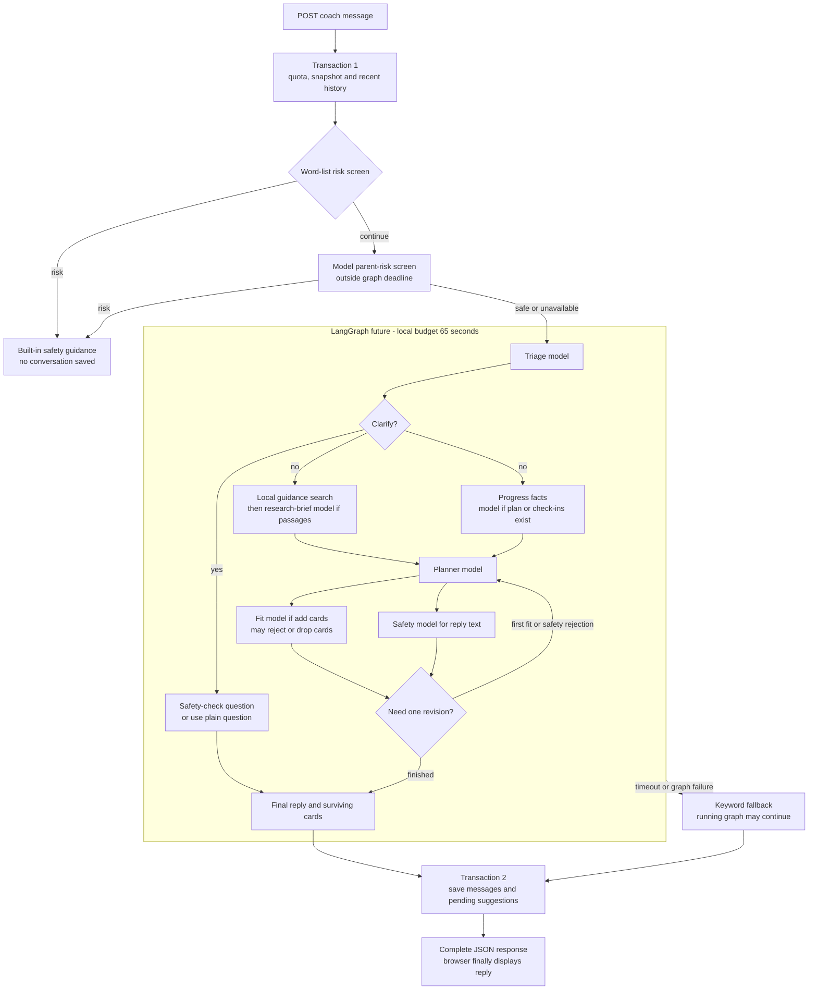

# HabitCoach: slow replies and missing recommendations

Investigation dated **2026-11-03**, against `831f4617acd5b36e67b1e431089a5f381f9dfd7e` and the active local
configuration. See [system design](system-design.md) for the application overview and
[sanitized evidence](evidence/2026-11-03/README.md) for the recorded observations.

## Findings

The long wait is consistent with the implemented model workflow: a successful synthetic local turn took
**45.08 seconds across nine provider calls**, including a revision. All roles currently resolve to the same
primary model. The first risk-screen call sits outside the configured 65-second graph deadline, so that setting
is not a whole-request deadline. The browser displays no partial result while this work runs.

Missing cards are not explained by an empty local catalog or a full current plan. A read-only snapshot found
**14 eligible, unplanned, unshown catalog habits and one available plan slot**. Both retained coach replies had
`no_habit_match=true`, but that flag does not identify why no cards survived. The system turns planner abstention,
fit rejection, fit-review failure and several intentional eligibility limits into the same catalog-sounding UI
message. A no-match result also dismisses earlier pending coach/add cards.

The exact stage responsible for those two historical replies cannot be recovered from the persisted thread.
Tracing is disabled, and the stored flag does not retain candidate counts, draft picks, reviewer outcomes or stage
durations. Eligibility counts prove availability, not that a habit directly addresses a particular request.

## Evidence and limits

| Evidence | Result | What it establishes |
|---|---|---|
| Local read-only eligibility snapshot | 41 active catalog habits; 19 eligible at current age/tier; 14 after plan/history exclusion; 1 free slot | The current child is not globally blocked by catalog emptiness, history exhaustion or plan capacity |
| Retained local conversation metadata | 2 parent messages, 2 coach replies, both replies flagged no-match | The backend recorded no-match outcomes; missing cards are not solely a browser rendering issue |
| Synthetic provider probe, original 50-second graph budget | Keyword fallback at 51.68 seconds; observed provider responses HTTP 200 | A valid key/model can still hit the graph deadline |
| Synthetic provider probe, local 65-second graph budget | AI result, 1 suggestion, 45.08 seconds; 9 HTTP 200 calls | The configured provider can complete the workflow; latency includes repeated model stages |
| Backend survey | All 25 existing crew tests passed with mocked providers | Current tested branches behave as implemented; this does not measure live recommendation quality |
| Deterministic mock probes | Fit API failure yielded no-match despite eligible habits; full paused plan suppressed crew additions; risk delay exceeded the graph-only budget | These failure modes follow from executable control flow without a real model or family data |
| Frontend survey | Response buffered; only coach/add cards render in chat; no coach screen/E2E test found | Perceived latency and visibility have frontend contributors |

The provider probes used a synthetic age-eight child with an empty plan and public catalog data. They are individual
runs, not a benchmark or a median/P95. They came from the preceding bootstrap checks; this investigation did not
replay the family's messages to the provider. The existing local plan activates a progress-model branch that the
empty-plan timing probe skipped. Database inspection used a read-only transaction and exported only counts and
public goal identifiers. Historical message timestamps cannot measure request latency: the parent and coach rows
are inserted together **after** model completion ([coach.py](../backend/src/habitquest_backend/coach.py#L514)).

## Why a response takes so long



The critical path is approximately:

`snapshot + risk + triage + max(research, progress) + planner + max(fit, safety) + optional revision/reviews + save`.

The branches are already parallel; adding all individual call durations would overstate elapsed time.
An empty-plan turn with no check-ins, guidance and cards makes six calls including the risk check; one revision
adds up to three. The recorded probe made nine, with no progress-model call. A populated-plan workflow can add
a progress call, for seven calls or up to ten with revision. Clarify, empty research or no-card paths can skip
other calls. Sources: [graph](../backend/src/habitquest_backend/crew.py#L274),
[risk screen and timeout](../backend/src/habitquest_backend/coach.py#L244).

### Recorded 45.08-second turn

| Stage | Provider completion, seconds from turn start | Contribution to the critical path |
|---|---:|---:|
| ParentRisk | 1.08 | 1.08 s |
| Triage | 5.68 | 4.60 s |
| Research Brief | 19.88 | 14.20 s |
| First Plan | 25.11 | 5.23 s |
| First Safety / Fit in parallel | 30.31 / 34.60 | 9.49 s until both finished |
| Revised Plan | 40.57 | 5.97 s |
| Second Safety / Fit in parallel | 42.73 / 45.07 | 4.50 s until both finished |

These completion timestamps are cumulative. The second planning/review pass alone added about **10.47 seconds**.
The recorded request sequence establishes a revision occurred, but it does not retain the verdict that triggered it.
One card survived; the reply retained zero citations. A passing transport/AI probe does not establish advice or
citation quality.

### Configuration and deadline issues

| Mechanism | Current behavior and implication |
|---|---|
| Model selection | Triage, research and progress default to `small`; safety to `safety`; planner and fit to `large`. The small/safety model variables are unset locally, so all use `deepseek-ai/DeepSeek-V4.1-Flash-1017`. Distinct role names currently provide no model-size speed benefit. |
| Reasoning/output budget | Planner requests medium reasoning; other crew roles low. Shared output allowance is 4,000 tokens, including reasoning where applicable. These are tunable parameters, not evidence that every request consumes that budget. |
| Provider timeout/retries | HTTPX timeout is 30 seconds per network phase, not a total turn limit. `max_retries=1` permits a second SDK attempt on retryable failures. |
| Graph timeout | `future.result(timeout=65)` starts after the model risk screen. Timeout returns keyword fallback, but Python does not cancel an already executing thread; late calls can continue consuming provider capacity. |
| Browser timeout | The AI POST permits 75 seconds. A slow risk check plus the graph and database work can exceed that budget. A browser abort does not itself stop server work. |
| Display | The client waits for complete response JSON; the screen shows one fixed progress label with animated dots. No stage progress or first useful partial output is delivered. |

Sources: [roles](../backend/src/habitquest_backend/crew.py#L58),
[role resolution](../backend/src/habitquest_backend/crew.py#L187),
[HTTP client and retries](../backend/src/habitquest_backend/llm.py#L12),
[timeout handling](../backend/src/habitquest_backend/coach.py#L273),
[browser request](../frontend/src/lib/api/client.ts#L122),
[coach display](../frontend/src/components/Coach.tsx#L75).

Raising the graph timeout from 50 to 65 seconds permits more turns to finish; it does not make them faster.
The evidence identifies model orchestration as a substantial source of delay. It does not establish provider
service-wide slowness or a measured database bottleneck. Hosted-instance cold-start messaging exists in the
frontend, but the measured provider workflow already takes tens of seconds with the API running locally.

## Why catalog habits do not become cards

The visible quest library and the coach's new-habit menu have different purposes. Recommendations pass through
the following restrictions:

1. An active shared catalog habit must belong to an active goal and fit the child's age and unlocked tier.
2. Any habit already in the non-removed plan is excluded from new additions. Active and paused habits count.
3. Any habit recorded in `shown_habits` anywhere in the retained thread is excluded, even if dismissed. The API
   loads only 20 stored messages; crew triage/planner format the last eight messages including the new message.
   The shown-ID exclusion is not limited to either window.
4. The planner can suggest at most `min(3, 6 - non_removed_plan_count)` additions. Family custom habits occupy
   slots, although they are not eligible new catalog recommendations.
5. The planner may return no additions if it considers none directly relevant. The fit reviewer can reject
   proposed additions. A fit provider/parsing failure drops all picks without an outer keyword fallback.
6. Chat displays only pending `source=coach, kind=add` cards. Other proposal kinds/sources use the family helper
   surface; the dashboard intentionally excludes coach/add cards.

Sources: [candidates](../backend/src/habitquest_backend/onboarding.py#L107),
[snapshot and shown history](../backend/src/habitquest_backend/coach.py#L347),
[planner menu/cap](../backend/src/habitquest_backend/crew.py#L342),
[fit review](../backend/src/habitquest_backend/crew.py#L414),
[chat filter](../frontend/src/components/Coach.tsx#L40),
[dashboard filter](../frontend/src/components/AiHelpers.tsx#L69).

### Current local eligibility

| Step | Count |
|---|---:|
| Active shared catalog habits | 41 |
| Age-suitable catalog habits | 38 |
| Eligible after active-goal and unlocked-tier checks | 19 |
| Non-removed plan entries | 5, all active |
| Habits recorded as previously shown in the retained thread | 0 |
| Eligible habits outside plan/shown set | 14 |
| Available addition slots | 1 |

Remaining eligible candidates by public goal: bedtime 3, meals 4, responsibility 1, homework 1, listening 3,
mornings 2. Feelings and screens each have zero remaining candidates because their eligible habits are already
planned. Keyword-only classification of the two recent parent messages matched meals and responsibility/homework,
which currently have remaining candidates. This classification does not reproduce the model's semantic judgment.

There are no pending coach/add cards in the inspected state. Historical coach/add decisions include five accepted
and seven dismissed cards; pending planner proposals exist separately. The counts do not establish whether those
seven cards were dismissed by a parent, reset or replacement logic.

### Confirmed misleading outcome and card removal

At [coach.py:316](../backend/src/habitquest_backend/coach.py#L316), the flag is simply:

```python
no_match = turn.researched and not turn.recommendations and not turn.changes
```

It is **not** a catalog-match check. Plan capacity, prior exposure, planner abstention, fit rejection and fit
failure can all produce it. The frontend then states “We don't have an approved habit for this problem yet”
([Coach.tsx](../frontend/src/components/Coach.tsx#L159)). This overstates what the backend knows.

When that flag is true, [save logic](../backend/src/habitquest_backend/coach.py#L532) dismisses every older pending
coach/add suggestion for the child. Therefore a temporary fit-review failure can remove previously usable cards
and present the result as a catalog gap. This is a confirmed control-flow defect, although the stored local rows
cannot show whether it caused a particular historical dismissal.

The deterministic fit-failure probe supplied valid eligible candidates and a valid planner card, then made the
fit endpoint return HTTP 400. The result was zero cards, `mapped_by=ai`, `no_habit_match=true`. The existing
[fit-failure test](../backend/tests/test_crew.py#L305) also enshrines dropping picks. Because the error is caught
inside the fit node, the outer fallback never runs. `mapped_by=ai` alone therefore does not mean every stage
succeeded.

### Conversation and frontend effects

- First opening a child's coach after each sign-in automatically deletes the old thread and dismisses pending
  coach suggestions. This is existing product behavior, not just a local cache reset. First send waits for this
  DELETE. Freshness markers have frontend tests; the frontend reset lifecycle does not.
  [Coach.tsx](../frontend/src/components/Coach.tsx#L48),
  [freshness marker](../frontend/src/lib/storage.ts#L182),
  [reset endpoint](../backend/src/habitquest_backend/coach.py#L551).
- Thread GET has no cancellation or stale-child guard. A late response can replace newer local state. Initial
  GET failure is shown as empty chat; reset failure is swallowed. These are source-supported races/error-display
  gaps, not a reproduced explanation for the current single-child missing-card state.
- React StrictMode is enabled in development; the reset effect lacks the store's replay guard. Duplicate reset
  requests are possible before the freshness marker is saved.
- Cold-state network retries can resend a POST after an ambiguous fetch failure. No idempotency key protects a
  coach turn, so a lost response can duplicate work or persisted prompts. The explicit 504 write safeguard does
  not cover that network-error path. [client.ts](../frontend/src/lib/api/client.ts#L139).
- The fit reviewer reads parent words from the recent conversation, while the planner receives triage's current
  problem. Earlier topics may influence a new-topic review; this is a hypothesis requiring a targeted regression
  evaluation. [parent_words](../backend/src/habitquest_backend/crew.py#L216),
  [fit input](../backend/src/habitquest_backend/crew.py#L417).

There is no post-reply family reload waterfall on the current coach page: it passes an async no-op `onChange`
([CoachPage.tsx](../frontend/src/pages/CoachPage.tsx#L26)). That callback does not explain the measured delay.

**Follow-up implemented on November 3:** the coach now shows waiting seconds and records response time beside each
new reply in the mounted session. The planner and weekly-review helpers also show waiting/completed/error timing.
The original display observations above describe the state before this addition. The timer measures browser
round-trip time around the actual API call, excluding reset, PIN and subsequent reload work. It does not expose
provider stages or persist historical latency. See [AiParts.tsx](../frontend/src/components/AiParts.tsx#L26).

## Additional findings

These deserve follow-up but are not established causes of the reported slow, empty replies.

| Finding | Evidence and consequence |
|---|---|
| Fallback capacity inconsistency | [Keyword fallback](../backend/src/habitquest_backend/coach.py#L218) does not respect remaining slots; a full plan can receive an addition card that acceptance rejects. The crew and acceptance both count paused entries toward six; that counting itself is consistent. |
| Rejected IDs are only transient | Fit updates `snapshot.shown`, but saving records only final recommendation IDs. Rejected picks can be tried again on the next turn, adding repeated review work. [crew.py](../backend/src/habitquest_backend/crew.py#L430), [coach.py](../backend/src/habitquest_backend/coach.py#L528). |
| Card reasons bypass safety review | The crew safety reviewer receives reply text, not card reasons; a mock probe confirmed an unsafe reason can survive alongside safe reply text. Review all parent-visible generated text. [crew.py](../backend/src/habitquest_backend/crew.py#L435). |
| Custom title can enter model history | Snapshot titles are masked, but accepting a proposal writes raw `h.title` into an app note; later history includes that note. This is a code-verified exposure path, not evidence that a real custom title was transmitted. [accept note](../backend/src/habitquest_backend/coach.py#L582), [history loading](../backend/src/habitquest_backend/coach.py#L504). |
| Concurrent turn/reset races | Snapshot and save are separate transactions with no per-child turn lock or conversation generation check. A late save can restore a cleared thread or conflict with another send. [send](../backend/src/habitquest_backend/coach.py#L489), [clear](../backend/src/habitquest_backend/coach.py#L556). |
| Concurrent acceptance limit | Acceptance locks the suggestion row rather than the child. Two distinct additions can both observe five entries and exceed six. [accept](../backend/src/habitquest_backend/coach.py#L579), [capacity check](../backend/src/habitquest_backend/coach.py#L443). |
| Catalog revalidation gap | Acceptance rechecks duplicate/age/tier/capacity but not current habit/goal active status. A catalog change can leave a stale pending suggestion acceptable. [apply_suggestion](../backend/src/habitquest_backend/coach.py#L418). |

## Proposed plan of action

These are proposed implementation steps; this review has changed documentation only.

| Order | Change | Acceptance criteria |
|---|---|---|
| 1. Make outcomes diagnosable | Add a request/turn ID, safe stage timings, model/schema/status/retry metadata, candidate/slot counts and explicit reason codes. Separate `no_eligible_habits`, `plan_full`, `already_shown`, `no_direct_fit` and `review_unavailable`. Avoid logging raw family text. | A single empty response can be traced to its actual stage; database, risk and graph durations are measured separately. Test planner abstention, fit rejection, fit error and timeout. |
| 2. Correct the recommendation contract | Preserve existing pending cards on transient failures; present a review failure as a retryable error. Use the same eligibility/capacity rules in crew, fallback and acceptance. Decide the intended history/reset policy explicitly. | Known eligible synthetic scenarios produce a reviewed card or an honest reason; failed review cannot masquerade as catalog absence or silently erase usable cards. Include five-slot, six-slot, paused, shown and custom-habit cases. |
| 3. Bound and shorten model work | Put risk and graph under one end-to-end budget; propagate remaining time to model calls/retries. Stop scheduling stages after expiry. Evaluate a faster small/safety role configuration against the same quality cases; measure research summarization and revision cost before simplifying stages. | Report repeated synthetic timings and recommendation/safety quality for baseline vs candidate settings. Meet an agreed latency target without bypassing review. No new calls are scheduled after timeout. Running HTTP work has bounded timeouts. |
| 4. Improve the frontend flow | Show actionable outcome text and stage progress if an API progress mechanism is added. Guard stale loads; surface reset/load failures; handle StrictMode replay. Add turn idempotency before retrying ambiguous writes. | Coach screen tests cover missing-card reasons, failed reset, child changes, overlapping responses and duplicate delivery; one submission yields one persisted turn. |
| 5. Close adjacent gaps | Review card reasons, mask custom titles in app notes, version/serialize thread changes and serialize capacity checks; recheck catalog active flags on acceptance. | Targeted privacy, safety and concurrency tests prove the named paths are covered. |

Start with outcome metadata and preservation of pending cards, then measure role/model changes. Enabling external
traces would add a data destination and is not necessary for basic timing/counter instrumentation. Leave tracing
and live settings unchanged until implementing the chosen approach.

For implementation validation, use mocked API/crew regressions plus the dedicated `_test` database, frontend
screen tests and a small, repeatable synthetic provider evaluation. The family database must not be the test
fixture. The documentation task did not rerun destructive database fixtures, change code or reset conversation
history.
