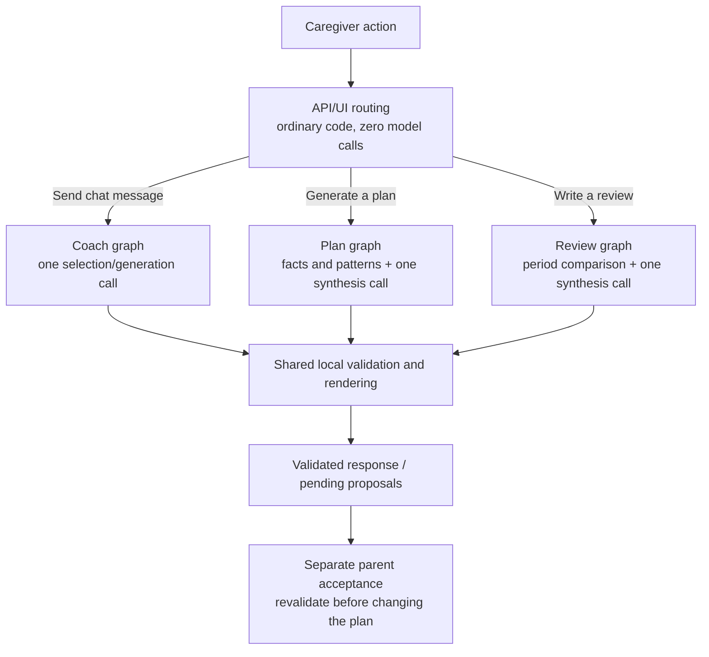
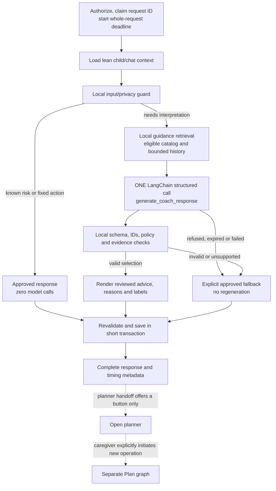
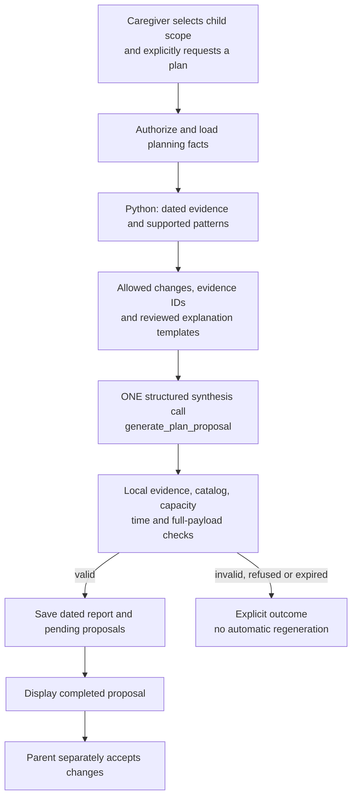

# Streamlined HabitQuest AI: one-call coach and explicit planning

**Implementation plan — November 4, 2026.** This is a proposed replacement for the current coach pipeline,
grounded in the [AI deep dive](ai-system-deep-dive.md) and [request walkthrough](coach-request-walkthrough.md).
No runtime changes or new live inference measurements have been made for this plan.

**Product direction confirmed:** prioritize reviewed advice blocks and one-call latency. The model chooses and
orders approved guidance and eligible habits; the server controls the displayed wording. Free-form generation
with additional semantic review is outside the normal coach path.

## 1. Decisions

1. **One provider request for a normal coach turn.** No model-based triage, brief, patterns, fit, safety critic or
   automatic regeneration on that path. SDK/network retries must not secretly turn one call into two.
2. **Keep LangChain and LangGraph.** LangChain supplies the model/schema interface. LangGraph orchestrates local
   nodes and separately invokable Coach, Plan and Review workflows. A graph node does not require an LLM call.
3. **Safety by bounded selection and rendering.** The model selects approved content IDs, habit IDs and reason
   codes. Arbitrary model-written advice, reasons, questions and action labels are not displayed.
4. **Plan analysis is explicitly initiated.** Progress features, pattern interpretation and routine redesign
   belong to the Plan workflow. Chat never launches or refreshes it automatically.
5. **Target a complete, useful response within five seconds.** A first token, status animation, acknowledgement or
   fast generic error is not the target result.
6. **One attempt, then an honest outcome.** Refusal, timeout, invalid output or uncertain content leads to approved
   fallback/clarification, without a repair call or silent fallback to the old ten-call workflow.

This replaces the earlier conservative five-call proposal as the implementation target. That proposal remains
useful as an audit comparison, not as the desired final architecture.

## 2. Separate workflows, selected by the user action



| Workflow | Trigger and ownership | Normal LLM requests |
|---|---|---:|
| Coach | A chat message: immediate guidance, clarification and small catalog recommendations | **1** |
| Plan | Explicit **Generate plan** action: analyze progress, identify supported patterns and propose routine changes | **1** |
| Review | Explicit **Write review** action: summarize two periods and supported observations | **1** |
| Known status/template action | Show existing data, open planner, known risk guidance or unavailable response | **0** |

The explicit Plan and Review boundaries already exist in
[insights.py](../backend/src/habitquest_backend/insights.py#L301) and are invoked by buttons in
[AiHelpers.tsx](../frontend/src/components/AiHelpers.tsx#L151). Build on those endpoints instead of introducing a
model supervisor that decides which other models to call.

Use distinct names: **`generate_coach_response`** is the coach's sole model node;
**`generate_plan_proposal`** is the separately initiated Quest planner. Both are task-focused agents/workflows,
but they do not deliberate with each other on each message.

## 3. The new coach graph



There is no edge back to the model. A parser error, weak selection or rejected response does not trigger an LLM
repair, alternative model or critic loop. A repeated user message is a new explicit operation, not an automatic
retry hidden inside the original turn.

### What replaces the current stages?

| Current model stage | Replacement |
|---|---|
| ParentRisk on every turn | Local risk rules before inference; same-call risk disposition; approved safety response and conservative uncertain-case handling |
| Triage | Known UI commands route in code; natural-language intent is understood inside the single coach call |
| Brief | Direct, age-filtered guidance snippets/approved advice blocks retrieved locally |
| Patterns in chat | Removed from chat; deterministic evidence and interpretation move into explicit Plan/Review |
| Planner inside coach | The sole `generate_coach_response` call, with a smaller selection contract |
| Fit critic | Eligibility, supported-problem metadata and validated selections; relevance quality must still be evaluated |
| Safety critic | Reviewed output text, controlled interpolation and complete deterministic payload validation |
| Decide/revise | Deterministic finalization or approved fallback, with no second generation |

The removal of independent risk/fit/policy judgments changes the semantic safety/relevance contract. Approved
wording narrows the exposure but does not prove the advice is appropriate to every context. That is a release gate,
not a guarantee supplied by JSON schemas or the model's self-rating.

## 4. Retrieval and lean context

Create **`load_coach_context()`**, separate from the current heavy
[take_snapshot()](../backend/src/habitquest_backend/coach.py#L347).

| Keep on normal chat path | Remove from normal chat path |
|---|---|
| Authorized child, age, current tier and plan membership/capacity | Fourteen-day approval/check-in analysis |
| Compact eligible shared-catalog menu and already shown IDs | `family_view()` and `weekly_counts()` |
| Bounded recent messages with trustworthy role/provenance | Freshly generated or automatically refreshed plan/review summaries |
| Known child-name substitution and common PII handling | Family-wide analysis and unrelated report facts |
| Direct guidance/approved advice retrieval | LLM query rewriting, Brief generation and Patterns generation |

Do not remove authorization, current eligibility or capacity checks to save time. Reuse existing tier calculations
initially, instrument their cost and combine/batch safe lookups where useful. No database transaction stays open
while awaiting inference.

Retrieval uses current parent text, a bounded previous parent problem/topic for follow-ups such as “something
different,” and deterministic synonyms/goal keywords. It does not require a preliminary model call. The existing
[BM25 index](../backend/src/habitquest_backend/guidance.py#L114) already fits the small library.

Start with these **experimental context budgets**, then tune using quality/latency results:

- At most four short advice/source items, filtered by age and supported topic.
- A short conversation window, capped by tokens; no model-written conversation summary.
- The complete compact eligible habit menu when it fits. Do not arbitrarily drop the only useful habit to meet
  a top-k rule. If growth requires filtering, test recall and expand locally **before** the one model call.
- About **2,000 total input tokens**, including instructions, schema and history, as an initial optimization goal.
- About **256 output tokens** for IDs/codes in the strict coach profile. This is a starting cap to test, not an
  assurance that every reasoning model can finish valid JSON with it.

If context cannot fit without losing essential constraints, narrow the request or return a clear clarification;
never omit a safety rule or fabricate a catalog gap. Keep provenance explicit. Parent text beginning `[App]` remains
parent text, not a trusted status note.

Carry app-note origin as structured data and keep its content informational. Store accepted-change notes using
habit IDs/actions and masked labels, so a raw family custom title cannot re-enter later model context. Apply
privacy transformations before model input, not only to optional trace exports.

## 5. Reviewed advice and the output contract

### Build an output-safe advice catalog

Create `coach_advice.json` or equivalent repository data containing stable advice IDs, approved text, source refs,
goal/topic tags, age limits and review/policy metadata. Create matching fixed clarification, handoff, fallback and
habit-reason templates. Review them as displayed advice: existing research passages are not automatically approved
standalone responses merely because they are in `guidance.json`.

Example record shape, with illustrative wording:

```json
{
  "id": "bedtime.one_last_request",
  "goal_ids": ["bedtime"],
  "min_age": 3,
  "max_age": 13,
  "text": "Agree on one last request before the bedtime routine ends.",
  "source_refs": ["G3"],
  "policy_id": "coach-policy-1",
  "review_status": "approved"
}
```

IDs should remain stable independently of positional guidance refs. The renderer derives source labels/citations
from approved records, rather than trusting model-authored citation prose.

### The one-call response is a selection, not unrestricted text

Proposed strict model contract:

```json
{
  "mode": "advice",
  "goal_ids": ["bedtime"],
  "advice_ids": ["bedtime.one_last_request"],
  "recommendations": [
    {"habit_id": "bedtime", "reason_code": "bedtime.clear_finish"}
  ],
  "clarification_id": null
}
```

`mode` is one of `advice`, `clarify`, `risk_redirect`, `plan_handoff`, `review_handoff` or `out_of_scope`.
Use request-specific enums for retrieved advice, allowed goals/habits and supported reason codes. Permit at most
a few advice blocks and two cards, further limited by actual plan capacity. Reject extra/unexpected fields.
There is no model `reply`, arbitrary
`reason` string, generated HTML, generated question or self-declared `safe=true` field authorizing display.

The server validates:

1. Mode/field consistency and cardinality.
2. Advice existence, approval status, age/topic applicability and source provenance.
3. Habit active status, age/tier, plan/shown exclusions and remaining slots.
4. Supported habit/goal/reason-code relationships.
5. All rendered text, allowed interpolation and display limits.
6. Current state again before saving actionable proposals and when the parent accepts them.

Advice metadata also needs applicability, contraindication and allowed-combination rules. Approval of one block
does not approve every combination of blocks. Reject conflicting or unsupported combinations and use a fixed
clarification where context is insufficient.

`risk_redirect` suppresses advice, habit cards and plan/review actions and renders only approved risk text.
`advice` must yield at least one appropriate advice block or valid recommendation; an empty selection becomes
clarification or unsupported output, not a generic successful answer. Valid advice can still have no new card;
record that recommendation status separately.

Render only selected reviewed text and approved templates. Allowed substitutions should be narrowly typed—such
as the child's saved display label, an approved habit title or a validated time—and escaped by the UI. Do not copy
the parent's arbitrary text, model-authored clauses or custom habit text into advice templates. A rejected field
does not get “fixed” by another model.

Escaping prevents markup injection, not unsafe wording. Normalize allowed substitutions, enforce length and control
character limits, and keep display names as labels rather than arbitrary advice clauses. Validate composition
after interpolation as well as the selected IDs.

Tags and allowed IDs constrain selection; they do not prove semantic relevance. Include vague messages, indirect
risk, topic changes and weak-match cases in evaluation. If no approved advice applies, ask an appropriate fixed
question or return an explicit unsupported outcome instead of stretching a match.

## 6. Safety policy and justified extra-call cases

The confirmed default uses one selection call and controlled wording. Keep local risk detection, common privacy
handling, same-call risk routing, full-payload validation, age/tier rules, parent approval and safe fallbacks.

Removing the dedicated input-risk model can miss indirect wording that lexical rules do not catch. Removing Fit
can admit contextually weak choices. Reviewed text prevents arbitrary newly generated policy violations, but an
otherwise acceptable block can still be inappropriate in a particular situation. Evaluate those risks directly.

LangChain documents the distinction between fast deterministic controls and semantic model-based controls; rules
can miss nuance. The framework supports either, but does not make their guarantees interchangeable.
[Official guardrails guidance](https://docs.langchain.com/oss/python/langchain/guardrails).

| Situation | Default result and call budget |
|---|---|
| Clear local risk signal | Approved safety guidance, **0** model requests |
| Explicit UI status/open-planner action | Local response/action, **0** |
| Ordinary message or natural-language clarification | **1** structured selection request |
| Model selects risk/handoff mode | Approved risk text or explicit planner action; **no additional call** |
| Invalid, refused, late or uncertain selection | Approved fallback/clarification; **no repair call** |
| Optional future unrestricted prose | Separate, explicitly enabled mode with independently evaluated screening; a remote LLM reviewer counts as a second call |

The default has **no mandatory second safety LLM**. Do not silently reintroduce one as “middleware,” “augmentation”
or an agent handoff. If future free-form advice must retain independent semantic review, a second model request
may be justified; that route must be labeled, measured and budgeted honestly. It is not the selected normal profile.
If no time remains, withhold the uncertain output and use approved text.

Keep child-facing policies separate: child-written risk notes must retain the existing disclosure/flagging behavior;
generated buddy text remains fail-closed or uses approved zero-call templates. Tuning the coach model must not
silently change child-text screening via `OPENAI_SMALL_MODEL`.

Safety-guidance paths should not persist raw parent risk text as an ordinary coaching message. All failures/risk
outcomes preserve prior usable pending cards. An outage must never become “no approved habit exists.”

## 7. Explicit Plan and Review graphs



Patterns belong here, with **no separate Patterns LLM**. Python supplies evidence; the single planner interprets
and chooses a routine. Proposed structured output can rank evidence-backed pattern IDs and choose allowed
`add`, `retime`, `pause`, `resume` or `remove` proposals with approved reason codes/evidence IDs. Render report
sentences from reviewed templates and factual values under the same controlled-output principle.

Illustrative Plan selection contract; every ID/code must be present in that request's allowed sets:

```json
{
  "summary_template_id": "plan.small_steps",
  "pattern_ids": ["brush_teeth.trickiest_count"],
  "proposals": [{
    "child_label": "Child A",
    "habit_id": "brush-teeth",
    "action": "retime",
    "cue_time": "19:15",
    "reason_code": "plan.small_time_shift",
    "evidence_ids": ["brush_teeth.trickiest_count"]
  }]
}
```

This demonstrates shape, not a recommendation justified by the existing family's data. The renderer fills reviewed
sentences with the validated evidence values; the model does not manufacture the numeric explanation.

Compute and label facts honestly:

- Approved completion **records** in each seven-day period.
- Distinct approval dates only when explicitly calculated.
- Check-in counts by mood/trickiest/favourite habit.
- Current plan, routine times, eligible additions and capacity.
- Clearly marked insufficient-data cases.

Do not infer historical completion percentages from the current schedule: the schema does not retain every
schedule edit. Distinguish consecutive calendar dates with approvals from a scheduled-habit streak. Never ask the
model to invent denominators, causes, percentages or missing history.

Normal chat must not call `family_view()`, `weekly_counts()`, `plan_for()` or this graph. A chat request such as
“redesign the week” returns `plan_handoff` and an **Open planner** action. The parent chooses scope and starts the
separate request. No automatic generation on dashboard load, report fetch or chat open.

Reuse the existing endpoints and `hq.ai_reports`/`hq.ai_suggestions`. Save input provenance in the report's existing
JSONB result: period/family-local date, source digest, catalog/policy digest, model and creation time. This is
provenance, not new row-version columns or plan-snapshot infrastructure.
[Current storage](../backend/db/migrations/202611010002_reports.sql).

Start with no AI-summary cache in chat. Existing reports are dated saved results, not live truth. Do not refresh
them through inference on a chat request. Any later derived-fact cache needs invalidation on plan, completion,
check-in, age/tier, catalog and family-date/timezone changes. Revalidate every proposal at save/acceptance.

## 8. Five-second latency contract

### Definition

For ordinary in-scope caregiver requests at declared production load, target **at least 95% receiving a complete,
validated, useful result within 5,000 ms from Send click to rendered response**. Define the cohort before execution;
do not remove slow failures, provider errors or invalid-output fallbacks from the denominator.

Track generated/selected useful results, correct clarifications/referrals, risk routes, unavailable responses and
fallbacks separately. A “try again” in one second, a first token or a `202 Accepted` is not a successful five-second
answer. Audit quality/correct routing so generic clarifications cannot game the metric.

Apply the same target to bounded **single-child planning**. Full-family planning can cover up to twelve children
today; it requires an explicit scope/latency decision. Narrow the user-selected scope if necessary. Do not quietly
exempt planning or claim an acknowledgement meets completed-result latency.

### Initial per-request budget, to validate experimentally

| Part | Design allocation |
|---|---:|
| Browser/request transit | 250 ms |
| Authentication, admission and scoped context reads | 350 ms |
| Local input checks, retrieval and context assembly | 150 ms |
| **One complete provider request** | **3,600 ms** |
| Validation and controlled rendering | 100 ms |
| Persistence | 250 ms |
| Response transit and UI rendering | 300 ms |
| **Total** | **5,000 ms** |

These are proposed allocations, not measurements or independently summable component P95s. The corresponding
server budget is about **4,450 ms**; enforce a monotonic whole-request deadline and reserve validation/save time.
The provider receives `min(3,600 ms, remaining budget minus finalization reserve)`, not a fresh timeout after a slow
snapshot. Any phase that exhausts the budget ends in an explicit outcome without dispatching another model call.

### Why one call alone is insufficient

The old first/revised Plan windows were about **5.23 seconds and 5.97 seconds**—already longer than the entire
target. The current model/prompt/settings have not demonstrated the new budget. Benchmark a compact ID-selection
prompt and an effective fast/non-thinking configuration using the installed adapter and actual schemas. The
[dated model shortlist](model-selection.md) is a starting candidate list, not a latency result.

Short ID output can reduce decoding work. A reasoning model may spend the completion allowance on hidden
reasoning, so blindly reducing 4,000 tokens to 256 can instead truncate the JSON. Verify effective model-specific
controls, valid completion rate, refusal handling, queue time and total usage. Do not infer five-second performance
from advertised tokens/second or a model's “Flash” name.

### Required runtime changes

- **Zero SDK retries** for the interactive call. No automatic LLM JSON repair or second-provider fallback.
- Use LangChain's asynchronous invocation in deadline-aware graph nodes and an appropriate async HTTP client.
  Await cancellation stops local waiting/scheduling; it cannot guarantee cancellation of accepted remote inference.
- Apply remaining-time limits to database connect/query/save operations. Current three-second connect and
  ten-second statement defaults cannot enforce this request budget unchanged.
- Bound provider/admission queueing and per-child concurrent turns. Reject overload explicitly; count it as
  unavailable, not useful success.
- Keep the serving process ready for the target workload. Cold starts and unpredictable provider queues must be
  measured; an operational setup that misses the budget does not qualify just because the graph has one node.
- Keep HTTP pooling and safe immutable public indexes. No global family-answer cache or request-bound graph reuse.

The current frontend timer starts around the API promise **after waiting for automatic chat reset**. Add a Send-to-
render metric as well. Remove implicit reset from the send path; make **New chat** an explicit action. Do not hide
that wait when claiming the five-second result. Give coach calls their own strict timeout/retry policy: the current
cold-server helper can override a short timeout with 70 seconds and can resend an ambiguous POST.
[Current timer boundary](../frontend/src/components/Coach.tsx#L83),
[client timeout/retries](../frontend/src/lib/api/client.ts#L122).

## 9. State, API and persistence contract

### Explicit request-local graph state

Use a `CoachState` containing `turn_id`, deadline, trusted request/context, allowed selections, draft selection,
validated output, outcome and provider-attempt count. Remove mutable `Snapshot`/`Turn` closures from reusable
graph instances. A compiled definition may be reused only when request/family state is passed explicitly and kept
isolated. No graph checkpointer or separate agent-memory service is required for this workflow.

The sole model node performs `with_structured_output(...).ainvoke(...)`. Count actual provider attempts in the
adapter and enforce a one-attempt budget; do not rely on a nested agent's per-run limit. Local validation never
calls the model. LangChain/LangGraph support model-backed and ordinary-code nodes without a tool-agent loop.
[Model interface](https://docs.langchain.com/oss/python/langchain/models#structured-output),
[Graph API](https://docs.langchain.com/oss/python/langgraph/graph-api).

### Keep existing endpoints, add explicit outcomes

| Endpoint | New responsibility |
|---|---|
| `POST /v1/children/{child_id}/coach/messages` | Run one-call coach or approved zero-call route |
| `POST /v1/families/{family_id}/plan-suggestions` | Explicit plan synthesis; support clearly selected child scope |
| `POST /v1/families/{family_id}/reviews` | Explicit period review |
| Existing suggestion accept/dismiss routes | Apply or dismiss proposals after current-state validation |

Initially keep the thread/suggestion envelope used by the frontend. Add `turn_id`, `outcome`, `next_action` and
timing/call metadata. Outcomes distinguish `advice`, `clarify`, `plan_handoff`, `review_handoff`, `risk_guidance`,
`out_of_scope`, `unavailable` and `invalid_selection`.

Keep recommendation status separate: `offered`, `not_requested`, `no_direct_fit`, `no_eligible_habits`, `plan_full`
or `already_shown`. Here `no_direct_fit` means no direct-fit card was selected, not proof that none exists in the
catalog. Useful advice may still be returned with zero cards. Preserve `no_habit_match` temporarily for
compatibility, but never set it for a reviewer/provider/validation outage; make its legacy wording consistent
with the new explicit status rather than catalog-absence claims.

Model `mode` expresses a suggestion; server validation determines the final outcome. Sources/citations and all
visible labels come from controlled records. A planner handoff returns an action, not a nested plan execution.
`next_action` distinguishes **Open planner** from **Open review**; either requires a separate caregiver initiation.

### Idempotency and concurrent requests

Disable ambiguous automatic POST retries and add a client request ID. To protect across processes/lost responses,
claim the ID **before inference** in a short scoped transaction. A unique constraint plus a durable receipt is
needed; an in-memory map or deduplication after generation cannot prevent duplicate provider calls.

Proposed minimal additive migration: an RLS-protected request-receipt table for workflow, user/family/child scope,
client request ID, input digest, status, owner nonce, timestamps/expiry and completed result references/payload.
It is request bookkeeping, not a background queue or a versioned plan snapshot. Do not store raw risk text in
the receipt.

An identical completed request replays its validated result; an in-progress duplicate checks the existing
operation without starting inference; the same ID with different input is rejected. Add an authenticated,
RLS-scoped `GET /v1/ai/requests/{request_id}` for status/result recovery after an ambiguous connection failure.
This read performs no inference. An in-progress acknowledgement is not completed success for the latency metric.

**Never automatically re-dispatch inference for an expired receipt under the same request ID.** The original
provider work may still run. Mark that operation indeterminate/unavailable; a retry requires a new explicit user
operation with a new ID. Before saving, atomically verify the receipt's owner nonce, in-progress status and expiry
under the short save transaction. This fences out stale owners; an expiry timestamp alone is insufficient.

New Chat cancels pending receipts and invalidates old response replays for that child, preventing a late request
from restoring the thread. Apply normal conversation retention/deletion rules to receipts too.

Serialize short save/acceptance checks on the child where capacity/state can race; keep transactions short, never
across model waiting. Validate active catalog/goal flags, age, tier, capacity and pending state again at acceptance.

## 10. File-level implementation plan

All names/settings below are proposed additions, not currently supported configuration.

| Area | Change |
|---|---|
| `coach.py` | Route to new graph, lean context, outcomes, deadline, request receipts and safe persistence; retain existing authorization boundary |
| New `coach_graph.py` | Acyclic LangGraph with one `generate_coach_response` node and ordinary input/retrieval/validation/rendering nodes |
| New advice data/renderer | Reviewed advice IDs, habit reason codes, questions and fallback templates; typed interpolation and provenance |
| `guidance.py` | Reuse local BM25/synonyms; retrieve direct bounded input, with no Brief call |
| Shared eligibility/validation module | One implementation for coach, plan, fallback and acceptance; fix capacity/active-status inconsistencies |
| `insights.py` + new planning graph | Explicit fact/pattern preparation and one synthesis call; separate review workflow; no chat-triggered analysis |
| `llm.py` / `config.py` | Per-workflow model, output budget, async client, zero retries and remaining-deadline options; avoid changing child screening through a shared setting |
| `safety.py` | Shared local guards, trusted provenance, reviewed-rendering checks and explicit exceptional-mode policy; keep kid policies distinct |
| New migration | Request receipt constraints, RLS and grants; never edit applied migrations |
| `Coach.tsx` / `api/ai.ts` / `api/types.ts` | Request IDs, honest outcomes, explicit planner action, send-to-render timing, no implicit reset/automatic inference retry |
| `AiHelpers.tsx` or planner page | Explicit child scope and Generate button; dated evidence/result; no generation on page open |
| API client | Workflow-specific strict deadline/retry behavior; preserve separate ordinary read/cold-start behavior |
| Tests/evals/docs | Call-budget invariants, safety/relevance cases, concurrency and performance gates; update API contract/status |

Suggested isolated configuration controls: `COACH_ENGINE=single_call`, `COACH_RESPONSE_PROFILE=reviewed_blocks`,
`COACH_MODEL`, `COACH_REQUEST_BUDGET_MS`, `COACH_GENERATION_BUDGET_MS`, `COACH_MAX_INPUT_TOKENS`,
`COACH_MAX_OUTPUT_TOKENS` and zero-retry policy. Add corresponding Plan/Review controls where needed. These must be
implemented and validated before use; copying them into today's `.env` does not activate the design.

## 11. Delivery sequence and release gates

| Step | Deliverable | Gate |
|---|---|---|
| 1 | Contract, advice catalog and scenario set | Reviewed content covers intended common problems and fixed uncertain/risk responses; selection schema has no unrestricted visible text |
| 2 | Metrics, request IDs and one-attempt adapter | Distinguish browser/API/local/provider/save durations; mock transport proves no hidden retry/repair/provider fallback |
| 3 | Coach graph and deterministic renderer | Normal path is exactly one provider request; known-template paths zero; no call to family analysis or old crew |
| 4 | Explicit Plan/Review separation | Opening chat/dashboard causes no generation; only the chosen action runs the appropriate graph |
| 5 | Receipts, races and acceptance rules | Duplicate delivery cannot duplicate inference/rows; timeout/reset cannot commit late results; current eligibility/capacity enforced |
| 6 | Paired offline/synthetic quality evaluation | Direct fit, correct abstention, useful-result coverage, contextual policy/risk recall and benign false positives meet predeclared criteria |
| 7 | Real-provider latency/load evaluation | Joint useful-and-on-time target meets the five-second gate at declared concurrency, including failures; one-call topology alone is insufficient |
| 8 | Controlled rollout, then retirement | Select new engine per cohort/config; retire crew/legacy after gates. Rollback is an explicit routing choice, never an automatic extra chain within a turn. |

Do not add per-live-request shadow model calls to the normal path. Compare old/new systems in a separately budgeted
evaluation. Keep the current system available only for controlled comparison/manual rollback until retirement.

### Test cases that define “done”

- Provider transport asserts **one HTTP attempt**, including refusal, malformed JSON, timeout and parse failures.
- Chat fails a test if it invokes `family_view`, `weekly_counts`, `plan_for`, Brief, Patterns or another model.
- Recommendations cover direct matches, no match, full/paused plans, shown IDs, custom habits, age/tier and inactive
  catalog changes. No forced weak card or fake catalog-absence warning.
- All rendered fields originate from approved content or validated typed substitutions. Unknown IDs, extra prose,
  unsupported evidence and incompatible modes are rejected without another generation.
- Risk cases include indirect wording, ordinary frustration, medical/punitive requests, injection and forged
  `[App]` text. Independent human/held-out grading tests contextual suitability and risk recall; the model's
  selected mode is not the evaluator.
- Severe contextual-policy violations or missed risk cases block rollout pending correction and reevaluation.
  Use independently labeled cases rather than treating the old classifier as ground truth. Report uncertainty;
  zero observed failures does not establish a universal safety guarantee.
- Planner facts use defensible dates/counts, handle sparse data and never invent rates/streaks. Chat only offers
  a handoff; explicit planning stays a separate request.
- Complete submit-to-render timing includes initial UI work, server queueing and persistence. Keep provider/local
  timing separate. Correct answers, errors, rejections and fallbacks remain distinct metric classes.
- Predeclare synthetic cases, repetitions, warm/cold conditions and target concurrency; retain failed runs and
  report uncertainty/tail latency. A tiny smoke test or a fast refusal is not SLO proof.

### Final acceptance condition

Ship this as the replacement only when **both** are established: normal coaching uses one provider request with
reviewed output, and the measured useful-result latency meets the five-second target at the intended load. If the
model or operating setup cannot fit the generation budget, change that configuration, narrow scope or content, or
report the unmet target. Do not recover the old experience by quietly adding more model calls.
