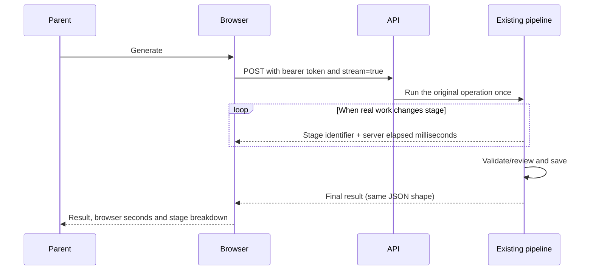

# Catalog presentation and generation progress

The later [generation and child-plan repairs](generation-ui-repair.md) supersede this document's
initial card layout and goal-opening interaction, and add timing/history and budget Settings.

Updated November 5, 2026. This is the presentation and measurement follow-up to the
[refined AI operations guide](refined-ai-operations.md).

## What changed

The reference was the HQ habits catalog and its planning-agent client, especially
`HabitCard`, `HabitDetail`, `ActionCard` and `ChatPanel`. HabitQuest now uses the
catalog's existing age-specific artwork, category labels and age badges. It keeps
the app's mapping: a source catalog card is a **goal**, and a generated action is
a **habit** that the parent can add to the plan.

- Goal cards show the category, illustration, age band, setting and reason for
  the recommendation. **Explore goal** opens the reader. **Make habits** opens
  the generation controls without dispatching a model call.
- The reader exposes the original child steps, finish condition, help phrase,
  adult setup, adaptations, easier version, support needs and research limitations.
- Habit cards show a short instruction, ordered steps, duration, recurrence,
  cue, materials, finish condition and help phrase. Grown-up guidance stays separate.
  **Add habit to plan** uses the existing parent/PIN and capacity checks. The
  schedule is visible as a summary and can be expanded to adjust time and days.
- Coach asks for a short introduction and two or three numbered steps. The
  renderer preserves the order of paragraphs, numbered steps and bullets, without
  accepting HTML. Formatting remains inside the existing generated-text review
  boundary; there is no extra formatter model call. Older paragraphs remain
  readable as paragraphs. Quest planner tips and habit instructions use ordered lists.

There are 381 local 128px icons and 24 category illustrations, copied unchanged
and verified against the original art manifest's SHA-256 hashes (13.3 MB total).
Only images actually displayed are fetched by the browser. Presentation metadata
is keyed by the pinned source ID, independent of model output. These static assets
do **not** preload any database goals. Failed images have a category/emoji fallback.

## Icon settings and local defaults

Coach, habit generation and the saved-habit goal reader use labeled Fluent icon
choices for **Home, School, Community, Outdoors and Online**. Native radio inputs
preserve keyboard navigation and a visible focus state. No location dropdown or
additional model request is needed. The existing API still receives a setting;
the browser supplies the suggestion unless the parent overrides it.

`frontend/src/lib/habitSetting.ts` contains the offline rationale:

1. Explicit places in the message take priority: “at home,” “in class,” “outside,”
   “at the library” or “online.” Thus “screen time at home” stays Home.
2. Otherwise, topics suggest the usual place: homework/bedtime/meals → Home;
   screen time/gaming → Online; teacher/classmates → School; outdoor play →
   Outdoors; library/club → Community.
3. A follow-up without a new place or topic keeps the conversation/goal setting.
4. Category defaults are used next: digital balance → Online, movement/play →
   Outdoors, social play → Community, other categories → Home.
5. Known catalog contexts constrain every rule. Unsupported choices are disabled;
   if the preferred default is unavailable, use the first supported setting.

These are editable suggestions, not a claim to know where a family is. A short
rationale appears beneath the icons. A parent's explicit selection persists until
they choose **Use suggested setting**, start a new chat or switch children.
Goal generation applies the chosen setting to the request and its retry identity;
changing it does not reload the source or dispatch inference. The backend still
enforces source/context compatibility. Controls are disabled during generation.

Generated habit cards also use matching Fluent icons, chosen from the habit's
title/instruction with a local keyword mapping and a generic fallback. The 32 SVGs
are copied unchanged from the planning-agent client; its MIT license and source
manifest are retained in `frontend/public/fluent-emoji/`. Models cannot supply
asset URLs. Goal cards keep the richer age-specific catalog illustrations.

## Actual stages, not an estimated animation

Existing generation POST endpoints accept optional `?stream=true`. Default JSON
clients continue to work. The browser uses an authenticated fetch stream:

Coach stages include context loading, privacy masking, retrieval, embedding,
Pinecone search, canonical card loading, input preparation, generation,
generated-text review, an optional revision and saving. Habit generation reports
context loading, writing, local validation, an optional correction and saving.
Quest planning and weekly review report context loading, generation, local
plan-rule checks and saving. Only stages actually reached are displayed. Fixture
mode and idempotent replays may have fewer stages.

The stream emits fixed stage names and timings, never intermediate model text.
The final response still follows existing authorization, budgets, safety,
ownership, reset fences and database rules. No inference call is added and no
provider/model configuration is changed.

## How to interpret the seconds

**Response in …s** measures the browser operation from request initiation until
the final response is parsed (including the Coach's initial reset wait). It is not
a browser-paint or production percentile measurement. The live timer ticks every
quarter second. Before the server confirms a stage, it says it is waiting for the
server; it does not guess that retrieval or writing has begun.

The expandable stage list uses differences between server event timestamps. The
last `complete` event closes the saving duration. A repeated generation/review
stage exposes a revision. Saved habit batches also show their persisted server
generation duration and the number of habits in that batch; that duration excludes
the HTTP round trip and surrounding endpoint database work. It is **per batch**,
not a separately measured duration for each habit generated in one call.

These timings do not establish a five-second guarantee. The two recent saved habit
batches inspected for this follow-up took **7,484.4 ms** and **8,447.2 ms**. Writer
time was **7,479.7 ms** and **8,439.3 ms**, respectively, with one logical writer
call and one provider attempt each. The reported 20–30 second Coach request has no
retained per-stage evidence from that browser session; its cause is not established.
The earlier 4–5 second synthetic samples were not representative of these later runs.

For a slow Coach result, compare the stage breakdown before choosing an optimization:
embedding/Pinecone time is retrieval; generation is the Coach; review is the
generated-text reviewer; a repeated pair is a revision. A long wait before any
stage is a connection/server-start or request-dispatch issue to investigate. A
large final gap between server stages and browser total needs separate transport
measurement. Long writer-only habit time needs provider/output-latency work rather
than removal of local checks, which took only milliseconds in the saved samples.

## Interrupted requests

Generation writes never automatically retry a dropped stream. The client keeps
the same habit request ID for an explicit retry of unchanged inputs. The server
returns the existing batch on replay. A connection closing cannot cancel an
already dispatched provider call or undo a committed write, so the UI directs
the parent to check the conversation or saved drafts before trying again.

Authorization/input errors before streaming retain their normal HTTP status.
Once a stream has begun, failures use an `error` event with a status and safe
detail; unknown exceptions do not disclose their contents. No cross-request
progress registry or progress database table is introduced.

## Validation and local operation

No new environment variables or database migrations are needed. Restart the
backend to enable streaming; Vite picks up the presentation changes. Existing
JSON clients retain the same behavior.

Regression tests cover chunked UTF-8/CRLF event parsing, interrupted streams,
no automatic retry, authorization and ownership, saved-batch replay, no partial
draft exposure, live stage rendering, ordered copy and the existing parent/PIN flow.
They also cover setting suggestions, explicit overrides reaching generation,
conversation continuity and source-context restrictions.
The browser checks intercept every API request with synthetic fixtures, including
generation and acceptance. They exercise desktop (1280px) and mobile (390px),
verify images load, verify browsing does not generate, and check for horizontal
overflow. Screenshots are presentation evidence, not live model latency evidence:

- [Desktop goals](../evidence/2026-11-04/catalog-goals-1280.png)
- [Mobile goals](../evidence/2026-11-04/catalog-goals-390.png)
- [Desktop habit](../evidence/2026-11-04/catalog-habits-1280.png)
- [Mobile habit](../evidence/2026-11-04/catalog-habits-390.png)

Verification: **100 frontend tests**, production build, and **two desktop/mobile
browser checks** passed. The backend's 793 cases were verified across the full
suite (792 passed before a new test's variable-shadowing error) and the corrected
29-case progress/schema recheck; combined statement and branch coverage is
**100%**. Ruff check/format and mypy passed. The test fixtures use the migrated
disposable database, not application family data. Vite reports a large-bundle advisory.

The restarted local API passed the [no-cost HTTP smoke](../evidence/2026-11-04/catalog-progress-smoke.json).
A separate [mocked graph probe](../evidence/2026-11-04/catalog-progress-graph.json)
verified that stage events propagate through the executor and LangGraph workers.

Run frontend checks with `npm test` and `npm run build`. The isolated browser
spec is `frontend/e2e/coach-catalog.spec.ts`; on this workstation use
`PLAYWRIGHT_CHANNEL=chrome npx playwright test e2e/coach-catalog.spec.ts` from
`frontend/` to use the installed Chrome. Backend tests must use a fully migrated
disposable `_test` database, as described in `backend/CLAUDE.md`. No additional
paid live inference was used for this follow-up.
