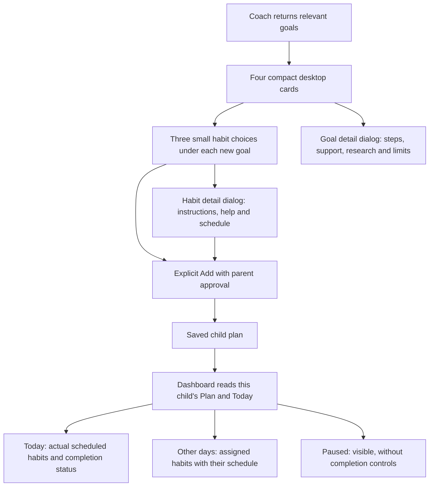

# Compact catalog cards and complete dashboard plans

November 5, 2026. This follow-up replaces the two-column, inline-detail presentation in
[goal/plan reliability](goal-plan-reliability.md). It changes presentation and dashboard reads;
the AI workflow, spending cap, plan capacity and saved family data are unchanged.

The later [goal-linking follow-up](goal-linking-and-saved-recommendations.md) adds exact goal links
and separates saved goals from recommendations. Its larger three-column cards supersede the
four-column sizing described below.

## Findings and changes

| Problem | Cause | Change |
|---|---|---|
| Goal and habit cards consumed too much space | Full habit instructions and scheduling controls expanded inside each goal | Four goal columns at desktop widths of 1280px or more, two on tablets, one on phones; small habit rows beneath their own goal |
| Opening details made the page longer | Readers expanded in the grid | Separate scroll-bounded dialogs for goal research, habit instructions/schedule, and generation options |
| Goal artwork looked soft | Original 128px icons intended for small thumbnails were enlarged | Original 512px illustrations, responsive 128w/512w sources and lazy loading |
| Dashboard looked empty despite saved habits | It fetched Today but never the saved plan; off-day assignments were omitted | Read each child's authoritative plan alongside Today and show Today, Other days and Paused separately |
| One failed refresh could blank all children | One shared Promise.all rejected all results | Isolated per-request results preserve successful or previously loaded child data; refresh on focus and visibility return |

The read-only local audit found one child with four active assignments: one scheduled today and
three generated habits scheduled for other days. The second child's persisted plan had zero
assignments at the time of inspection. The UI now explains that distinction; it does not copy
habits between children or assign drafts automatically.

## Interaction

- The count slider appends choices and preserves earlier ones. Existing preparation limits and
  saved-draft reuse remain intact. Browsing details does not itself spend on generation.
- Compact habit rows retain direct Add/Remove controls. Full instructions, parent guidance,
  completion wording and schedule controls are in the habit dialog.
- Dialogs support Escape, backdrop dismissal, focus containment and focus restoration. Adding
  from a dialog closes it before the parent PIN prompt, so the prompt remains usable.
- Goal cards retain category color, age, artwork and a short research insight. The detail dialog
  preserves canonical research links, qualifications and limitations.
- Off-day and paused habits do not count toward today's completion total. Scheduling and
  server authorization remain authoritative.

## Artwork provenance

All 381 goal illustrations were copied unchanged from the original catalog's 512px exports.
The existing 381 thumbnails and 24 category images remain. All 786 PNGs were checked against
the original export manifest for checksums, dimensions and byte counts; all 32 Fluent habit
SVGs also match their originals. See the [asset notes](../../frontend/public/catalog-art/README.md)
and [manifest](../../frontend/public/catalog-art/manifest.json).

The new originals add approximately 140 MB to static assets. They are loaded lazily as needed,
not bundled into JavaScript or fetched as a whole catalog. No source goals were imported into
the database to display the artwork.

## Verification

Final verification passed **114 frontend tests across 21 files**, the production TypeScript/Vite
build, and **four browser checks** (23.7 seconds). The build retains its existing large-JavaScript-
chunk advisory. No backend implementation changed in this follow-up.

The checks cover:

- Frontend regression tests, including two-child separation, saved goals without assignments,
  off-day and paused plans, failed refreshes, and library add/remove followed by reload.
- Desktop and mobile browser fixtures: four desktop columns, small habit rows, original 512px
  images selected for goal cards, popup research and scheduling, add and append behavior,
  generation settings and child-facing steps.
- Actual API and PostgreSQL browser flows on a disposable `_test` database: four goals with
  three choices each, full-plan recovery, add/remove/restore, goal removal, chat reset and child
  details; plus two children's generated/catalog/paused/off-day assignments, reload, and refresh
  after add/remove.

All provider transport is blocked in the isolated browser API. These checks establish UI and
persistence behavior, not live model latency. No paid provider calls or real family mutations
were used for this follow-up. The previously measured latency remains documented in
[goal/plan reliability](goal-plan-reliability.md).

Screenshots: [desktop cards](../evidence/2026-11-05/compact-habits-1280.png),
[mobile habit dialog](../evidence/2026-11-05/compact-habit-dialog-390.png),
[two-child dashboard](../evidence/2026-11-05/dashboard-two-children.png).
