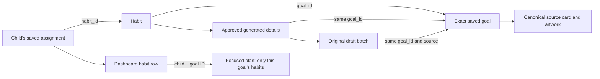

# Goal linking, saved plans and Coach recommendations

November 5, 2026. Follow-up to [compact cards and dashboard plans](compact-cards-dashboard.md).

## What the audit found

The existing family's inspected habit links were consistent in PostgreSQL and the API. The two
generated media habits both refer to the canonical goal **Agree on a realistic media stopping
point**. Their habit rows, approved details, generation batches, canonical source IDs and artwork
metadata agree. The legacy **Finish dinner on time** habit correctly refers to **Happier mealtimes**,
as defined by the seed catalog. Every inspected active habit has one matching saved goal.

At inspection, the second child had two saved goals and no assigned habits. A saved goal alone
does not mean a habit has been assigned. No real family records were changed or reassigned.

The presentation made these relationships unclear: saved goals appeared in a flat list above
the habits, habit rows did not show their goal, and all goal links opened the entire plan. Coach
also mixed saved goals and persisted recommendations in the same grid.

## Updated behavior

- The dashboard displays **Habits** first, including Today, Other days and Paused, followed by
  **Goals**. Each habit shows its exact linked goal. Each goal shows its linked-habit count or
  **Saved · no habits yet**. Counts include paused assignments and exclude removed assignments.
- A goal link opens `#/quests/:child/goal/:goalId`. That view filters the child's saved habits by
  the exact `goal_id`, with a clear way back to all habits. Unknown or unsaved goal links do not
  substitute a different child's plan or the first goal in a list.
- The plan's approved habit reader opens in a dialog and includes its source-goal image and link.
  The focused goal reader loads canonical steps, research and limitations without generating.
- Coach separates **Goals in the child's plan** from **Coach recommendations**. Recommendations
  identify a new response or an earlier saved conversation. A saved goal recommended again
  appears once. Saving a goal keeps its existing draft choices and workbench state.
- Goal cards use three desktop columns, two tablet columns and one phone column. The desktop
  card width now matches the dashboard child cards more closely. Artwork is 176px; full details
  use a 960px-wide responsive dialog, aligned images/text and two columns for child/parent habit
  guidance on larger screens. Small habit previews remain beneath each goal.

## Identity and lifecycle rules

Goal relationships are never inferred from card position, display title, image or the first saved
goal. UI guards reject a mismatched source, child/batch, approved-detail or acceptance response
instead of placing unrelated content under a goal. Switching children remounts the plan reader;
switching focused goals resets the canonical detail reader. Nested dialogs handle Escape and
focus only at the topmost open dialog.

The existing backend retains parent approval, child/family isolation, source pinning, immutable
approved instructions, chat reset fences and goal/habit restoration rules. No model calls,
database migrations, cap changes or provider routing changes were added.

## Verification

The frontend passed **124 tests across 22 files** and the production TypeScript/Vite build.
All **four browser scenarios passed**; the desktop/mobile fixtures then passed again with added
saved/recommended heading and deduplication assertions. The existing large-JavaScript-chunk
build advisory remains. Ruff check/format and mypy also passed.
The full backend suite passed **835 tests with 100% statement and branch coverage** on the
disposable `habitquest_refinement_fresh_test` database. The main app and API both returned HTTP
200 after verification; only the isolated QA API was stopped.

The new backend integration journey exercises two children, two generated source goals, an empty
saved goal and a legacy habit. It compares plan, option, batch, parent-detail and kid-detail IDs;
checks sibling restore rejection; removes one goal without touching another; then resets chat
and restores the approved habit with its original goal. Targeted generation/journey checks passed
54 tests on an isolated `_test` database with providers disabled.

Frontend regressions cover reordered goal lists, distinct goal/habit mappings, saved goals without
habits, missing metadata, removal counts, saved/new separation, draft retention while cards move,
wrong-child/goal responses, focused plan navigation and nested dialogs. Browser checks exercise
desktop/mobile media layout and the actual isolated API journey through dashboard goal links,
approved habit details, canonical goal details and reloads.

Screenshots: [larger goal card](../evidence/2026-11-05/linked-card-1280.png),
[saved goals and recommendations](../evidence/2026-11-05/linked-saved-recommendations-1280.png),
[dashboard habit-to-goal links](../evidence/2026-11-05/linked-dashboard-two-children.png),
[approved habit dialog](../evidence/2026-11-05/linked-approved-habit-dialog.png).
All screenshots and test records use synthetic families. No paid provider checks were run.
