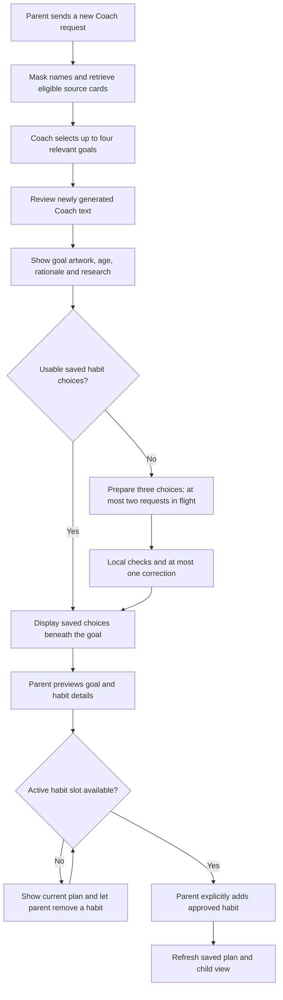

# Goal recommendations, habit generation and plan editing

November 5, 2026. Follow-up to [generation and child-plan repairs](generation-ui-repair.md).
The earlier repair checks did not cover the full-plan and device-parking cases reported by the owner.

The later [compact-card/dashboard follow-up](compact-cards-dashboard.md) supersedes the two-column
layout below with four desktop columns, popup details, higher-resolution originals and complete
dashboard assignment visibility. The generation and plan-lifecycle repairs remain applicable.

## What actually failed

1. **The active plan was full.** One inspected child had six active habits, the existing app limit.
   Another had five. Generated drafts are choices, but accepting one requires an active slot.
   The UI hid this distinction and offered Add even when the server would reject it.
2. **Removed habits could still appear added.** A saved draft retained its accepted assignment ID.
   Reacceptance returned that ID without checking whether the assignment had since been removed.
3. **A completion rule misread a device action.** The latest inspected failure concerned the
   age 11–13 shared-device-parking goal. Both writer attempts failed
   `completion_includes_nonparticipation`. Its canonical practice explicitly allows pausing
   entertainment, but the checker recognized that context only when the goal title began with
   “Pause”. A title such as “Park the device” could therefore be rejected for the same valid action.
   Rejected model text was not retained, so the exact failed sentence cannot be reconstructed.
   Regression examples use synthetic, source-aligned wording.
4. **The Coach was instructed to return one goal.** A previous latency-oriented prompt requested
   one primary goal and limited source recommendations to three. The updated request is three or
   four relevant options, without padding the list with weak or unsuitable matches.
5. **Important content was hidden.** Research required opening a goal, expanding the full reader,
   then expanding Research. The habits appeared in one detached workspace rather than beneath
   their goal. Old failed batches could leave an error visible after a newer success.
6. **Reset and saved data were conflated.** A chat reset correctly invalidates unapproved drafts,
   but the screen also lost approved habit details. Those now load through their durable details
   API. Old-reset/old-age unaccepted drafts no longer enter new-generation duplicate checks;
   approved plan habits still do.
7. **Catalog Add replaced the entire plan.** That older path could drop independently saved goals
   and briefly reactivate paused habits. It now uses the incremental, PIN-protected habit endpoint.

The audit used code, redacted diagnostic codes and read-only database counts. It did not expose
family names, conversations, provider keys or rejected drafts.

## Intended interaction

Opening historical conversations and reloading saved choices must not initiate model calls.
The automatic preparation is tied to a new parent Send, and generated choices never become
assignments automatically. A failed batch does not retry indefinitely. Increasing the count
requests additional choices while preserving earlier ones.

The six-habit limit remains a plan rule, independent of the editable dollar budget.
Active and paused assignments occupy slots; removed assignments do not. Goals and draft choices do not consume habit slots. Removing an assignment preserves
its completion history. Removing a goal also removes its active assignments from the plan;
adding the goal back does not silently reassign every old habit. An approved habit can be
explicitly restored with the same eligibility, parent approval and capacity checks.

Research comes directly from the pinned source card: insight, links, what a source supports,
age-transfer qualifications and limitations. It is not newly invented citations or a claim
that the exact generated habit has proven efficacy.

The current cards use two desktop columns, category accents, larger artwork, age badges,
plain-language support labels, visible research summaries/links, and habit choices beneath
their own goal. Full goal and habit readers remain available. Mobile uses one column.

## Changes and boundaries

- [Generation and diagnostics](../../backend/src/habitquest_backend/generated_habits.py) and
  [completion validation](../../backend/src/habitquest_backend/action_quality.py): distinguish
  pausing a device from declining practice, prevent repeats of current usable draft choices,
  and return safe cause-specific errors. Existing failed batches get better display messages
  without rewriting their stored history.
- [Plan API](../../backend/src/habitquest_backend/onboarding.py): exposes capacity, supports
  incremental goal/habit changes, restores approved habits, and serializes capacity-sensitive
  changes under the child's lock. Removed assignments retain history. No migration was required.
- [Coach selection](../../backend/src/habitquest_backend/refined.py): targets three/four relevant
  source goals and permits at most four. It still withholds unsuitable matches instead of padding.
- [Goal/habit UI](../../frontend/src/components/GoalRecommendations.tsx): renders source research,
  bounded preparation, saved approved details and add/remove/restore controls. Saving a goal
  does not silently assign its habits. A full plan disables Add and shows removal controls.

Normal Coach still uses one generation plus one review of new prose. Each habit batch normally
uses one writer with at most one correction, and no additional remote Safety call. Automatically
preparing four new goals therefore means four separate habit-writer requests after the Coach,
limited to two in flight. Per-operation status and timing remain visible according to Settings.

## Verification

- Backend: a full 832-case run passed 831 cases; the only failure was an old assertion limiting
  selected goals to three. After updating it to four and adding the two reset/age regressions,
  all 53 focused rechecks passed. Statement and branch coverage is 100%. Ruff check/format and
  mypy passed. Disposable databases were used throughout.
- Frontend: all 107 tests and the production build passed. The existing bundle-size advisory remains.
- Browser: the real API/disposable database flow verifies four goals → twelve choices, a full
  six-habit plan, removing one habit, adding, removing/restoring the approved habit and its goal,
  chat reset/reload, and child-facing details. Provider transport is blocked in this service.
  Separate desktop/mobile checks use synthetic API responses to verify layout and Settings.
- The local API was restarted. [Read-only smoke evidence](../evidence/2026-11-05/reliability-readonly-smoke.json)
  confirms the new routes, actual plan capacities, frontend/API readiness and the unchanged $5 cap.
  No real family assignment was removed or changed by this work.

## Approved live checks

The owner separately approved one synthetic Coach request and two three-habit batches, with
at most $0.12 in additional planning reservations. All completed successfully:

| Operation | Time | Logical chat calls | Result |
|---|---:|---:|---|
| Screen-balance Coach | 11.73s | 2 | Three relevant goals: stopping point, offline transition, shared device parking |
| Three habits for the first goal | 10.71s | 1 | Three distinct habits with three different icons; no correction |
| Three habits for the previously failing device-parking goal | 10.35s | 1 | Three valid habits, including pausing a video and parking the device; no correction |

The [Coach/first-batch record](../evidence/2026-11-05/reliability-live-coach.json) measures local
HTTP round trips. The [device-parking record](../evidence/2026-11-05/reliability-live-device-parking.json)
measures an isolated in-process API request with real providers; it excludes browser paint and local TCP.
Only synthetic inputs/outputs were captured. Both temporary families were removed; the ledger was
preserved. Added planning reservations totaled **$0.09499712**, within the approved $0.12 bound.

The five-second target is **not met**. In the Coach sample, retrieval took 2.13s, generation 4.81s
and text review 4.64s. The two habit batches spent almost all their time in the writer. These are
single successful samples, not percentile measurements or a guarantee of later latency.

Screenshots:

- [Desktop goal cards with research](../evidence/2026-11-05/rich-goals-1280.png)
- [Habit choices beneath their goal](../evidence/2026-11-05/rich-habits-1280.png)
- [Mobile goal cards](../evidence/2026-11-05/rich-goals-390.png)
- [Child plan from the real-API test](../evidence/2026-11-05/real-api-child-plan.png)
