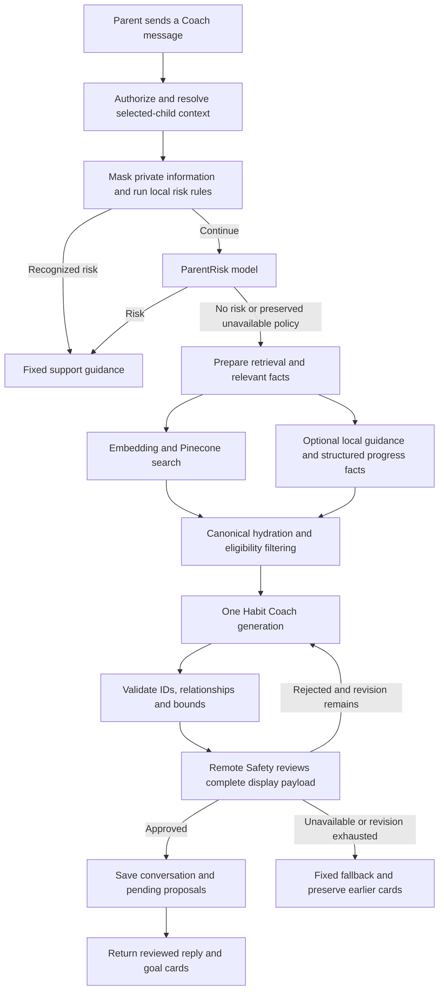
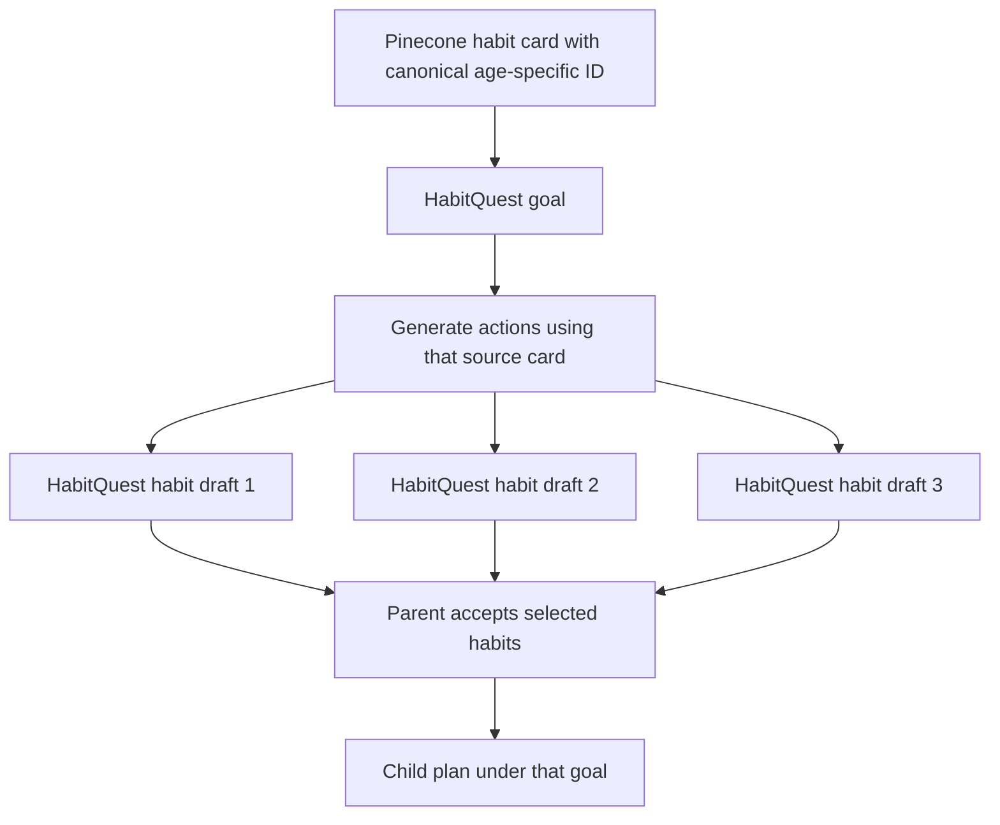

# HabitQuest: planning capability integration plan

Date: November 4, 2026  
Status: Approved plan, now implemented and activated locally. The review findings below describe the
pre-implementation state; see the [execution record](implementation-progress.md) and
[operations guide](refined-ai-operations.md) for current behavior and verification.

**Execution clarification from the owner:** do not bulk-import source goals. Retrieval and browsing are
read-only. Create only the goals selected by a generated Coach recommendation after Safety approval,
then generate habits under those local goals. This supersedes any bulk-import assumption below.

**Latest Safety/citation scope:** review only newly generated Coach prose and explanations remotely.
Remove remote ParentRisk from refined Coach; bounded habit generation uses local checks and parent
approval without a separate Safety call. Thus normal Coach has two chat calls and habit generation one.
Source-goal retrieval has no Safety/research call or legacy G guidance lookup; use canonical research
provenance instead. These execution instructions supersede the original three-call/full-payload plan below.

**Confirmed product mapping: a habit card retrieved from Pinecone becomes a HabitQuest goal; an action generated under that card becomes a HabitQuest habit under that goal.** Catalog-card points/reward settings are outside this integration. Preserve the main app's existing points/reward behavior for assigned habits.

**Recommendation: integrate retrieval and goal cards into the main LangGraph workflow first, then add explicit generation and parent-approved assignment of habits under those goals.** The first useful release should deliver faster Coach responses with grounded goal recommendations. Follow with the source-linked habit drafts and persistence needed for the real child plan.

The [AI refinement handoff](habitquest-ai-refinement-handoff.md) is the governing design. It supersedes the earlier [one-total-call proposal](../streamlined-ai-implementation-plan.md): the normal refined Coach path retains **ParentRisk + one Coach generation + remote Safety = three logical model calls**. One Safety-triggered revision can bring this to five. Embedding, Pinecone operations and transport retries are counted separately.

## 1. What is actually available

| Component reviewed | What it provides | Integration implication |
|---|---|---|
| Main `habbit-quest` app | Authenticated family/child accounts, PostgreSQL/RLS, conversation persistence, current Coach crew, suggestion acceptance and daily quests | Keep this as the application and authorization owner. |
| `hq-ai-services/planning-agent` | Live query embeddings, Pinecone Documents search, checked canonical records, deterministic ranking, a Deep Agents recommendation loop, and a separate action generator | Reuse the domain components. Calling its complete `/planner/turn` endpoint inside Coach would introduce another generation loop. |
| `hq-habits-catalog` | Editorial content, age variants, research claims/limits, support requirements, outcome/reward policies and optional stacks | This is the source of content and restrictions, rather than a collection of interchangeable quest titles. |
| Catalog explorer | Portable HTML with local keyword search, detailed readers and stack exploration | Useful reader/filter patterns; it does **not** call Pinecone. |
| `hq-app/planning-agent-client` | React prototype for recommendations → actions → parent/kid preview | Useful interaction and validation code. Its approved plan is browser-memory state, not a persisted HabitQuest family plan. |

The standalone service's `CatalogRepository(Settings(_env_file=None))` passed its local manifest, file, record and embedding checks during this review. The snapshot contains **381 age records, 96 concepts and 24 categories**. Four records are parent coaching. All records currently declare `research_grounded_editorial_draft`; retrieval availability and valid hashes do not establish product approval or clinical validation. The catalog's points/reward metadata was inspected but is not mapped into the app, per the user's scope clarification.

The planning service has populated configuration entries for Pinecone, embeddings and its catalog snapshot. The main backend has its existing chat-provider configuration but lacks those retrieval entries. Non-secret model/runtime settings and credential presence were checked; no secrets were printed or copied. **Live Pinecone access and current credentials were not tested.** Local snapshot validation is not proof that the remote namespace is currently healthy.

Some catalog integration notes describe the October 31 TypeScript server and old frontend layout. They remain useful policy context, but current Python backend and React source determine this plan.

## 2. Reuse the capability without nesting the prototype's agent loop

The current live retrieval implementation:

1. Takes up to three explicit objectives. Short follow-ups can reuse the previous objective.
2. Calls LangChain `OpenAIEmbeddings` with `text-embedding-3-small`, **512 dimensions**.
3. Searches Pinecone's **Documents API `2026-07`**, index `hq-habits-v1`, namespace `habits-0-1-0`, dense field `embedding`, cosine similarity. The host is configured privately.
4. Applies age, context, language, release, availability and relevant intent/concept exclusions in the query.
5. Checks returned IDs and metadata against the local checksummed release, then deduplicates/reranks to at most six concepts.
6. Loads the full canonical content locally. Pinecone supplies matching record IDs/ranks; it does not generate child actions.

These values come from the existing service, not a proposed new index. Preserve the matching embedding space and snapshot contract. Do not replace this with a generic vector-store adapter unless it demonstrably supports this Documents schema. Pinecone documents that schema-based indexes use document operations, which differ from the older vector operations. [Official API migration reference](https://sdk.pinecone.io/python/migration/v10-migration.html).

**Recommended boundary:** extract a small, installable planning-core package from the service, with retrieval, canonical loading, ranking, evidence contracts and action validators. Let the main backend call it in process through a thin adapter. Keep the standalone demo working against that same core. The core must not import the Deep Agents harness, mutate tracing environment variables, own family sessions, or require its local usage-ledger file.

Package the dependency and a pinned catalog release into the main application's build. A development import or snapshot pointer reaching into sibling checkout directories is insufficient for a clean clone or deployment. Ship only required content/metadata/assets; the live main-app retriever does not need to load all stored embedding vectors. Retain the existing manifest checks or introduce an explicitly validated derivative artifact.

An authenticated retrieval-only HTTP endpoint is an alternative if independent deployment is required later. The current prototype has no such endpoint, and its opaque local session token is not family authorization. A second runtime service is unnecessary for the first integration.

| Reuse | Adapt | Keep out of ordinary Coach |
|---|---|---|
| Repository checks, metadata filters, Pinecone request format, deterministic reranking | Privacy before embeddings; selected-child context; domain IDs; compact evidence; error/timing contracts | `create_deep_agent`, todo planning, tool-selection loop, prototype checkpoint/session store |
| Action schemas, source lineage, age-copy and novelty checks, action-writing prompt | Main provider adapter, full-payload Safety, persisted approval, bounded correction budget | Automatic action writing for each retrieved card |
| Detailed parent reader, child steps/help, stale-response checks | Main auth/API/store and design system | Browser-local approval as permission to mutate the real plan |

The main adapter must also enforce app-owned eligibility: the source catalog has no HabitQuest tier or plan-capacity model. Obtain the setting explicitly (for example, home or school), retain readiness/support requirements, and do not infer them from age or vector score alone. Tier/capacity checks apply to the app habits being proposed or accepted; the source goal itself does not become an earning task.

The prototype's recommendation loop permits five generation invocations by default, plus bounded tools and a repair within that cap. Its assembly also pads selected results with other shortlisted records. Neither behavior belongs in the refined Coach: return only deliberately selected fitting recommendations, and permit advice/clarification without cards. LangGraph supports predetermined workflows alongside model-driven agents; retaining it does not require a nested tool loop. [Official workflow guide](https://docs.langchain.com/oss/python/langgraph/workflows-agents).

## 3. Target workflows

The Safety loop has **one total revision**, reuses the same allowed evidence, and never re-runs a hidden Triage/Brief/Patterns/Fit chain. Invalid IDs/schema are handled explicitly and cannot bypass Safety or create an unbounded repair loop. ParentRisk unavailability remains distinct from a confirmed no-risk result, with the handoff's current continuation behavior preserved.

```mermaid
flowchart LR
    A[Goal backed by a Pinecone habit card] --> B[Read goal details locally]
    A --> C[Parent explicitly selects Generate habits]
    C --> D[Authorize source and mask current instructions]
    D --> E[Risk checks for new parent text]
    E --> F[One action-writing pass using selected canonical source]
    F --> G[Validate source, goal link, child wording and schedule]
    G --> H[Remote review of all generated parent and child wording]
    H --> I[Save reviewed action drafts]
    I --> J[Parent reviews and accepts]
    J --> K[Recheck current rules and atomically assign]
    K --> L[Child plan with existing approval and points behavior]
```

Opening details must make no generation request. The prototype currently generates on first detail open and streams provisional child wording before final validation; the integrated UI should stream only fixed phase labels until review completes. Reuse cached reviewed drafts when reopening details. Regeneration remains an explicit parent action. The prototype's “Make actions” operation becomes **Generate habits** in HabitQuest.

Action writing is distinct from the existing **Quest planner** (`insights.plan_for`) and weekly review. Neither report runs automatically from chat or a catalog-card click. New action-specific risk/review handling must not change existing child-note disclosure handling or buddy-line screening through shared settings.

### Calls and latency

| Operation | Expected logical chat-model calls before transport retries | Other external operations |
|---|---:|---|
| Recognized local risk stop | 0 | None |
| ParentRisk identifies risk | 1 | None; stop before retrieval |
| Ordinary refined Coach response | 3 | Normally one embedding request and one Pinecone search |
| Coach with one Safety-triggered revision | Up to 5 | Reuse retrieval; do not search again merely to revise wording |
| Open canonical details or previously reviewed drafts | 0 | None when the pinned source/draft is available |
| Explicit Generate habits | One writer + one review; add ParentRisk when fresh parent text needs assessment | No fresh embedding/search for an unchanged selected goal's source |
| Explicit Quest plan / weekly review | Separate feature budgets | No automatic invocation from Coach |

The action-call row is a proposed target, not the prototype's present safety behavior. Its current writer has a possible semantic repair but no independent remote output review. Define **one shared correction allowance** for the integrated action operation rather than stacking that repair with another complete Safety-revision loop. Any additional child-text screening required to meet the selected policy must be counted explicitly; do not claim a two-call action path before verifying that contract.

Preserve the main backend's current SDK/network retry setting initially, as the handoff requires; its adapter currently uses `max_retries=1`. Record logical calls, generation passes and actual provider attempts separately. Do not inherit the prototype's zero-retry policy or switch the main chat model silently.

**Five seconds remains the user experience target, not an established result.** Three sequential model calls plus embedding/search may still exceed it. First instrument full Send-to-reviewed-render latency, including initial reset waiting, network, queueing and final save. Report p50/p95, useful-result rate, failures, revision rate, token counts and per-stage times on fixed synthetic cases. A first token or a fast error is not a completed useful answer. Model/prompt tuning and deadline adjustments follow measurements; do not regain speed by displaying unreviewed text.

## 4. Confirmed mapping: source habit card → goal; generated action → habit

This mapping is a user decision, not an open option. The Pinecone habit card itself supplies the goal. Do not replace that relationship with a broad category or a many-to-one crosswalk to an unrelated existing goal.

| Identity | Proposed use |
|---|---|
| Catalog `category_id` | Navigation/filter metadata attached to the goal. |
| Catalog `concept_id` | Cross-age grouping and recommendation deduplication metadata. It does not replace the selected card's identity. |
| Catalog record `id` + release + SHA-256 | Exact source habit card projected as an application goal, with its age variant, evidence, instructions and suitability constraints. |
| Application `goal_id` | Stable, server-owned ID mapped one-to-one to that canonical source card. Keep source IDs separately rather than asking the model to create IDs. |
| Generated action ID | A reviewed HabitQuest habit draft under the mapped `goal_id`; multiple habits may share one goal. |
| Child assignment ID | The actual accepted instance, owner, schedule, start date and outcome history. |

For example, the source card `learning-homework--ask-about-one-stuck-spot--a6-8`, titled “Ask a specific learning question,” becomes a HabitQuest goal. An illustrative generated habit beneath it could be “Mark one question you need help with,” with concrete child steps and a help cue. That example is a proposed description, not a generated or approved action. Each accepted habit retains the exact source card reference through its goal and its own generation provenance.

Publish eligible source cards as **goals**, not executable quests. Preserve existing goals/habits during migration; use a separate ID namespace for these new goals. Some source IDs exceed the custom-habit API's 40-character `goal_id` limit, so use a stable short application ID with a unique source-ID mapping. Retain age variants explicitly; do not merge them solely because they share a concept. Birthdays require suitability review of existing assignments rather than silently replacing their source.

The existing `candidates()` path omits goals with no eligible application habits. A newly imported source goal initially has no generated habits, so it needs a goal-recommendation contract that can represent that state. Extend goal browsing/selection accordingly; do not create placeholder habits just to satisfy the old selector.

### What the existing habit endpoint needs

- It stores short title/hint fields and assigns ages 3–13. Add the source-goal link, intended child/age scope and richer child steps/parent guidance without losing them through truncation. Existing server-owned tier/points defaults remain in effect.
- `child_habits` supports a required time and selected weekdays. It cannot express `every_n_days` or `as_needed` faithfully.
- Keep the existing submission/approval/rejection and pause behavior for the initial supported actions. Broader activity-outcome tracking is a separate feature rather than an automatic prerequisite for this integration.
- Editing a family custom habit changes what all assigned children see. A child-specific generated action must not silently rewrite another child's action or the meaning of historical practice.
- `ai_suggestions.habit_id` requires an existing application habit row. A Pinecone source ID or unsaved generated draft cannot simply be placed there.

Consequently, begin with **goal recommendations as a separate response type**, alongside existing actionable habit suggestions. Persist the goal ID, typed source reference and reviewed explanation with the conversation so reload/reset and shown-history behavior remain correct. Showing a goal does not assign a habit. Generated habit drafts must retain their owning goal and become plan entries only after parent acceptance.

Keep separate typed allowlists for goal IDs, existing habit IDs and draft IDs in prompts, API payloads and validation. A full habit plan can still receive useful goal guidance; capacity blocks adding habits, not reading a goal. Requesting more habits under an already selected goal resolves that goal directly rather than excluding it because its source card was previously shown.

For the later assignment phase, design additive migrations for source-goal mappings, generated-habit drafts/details and exact source lineage. Reuse existing family/child ownership, approval, habits and assignment tables where their meanings fit. Do not edit applied migrations or introduce a general versioned-plan system: the source-release reference records what content justified this habit. Retain pinned source releases or sufficient canonical content to make that reference resolvable after catalog updates.

**Points are out of scope.** Do not import the prototype's `reward_for()` defaults, goal-card reward fields or catalog reward-gate settings into HabitQuest scoring. Keep the existing main-app points, Sparks, boosts, streak and chest implementation. General coaching prohibitions such as threats or deprivation of basic care remain covered by the handoff's retained Safety review; they do not require a reward-system redesign in this plan.

## 5. Context reuse and privacy

The frontend store currently loads account, family and child profile data. Coach history/cards live in the Coach component; the backend still builds a fresh snapshot per send. There is no existing complete trusted Coach context to simply pass through.

Introduce a typed selected-child context with identity/scope, profile, plan/capacity, shown source/application IDs, recent conversation and relevant facts. Use the following ownership rules:

| Context | Reuse strategy | Freshness/authority |
|---|---|---|
| Canonical release, mappings, local guidance | Read-only process cache keyed by release/hash | Reload deliberately on release change; never cache request-bound mutable graphs. |
| Bounded history for authorized children | Batch on application load, partitioned per child; start with 20 entries each | Keep private history in memory, outside the frontend's persisted general snapshot. Reset/retention still apply. |
| Current child/plan and pending state | Small bounded backend context cache, seeded by authorized load, explicitly passed into graph state | Every send still authorizes. Lightweight authoritative reads/fingerprints detect other devices/workers; refresh changed sections. Cache miss always reloads. |
| Progress facts | Compute honest period-specific facts locally and cache only when needed | Invalidate on approvals/check-ins and local-day changes; bounded freshness for remote updates. No automatic Patterns model/report. |
| Final acceptance | Read authoritative current rows in a short transaction | Lock/recheck child capacity, source approval, age/context, membership, duplicates and pending state. |

Start with a short proposed mutable-context freshness bound, such as 30 seconds, then measure. Critical eligibility and permission checks cannot rely on that TTL alone. A fingerprint must include meaningful edits such as status and schedule, not merely row count or latest creation time. No Redis, global family-memory graph or new cache service is required. Implement cross-worker tests before claiming reuse is correct in multi-worker deployments.

Synchronize or invalidate after send, accept, dismiss, reset, profile/plan edits and relevant progress changes. Use per-child request generations to discard late responses after reset or switching children. Keep `[App]` as display text only; trusted message origin comes from stored role metadata.

Preserve the handoff's automatic first-chat-open reset initially, and invalidate the preload when it happens. This creates avoidable loading work but removing that reset is a separate product choice, not an incidental optimization.

Mask known child/caregiver names and agreed personal-information patterns **before embeddings as well as generation**. Do not pass raw parent input from the prototype's request directly to `Retriever`. Its current live path embeds the supplied text without the main app's masking. Keep sensitive user input out of the public catalog/index, local usage reports and traces; external retrieval is query-only. Unknown personal information still requires evaluation rather than a claim of complete anonymization.

## 6. Recommended order: finish Coach refinements, then integrate planning

| Phase | Concrete work | Reviewable result / release gate |
|---|---|---|
| **1 — Main Coach foundation** | Add explicit context/outcome/evidence contracts and stage/attempt metrics. Implement scoped reuse and invalidation. Replace Triage/Brief/Patterns/Fit calls with local preparation and one Coach generator. Expand remote Safety to every generated field; preserve bounded Safety revision, current retry/risk defaults and pending cards on failure. Use the current supported retrieval during this step. | Existing app still works; normal AI path has exactly three logical calls; family isolation, reset and expanded Safety tests pass. This is the recommended first implementation subset. |
| **2 — Pinecone cards as goals** | Extract/adapt planning core; package the canonical release; carry over Pinecone/embedding settings and Luna Coach configuration through a dedicated OpenAI provider group. Add masked retrieval, strict filters and canonical validation. Project source cards into application goals with stable IDs. Add goal-recommendation payload/persistence and parent detail reader. | The main Coach explains and displays source-backed goals even before they have generated habits. Role-routing/configuration and mocked contract tests pass, then separately authorized live checks establish real integration. |
| **3 — Actions as habit drafts** | Reuse action-writing prompt/contracts and validators behind an explicit Generate habits operation. Add main-app auth/child/goal binding, risk handling for new text, full generated-payload review, parent/child preview, request deduplication and one bounded correction allowance. Persist draft ownership and status; details alone trigger no inference. | Parent can request and inspect reviewed habit drafts under a source goal. No draft enters the daily plan. Reopening reuses results; unreviewed streamed text is never displayed. |
| **4 — Accept habits into the plan** | Add generated-habit details/provenance and atomic creation/assignment under the owning goal. Revalidate current child eligibility, capacity, duplicates and any edited wording. Retain existing points/reward behavior. | Accepted habits survive reload and work through the real kid/caregiver loop. Start with daily/weekly schedules supported by today's schema; keep interval/as-needed assignment disabled until implemented. |
| **5 — Measure and expand** | Benchmark retrieval relevance, completed-response latency and generation quality. Expand released goal coverage and supported scheduling as separate changes. Reuse retrieval in explicit Quest planning/review where useful. | Measured experience targets and broader supported coverage; separate report workflows remain explicit. No reward-system redesign is included. |

**Recommended starting milestone: complete Phase 1 using the current catalog, then Phase 2.** This isolates the call-stack and Safety changes from the catalog/entity migration. The handoff's Pinecone item is explicitly deferred to Phase 2, not claimed complete in Phase 1. Phases 3 and 4 complete the requested goal → generated habits → accepted plan flow.

Pinecone indexes, existing family data and current goal/habit IDs remain intact throughout. The new source goals and generated habits coexist with legacy content. Retiring old content is a separate migration decision, not an implicit part of integration.

### Phase 1 work packages

1. **Contracts and baseline.** Add explicit `CoachContext`, `RetrievedEvidence`, generated-output and final-outcome contracts. Capture context/risk/retrieval/generation/Safety/save times and provider attempts. Keep existing behavior initially so before/after comparisons are meaningful. Define synthetic fixtures covering ordinary help, refinement, progress, risky language, full plans and failures.
2. **Context reuse.** Add an authenticated family bootstrap/context read that batches recent history per child and shares trusted backend context with subsequent sends. Cache immutable catalog data separately. Implement targeted refresh, lifecycle invalidation and role provenance. Verify that normal warm sends do not rebuild every old snapshot query, while authorization and necessary fresh checks remain.
3. **Refined graph.** Replace the four standalone Triage/Brief/Patterns/Fit invocations with code nodes. Supply sanitized conversation, local retrieval and relevant computed facts to one `generate_coach_response` call. Preserve existing proposed schedule/plan changes; do not invoke the separate Quest planner.
4. **Full Safety and deterministic finalization.** Validate and normalize every generated field, then review the exact reply/cards/change reasons/questions that may be displayed. Keep one Safety-triggered revision; withhold unchecked generated content and preserve previous pending cards. Distinguish unavailable, abstention and real no-candidate cases.
5. **Frontend/lifecycle integration.** Reuse per-child thread state, guard late responses and reset races, display accurate final outcomes, and measure Send-to-reviewed-render. Preserve the existing sign-in reset policy initially. Keep remote model calls outside DB transactions; adopt deadline-aware async model/retrieval boundaries so timeout handling does not leave an unconstrained background graph running.

**Phase 1 exit:** three logical calls for the normal AI response; no Triage/Brief/Patterns/Fit provider invocation; complete Safety coverage; scoped context reuse; unchanged explicit reports/child moderation; passing regression checks. Record timings without claiming five seconds from call count alone.

### Phase 2 work packages

1. **Extract a compatible core.** Separate catalog/retrieval/ranking interfaces from prototype settings, sessions, Deep Agents and the local budget ledger. Preserve the prototype's own behavior through adapters. Pin the package and catalog artifact; verify both projects can build from their declared dependencies.
2. **Source-goal projection.** Add a unique canonical-source-card → short `goal_id` mapping. Create only the source goals selected by reviewed Coach generation, using a deterministic, authorized database operation against pinned canonical records. Never execute model-generated SQL or create arbitrary global goals. Retrieval and browsing remain read-only. Preserve source record/release/hash, concept, category and suitability metadata; detect changed/retired releases rather than overwriting mappings accidentally.
3. **Main retrieval adapter and model handoff.** Carry over `text-embedding-3-small`/512, exact Pinecone target settings and `gpt-6-luna` for Coach through explicit imported OpenAI credentials. Preserve risk/Safety and unrelated AI routing. Add the commented env instructions and validation described in the [configuration handoff](ai-configuration-handoff.md). Use masked text and explicit setting; validate Documents responses; hydrate canonical details; apply main-app eligibility. Start with one bounded contextual query for ordinary chat. Add multi-objective querying only when explicitly needed and count every embedding/search request.
4. **Goal cards and history.** Add `goal_recommendations` alongside current `suggestions`, with stable source-backed IDs and reviewed explanations. Show goals with no generated habits. Persist reviewed references and shown/dismissed goal state so reload/reset/exclusions work. Keep goal and habit ID sets distinct.
5. **Integration verification.** Mock all external transports and failure modes first. Then perform separately authorized read-only target checks and a small synthetic live retrieval trial. Never create or repopulate an index as a side effect of startup/chat. Keep the existing retrieval path usable when the new adapter is disabled.

**Phase 2 exit:** a real parent message in the main app can retrieve relevant Pinecone cards and present them as source-backed goals using the refined three-call Coach path. Without authorized live checks, report adapter/fixture completion separately from verified live integration.

### Phases 3–4 work packages

1. **Generate habit drafts.** Resolve the selected goal's canonical record on the server; enforce family/child ownership and source applicability. Reuse action prompts and deterministic checks with the imported `gpt-6-luna` model and direct OpenAI Responses configuration. Use the dedicated planning credential group, while preserving existing provider routing for unrelated main-app features. Verify structured output, token limits and actual role selection in the integrated adapter.
2. **Persist and review drafts.** Store the draft's child, goal, request identity, exact source reference, generated fields, validation/review status and expiry. Return parent and child previews only after full review. Regeneration creates new proposals and cannot overwrite accepted habits. Edited text invalidates its previous review and must be checked again.
3. **Atomic acceptance.** Validate the PIN when configured, lock the child's plan and draft, recheck eligibility/capacity/duplicates, then create the private app habit and child assignment under the mapped goal in one transaction. Mark the draft accepted and activate the child goal. Repeated acceptance returns the existing accepted result or a clear conflict, never a second assignment.
4. **Rich habit rendering.** Keep compact title/hint fields for existing screens, with detail fields for steps, materials, help phrase, cue, completion and parent guidance. Child mode excludes parent guidance. Preserve full content rather than truncating it to fit old APIs; use allowlisted icons/assets.
5. **Supported schedules and app behavior.** Map daily to all seven weekdays and weekly to selected days, with parent-confirmed cue time and the family's local start date. Do not silently convert interval/as-needed drafts into daily habits. Use existing server-owned tier/points and existing completion/approval paths. Confirm source-goal fields cannot alter scoring.

**Phases 3–4 exit:** one source goal can have multiple generated habits; the parent chooses which to assign; accepted habits survive reload, remain child-scoped and work in the existing daily loop. Legacy habits and rewards behave as before.

### Proposed API and storage changes

Names below are design proposals, not implemented endpoints/tables. Final field names should follow the repository's conventions.

| Boundary | Proposed contract / storage |
|---|---|
| Family context | Authenticated batched context endpoint, e.g. `GET /v1/families/{id}/coach-context`; histories keyed by child, freshness metadata and no client authority over eligibility. |
| Coach response | Existing reply/thread/suggestions plus typed `goal_recommendations`, explicit outcome and stage timings. Legacy suggestions keep application habit IDs. |
| Source goal | Existing `hq.goals` row plus a narrow shared source-mapping record keyed by `goal_id`, unique canonical card ID and release reference. Shared catalog writes remain controlled; family context never enters this table. |
| Goal reader | Extend goal/catalog reads to expose source details and goals with zero generated habits. Source URLs and claims come from canonical records, not model-written URLs. |
| Generate habits | Proposed `POST /v1/children/{child_id}/goals/{goal_id}/habit-drafts`, with bounded parent instruction/count and a request ID. Server supplies trusted child/source context. |
| Drafts | A family/child-scoped draft-batch record per generation request, with goal/source IDs, generation/review state, expiry and a bounded collection of individually identified habit drafts. Each item has its own acceptance state and habit/assignment references. Add RLS, grants, retention/export/deletion and uniqueness on the request identity; one request can legitimately return several drafts. |
| Accept draft | Proposed `POST /v1/habit-drafts/{id}/accept`; use current PIN/authorization conventions and one short transaction. Do not pretend a draft is already a row in legacy `ai_suggestions`. |
| Accepted habit | Existing private `hq.habits` + `hq.child_habits`, with a linked detail/provenance record. Preserve the private-habit ID convention and source age/child scope; avoid a new parallel plan store. |
| Goal recommendation history | Persist reviewed goal/source references and explanations separately from shown app-habit IDs, with reset/dismissal behavior. A narrow child-scoped table or explicit message JSON field can serve this; choose after final contract review. |

### File-level implementation map

| Work | Main locations |
|---|---|
| Refined graph/context | `backend/src/habitquest_backend/coach.py`, `crew.py`, `coach_tools.py`; proposed focused `coach_context.py` / `coach_graph.py` modules |
| Risk, Safety and provider calls | `safety.py`, `llm.py`, `config.py`; keep child-feature settings separate |
| Model/env carryover | `backend/.env.example`, ignored private `backend/.env` during activation, `config.py`, role-specific provider construction and setup docs; use the [configuration handoff](ai-configuration-handoff.md) and [commented planning template](backend-ai.env.example) |
| Core retrieval and source goals | Extract from `hq-ai-services/planning-agent/src/hq_planner/{catalog,retrieval,reranking,augmentation}`; add thin main-app adapter and controlled goal importer |
| Goal/habit API and persistence | `onboarding.py`, `habits.py`, additive `backend/db/migrations/` files; new draft/detail module rather than enlarging `coach.py` indefinitely |
| UI/API/types | `frontend/src/components/Coach.tsx`, `frontend/src/lib/store.tsx`, `frontend/src/lib/api/{ai,types}.ts`; focused goal reader and generated-habit preview components |
| Prototype reuse | Action schemas/prompts/validators and client detail/lifecycle patterns, adapted to the main app; retain the prototype as a working consumer of the shared core |
| Verification/docs | Coach/crew/safety/API tests, retrieval/goal mapping/draft tests, relevant frontend screens, backend API contract/status and this plan |

### Model/environment carryover and failure behavior

**Carrying over models and environment configuration is required implementation work.** The [configuration handoff](ai-configuration-handoff.md) identifies the model/provider for every call, maps the source env variables to the main app, records settings intentionally replaced by the refined architecture, and defines validation checks. The [commented env template](backend-ai.env.example) contains the instructions that must be merged into `backend/.env.example` and the ignored private `backend/.env` when implementation is activated.

Use `gpt-6-luna` for the integrated Coach and generated-habit writer, and `text-embedding-3-small` with 512 dimensions for retrieval. Preserve the existing risk/Safety and unrelated feature models. Add a separate proposed `PLANNING_OPENAI_API_KEY` / `PLANNING_OPENAI_BASE_URL` group for these imported OpenAI calls; retain the existing `OPENAI_*` provider group for legacy routes. The standalone service and main app currently use the same key variable name for different provider configurations, so copying the entire source `.env` would overwrite unrelated settings.

Phase 1 preserves the current model as a baseline; Phase 2 deliberately activates Luna for Coach, and Phase 3 for generated habits. Include Pinecone credentials/host/index/namespace/API version, embedding settings, catalog artifact path/release, role-specific token/time/retry settings, TLS, disabled tracing and development budget/accounting disposition. No setting should be silently ignored or treated as permission to run paid checks.

Keep secrets backend-only and ignored. Validate target/readiness once during controlled initialization with bounded caching, not on every message. Catalog loading must work without internet; a Pinecone outage must not take down authentication and daily quests.

Initially retain the supported local guidance/current catalog path as an explicit degraded mode, with provenance and safe wording. Do not pass a fixture response off as live Pinecone retrieval. Distinguish `retrieval_unavailable`, `no_eligible_candidates`, `no_direct_fit`, `clarification`, `plan_full` and `safety_unavailable`; none is automatically proof the whole catalog lacks a suitable habit. Preserve earlier usable cards.

## 7. Coverage of the handoff's 12 items

| # | Requirement | Planned change |
|---|---|---|
| 1 | Reuse child context | Phase 1: typed child-scoped context, batched bounded history, targeted refresh and authoritative checks. |
| 2 | Privacy masking | Phase 1 verification; Phase 2 applies it before external embeddings/search too. |
| 3 | Local and remote ParentRisk | Retained; same-child loaded parent history, explicit unavailable state, unchanged default policy. |
| 4 | Remove Triage call | Explicit UI routing in code; conversational interpretation/clarification in Coach generation. |
| 5 | Retrieval/Pinecone | Phase 1 adapter boundary/current retrieval; Phase 2 shared core with real Documents contract and source cards mapped to goals. |
| 6 | Remove Research/Brief call | Bounded direct evidence from retrieved canonical content and useful local guidance. |
| 7 | Remove Patterns call | Relevant structured facts prepared locally, with period and distinct record/date meanings. |
| 8 | Central Habit Coach generation | One structured pass per attempt; name it clearly so it is not confused with Quest planning. |
| 9 | Fit without another model | Hard prefilters, explicit contextual selection/abstention instructions, post-generation ID/relationship checks; independent relevance evaluation. |
| 10 | Expanded remote Safety | All generated display fields reviewed together; no partial explanation/draft leaks. |
| 11 | Deterministic finalization | One bounded Safety revision, no Fit-triggered loop; preserve SDK retry setting and count actual attempts. |
| 12 | Persistence and parent approval | Preserve current proposals; map source cards to goals and generated actions to habit drafts; revalidate and assign only after acceptance. |

Quest planning, weekly review, child-written disclosures and buddy-line screening retain their separate entry points and existing policies. New action content receives its own explicit coverage rather than silently inheriting an incomplete parent-only review.

## 8. Verification and decisions before each phase

Use synthetic parent examples and mocked transports first. Test exact first-pass/revision call counts, complete Safety payloads, parent-risk history, stale resets, sibling/family separation and preserved pending cards. Retrieval tests must cover masked queries, fixed embedding space, Documents filters, unknown/hash-mismatched records, outages, age/context boundaries, follow-ups and exclusions. Compare fixed held-out retrieval examples to the current local baseline using relevance labels; schema validity and vector scores are not relevance grades.

Assignment tests must cover RLS, two concurrent acceptances at capacity, repeated acceptance, expired/dismissed/changed drafts, edited text, source retirement, birthdays and schedule/timezone boundaries. Verify one goal can own multiple generated habits, no action is assigned under another goal, and source metadata cannot change existing points behavior. Catalog-source concepts can deduplicate goal recommendations, but distinguish explicitly requested new habit variations under the same goal from accidental duplicate assignments.

No new durable request-receipt subsystem is assumed in Phase 1. Correlate UI requests and serialize overlapping child operations; do not add new automatic POST retries. In the action phases, use the persisted draft/request identity and a uniqueness constraint for duplicate creation/acceptance. Resolve ambiguous in-flight generation conservatively; cancellation does not prove a remote provider stopped billing or executing.

Claim the draft-batch request identity before provider work, with an input digest and owned in-progress state. Repeated IDs with different input fail; completed requests replay reviewed results; in-progress requests do not start another generation. An expired/uncertain request is not automatically re-dispatched under the same ID. Persist final results only if the operation still owns its claim and the child/context was not reset. This stays within the feature's draft-batch storage rather than requiring a general request-receipt platform.

Follow backend-required formatting, linting, typing and coverage checks, appropriate frontend tests/build, and fresh test-database migration checks when schema work begins. Use only a dedicated `_test` database for destructive fixtures. Update API contracts and status docs with implementation.

| Decision | Proposed starting position |
|---|---|
| Integration boundary | Shared in-process core, main backend owns auth/state; no nested Deep Agents recommendation call. |
| First delivery | Complete the handoff's main Coach refinements first, then integrate Pinecone goals, then generated habits/acceptance. |
| New action invocation | Explicit Generate habits under a selected goal; details remain read-only. |
| Goal/habit mapping — confirmed | Each Pinecone habit card becomes an app goal; its generated actions become habits under that goal. Existing content coexists initially. |
| Initial content | Small declared source allowlist; no assumption all editorial drafts are application-approved. |
| Action quantities | Begin with a small bounded batch, e.g. up to three; the prototype's four-to-eight options need a separate latency/quality decision. |
| Points/rewards — confirmed scope | Ignore catalog-card points mapping and preserve the existing HabitQuest scoring/rewards. No redesign or migration of those mechanics. |
| Models/environment — carried-over target | Luna for Coach/generated habits; small/512 embeddings and the existing Pinecone release. Keep explicit risk/Safety/legacy routes; deliver commented env instructions. |
| Chat history/reset and retry settings | Preserve handoff defaults initially; report the costs/conflicts rather than changing them implicitly. |

### Rollout and rollback

Use explicit feature/configuration switches for the refined Coach, Pinecone goal retrieval and generated habits. Switches choose the execution path before a request begins; they must not trigger a second hidden model chain after a failure. Initially expose new goal/habit capabilities only to the intended development cohort. Preserve legacy data and keep new migrations additive.

If new generation is disabled, already accepted habits must remain readable and usable through the main app. If Pinecone is unavailable, source details already present in the pinned release remain available. Rollback disables new requests through that feature; it does not delete accepted habits, chat history or the source mapping required to interpret them.

For each phase, report implemented files, schema/API changes, actual call counts, checks performed, measured timings and remaining integration gaps. Stop at the agreed phase boundary for review rather than silently implementing every later feature. This document itself is the planning deliverable; it does not begin implementation or request approval.

## 9. Source map and review limits

| Area | Sources inspected |
|---|---|
| Decision authority | [Refinement handoff](habitquest-ai-refinement-handoff.md) |
| Main backend behavior | [Guide](../../backend/CLAUDE.md), [status](../../backend/docs/status.md), [coach](../../backend/src/habitquest_backend/coach.py), [crew](../../backend/src/habitquest_backend/crew.py), [provider adapter](../../backend/src/habitquest_backend/llm.py) |
| Current assignment constraints | [Custom habits](../../backend/src/habitquest_backend/habits.py), [schema](../../backend/db/migrations/202610310001_lean_schema.sql), [custom migration](../../backend/db/migrations/202611030002_custom_habits.sql), [daily loop](../../backend/src/habitquest_backend/daily.py), [chest](../../backend/src/habitquest_backend/extras.py) |
| Main frontend context | [Store](../../frontend/src/lib/store.tsx), [Coach](../../frontend/src/components/Coach.tsx), [AI API](../../frontend/src/lib/api/ai.ts) |
| Retrieval implementation | [Retriever](../../../hq-ai-services/planning-agent/src/hq_planner/retrieval/pipeline.py), [filters](../../../hq-ai-services/planning-agent/src/hq_planner/retrieval/filters.py), [ranking](../../../hq-ai-services/planning-agent/src/hq_planner/reranking/ranker.py), [repository](../../../hq-ai-services/planning-agent/src/hq_planner/catalog/repository.py), [settings](../../../hq-ai-services/planning-agent/src/hq_planner/config.py) |
| Prototype orchestration | [Planner service](../../../hq-ai-services/planning-agent/src/hq_planner/application/planner_service.py), [agent factory](../../../hq-ai-services/planning-agent/src/hq_planner/agent/factory.py), [evidence](../../../hq-ai-services/planning-agent/src/hq_planner/augmentation/evidence_builder.py) |
| Actions and preview | [Action contracts](../../../hq-ai-services/planning-agent/src/hq_planner/api/actions.py), [service](../../../hq-ai-services/planning-agent/src/hq_planner/application/action_service.py), [writer](../../../hq-ai-services/planning-agent/src/hq_planner/generation/action_generator.py), [streaming](../../../hq-ai-services/planning-agent/src/hq_planner/generation/action_streaming.py), [client](../../../hq-app/planning-agent-client/src/App.tsx), [action lifecycle](../../../hq-app/planning-agent-client/src/planner/useHabitActions.ts) |
| Catalog/mockup | [Catalog README](../../../hq-habits-catalog/README.md), [data dictionary](../../../hq-habits-catalog/docs/data-dictionary.md), [integration policy notes](../../../hq-habits-catalog/docs/app-integration.md), [explorer model](../../../hq-habits-catalog/explorer/src/model.js), [prototype guide](../../../hq-app/planning-agent-client/README.md) |

This review inspected source, verified the local canonical snapshot and checked non-secret model/runtime configuration and credential presence. It did not execute the planning demo, benchmark live retrieval/models, validate credentials remotely, run application test suites, modify cloud data or change runtime AI behavior. Diagrams describe the proposal, not an implemented graph.

Separately, the requested startup subagent started the existing main application: frontend `http://localhost:5180`, backend `http://127.0.0.1:8000`. Readiness/docs/frontend returned HTTP 200 using the existing PostgreSQL and configuration. No login or AI conversation was submitted.
