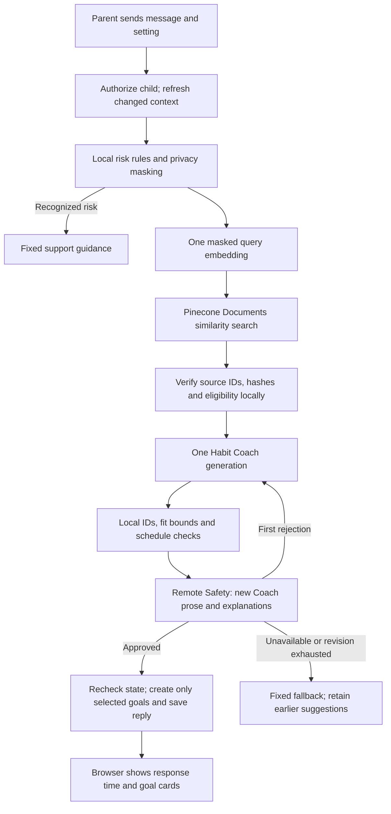

# Refined Habit Coach and source-backed habits

Implementation record: November 4, 2026. See [execution progress](implementation-progress.md) for verification and activation status. This supersedes the older crew diagrams for `COACH_ENGINE=refined`; the legacy engines remain available.

November 5 [more-choice controls](more-goals-and-habit-choices.md): **Get more goals**
appends up to four additional recommendations using the same concern and excluding
earlier choices. **More habit choices** replaces the slider and requests another
batch of three. Existing cards and the two-request habit queue are preserved;
provider routing, review bounds and spending limits are unchanged.

The [November 5 reliability update](goal-plan-reliability.md) changes the parent interaction:
Coach aims for three or four relevant source goals, and a new explicit Send can prepare three habit
choices under each result, with at most two habit requests in flight. Historical page loads do not
generate. These are separate bounded writer requests, not extra steps inside the Coach graph.
With four new goals, the normal path is two Coach chat calls plus four habit-writer calls;
each operation retains its existing correction/review bound and its own recorded timing.

## What runs on Send



The usual live path has **two logical chat calls**: Coach generation and a Safety review of newly generated
conversational text. One Safety revision adds two calls. Per the owner's execution clarification, the
refined path has no remote input-risk call and does not re-review canonical goals or run a separate
Safety model on bounded habit drafts. Triage, Research/Brief, Patterns and remote Fit are absent.
Pinecone search and query embedding are separate operations. The embedding is a model API request;
retrieval makes no chat-generation, research or Safety call. Fast local urgent-risk routing and the
explicitly labeled fixture preview use zero chat calls.

`refined.py` compiles a reusable LangGraph graph with explicit per-request runtime context. LangChain constructs the role-specific models and validates structured responses. The prototype's Deep Agents tool-selection loop is not nested inside this graph.

## Model and provider routing

| Operation | Model | Credential group / API |
|---|---|---|
| Habit Coach | `gpt-6-luna`, low reasoning | `PLANNING_OPENAI_*`, Responses, `store=False` |
| Generated Coach text Safety | `deepseek-ai/DeepSeek-V4.1-Flash-1017` | `OPENAI_*`, Chat Completions |
| Query embedding | `text-embedding-3-small`, 512 dimensions | `PLANNING_OPENAI_*`, embeddings |
| Explicit habit writer | `gpt-6-luna`, low reasoning | `PLANNING_OPENAI_*`, Responses, `store=False` |
| Legacy ParentRisk, Quest planner, weekly review, child moderation and buddy lines | Existing main routing | Existing explicit workflows; ParentRisk is not called by refined Coach or habit writing |

Coach retains one SDK retry per logical call. The imported habit writer and embeddings retain zero SDK retries by default. Logical-call counts and actual HTTP-attempt maps are reported separately. A transport timeout cannot retract a request already received by a provider; shared deadlines prevent subsequent dispatch or late publication.

Model inputs use a compact projection: server-only source IDs/hashes/release provenance and research URLs
are kept in canonical state and the reader, not repeated to the models. Research supports, age-transfer
limits and substantive caveats remain. Replies and parent-only draft fields have brevity guidance; local
validation and required support remain unchanged. Existing shared model HTTP pools use a 60-second idle
keepalive, with per-request credentials/timeouts and attempt counters preserved.

The real commented template is [backend/.env.example](../../backend/.env.example). The older `backend-ai.env.example` is a planning artifact. `PLANNING_OPENAI_API_KEY` receives the planning service's key; the main `OPENAI_API_KEY` remains associated with its existing provider. Keys never belong in `VITE_*` variables.

The canonical catalog is now bundled in the backend package. **Leave `CATALOG_SNAPSHOT_POINTER` empty.** Runtime overrides are rejected instead of silently using a sibling checkout. Pinecone settings must match the pinned `hq-habits-v1` / `habits-0-1-0` release and its Documents API `2026-07` schema.

## Goals, generated habits and assignment

```mermaid
flowchart LR
    P[Canonical Pinecone age record] --> G[Stable hqg- application goal]
    G --> R[Explore: local source reader]
    R --> B[Explicit Generate habits]
    B --> W[Luna writes a bounded batch]
    W --> V[Local source, wording and novelty checks]
    V -->|Valid| D[Persist locally validated child-bound drafts]
    V -->|First local rejection| W
    V -->|Invalid after one correction| U[No draft returned]
    D --> A[Parent chooses schedule and accepts with PIN]
    A --> H[Private my-ai- habit and child assignment]
    H --> T[Existing daily completion and approval loop]
```



One selected source card maps to one goal; age variants remain distinct. **Source goals are created locally
only after Coach generates a recommendation that passes Safety and final validation.** Retrieval and
source browsing create no goal rows. A failed or rejected generation creates no new goal. Multiple
generated habits can belong to an existing goal. Parent-only coaching source cards remain available for
provenance but are excluded from child-goal selection. No catalog-card reward or points setting is imported.
Accepted habits use the main app's existing tier-1 / 10-point custom-habit policy and its existing approval,
Sparks and boost behavior.

The source-details API and reopening saved drafts make no model call. Since the November 5 owner update,
explicitly opening a goal in Coach also prepares three habits when no saved batch exists. A count slider
can append up to three more per request; it preserves existing choices and does not retry failures automatically.
Habit generation normally makes
**one writer call**. Schema, source, age, child wording, duration, privacy and duplicate-action checks run
locally; one correction call is allowed for a failed local check. There is no remote input-risk or separate
whole-habit Safety call. The parent previews and approves the draft before assignment. Local validation
does not claim to be an independent semantic review of every possible generated instruction.

Explicit habit generation starts from a locally saved goal selected by Coach. A direct request for an
unmaterialized canonical goal is rejected before provider calls or budget reservation; it does not create
a placeholder goal. The source goal and its provenance remain linked by the existing database constraints.

Drafts are bound to family authorization, child, source goal, setting, request identity and conversation lifetime. Only locally validated content is returned for parent review. Replaying a generation request ID returns its existing batch; it cannot dispatch a second writer. Acceptance locks and rechecks current state, requires a schedule, and is idempotent. Daily drafts use all seven days; weekly drafts use selected days. Interval and as-needed schedules are unsupported and are not silently converted.

Accepted content stays immutable through the ordinary custom-habit editor. To change wording, generate and review a new draft. Child mode reads an explicit projection containing only child instructions, steps, materials, cue, completion and help. Parent guidance remains behind caregiver authorization. Source lineage and rich details survive chat reset; deleting the owning child cannot turn a generated habit into a shared family habit.

## Context, privacy and failure behavior

The frontend preloads up to 20 messages per authorized child into account-scoped memory. It does not persist these histories in the browser's general family snapshot. The existing first-chat-open reset remains; the Send timer includes waiting for that reset. Lifecycle guards discard late responses after reset, child changes or unmounting.

The backend cache stores a defensive copy of selected-child context. Every send authorizes again and reads authoritative fingerprints, including row IDs and Postgres row versions. Unchanged warm context needs one fingerprint query instead of materializing every snapshot section again. Changed sections reload individually. These fingerprints still perform database work; they are not a claim that a warm send needs no database reads. Final saves and acceptance use fresh rows under locks.

Pinecone and local guidance share a deterministic query resolver. Recognized refinement followups keep
the last explicit objective across multiple turns; explicit topic switches reset it. The full feedback
still reaches Coach generation. Relevant pending goals can be included again with checked canonical
details, within the same six-concept evidence bound. Reselecting one updates its existing card instead
of creating another. This is a bounded language heuristic, not a universal intent classifier.

Recommendation rank is stored separately from UUIDs and source-lock order. The strongest selected goal
stays first across the initial response, reload, context preload and reselection. Source rows are locked
in canonical ID order to avoid cross-request deadlocks; that lock order does not reorder the display.

Known child and caregiver names, common email addresses and phone formats are masked before external embedding and model calls. This is not comprehensive PII detection. Stored role metadata identifies app notes; a parent typing `[App]` does not gain trusted-message privileges.

Unavailable providers, malformed output, deadline expiry and rejected Coach text reviews produce fixed outcomes and preserve previous usable cards. They do not claim that the catalog has no matching habit. Invalid drafts are not streamed or displayed. Ordinary chat never starts the separate Quest planner or weekly review.

The source-goal flow does not use the old `G1`-style citations or local generic-guidance BM25 lookup.
Those labels were guidance-section IDs, not the catalog's research bibliography. The pinned catalog
contains 601 evidence entries and 42 distinct research links across its 381 cards. Coach uses their
supports, age-transfer constraints and research limitations; the goal reader displays the original links.
No research browsing or extra model call occurs. The catalog's mechanism-informed evidence does not
claim that the exact app habit has demonstrated efficacy. The legacy local-guidance mode remains separate.

Habit-generation diagnostics expose only allowlisted failure codes and known schema field paths.
Correction feedback names the failed rule without echoing rejected copy. Raw provider output,
unknown model-authored field names and exception inputs are not logged or returned.

## Local setup and operational checks

From `backend/`, using the existing project virtual environment:

```bash
# DATABASE_URL must select the intended database; back up its data first.
uv run --env-file .env python scripts/setup_db.py
.venv/bin/python scripts/import_planning_usage.py --ledger /path/to/planning-agent/reports/live-usage.json
.venv/bin/python scripts/check_ai_configuration.py
# Optional explicit read-only Pinecone preflight; no embedding or generation.
.venv/bin/python scripts/check_ai_configuration.py --verify-target
```

Do not bulk-import source goals. The packaged release contains 381 canonical reference records, including
377 eligible child-use records and four parent-only records. That read-only artifact supports retrieval,
validation and source reading; it is **not** a preload of 377 local database goals. Reviewed selection creates
only the needed goal and provenance together, idempotently, without overwriting changed or retired records.
Existing app goals and habits remain intact. No operation here writes to Pinecone.

The imported provider's development spending guard uses a persistent database ledger. Activation imports the prototype's existing accounted usage before marking the ledger initialized. An uninitialized or exhausted ledger blocks imported calls. Reservations cover both allowed generation passes and SDK retries, and remain charged after uncertain failures. They are conservative guard amounts, **not a provider billing report**. `PLANNING_*_RATE_PER_MILLION` values are carried-over estimates, not newly verified model prices. The old prototype and main app do not share a continuously synchronized ledger; use one active owner for the development cap.

The usage importer never overwrites an initialized main ledger. It accepts only a valid persisted source ledger;
rerunning it reports the existing state without granting a fresh allowance.

Rollback switches are `COACH_ENGINE=crew`, `COACH_PROVIDER=legacy`, `RETRIEVAL_MODE=local`, and `HABIT_GENERATION_ENABLED=false`, followed by a restart. Keep the additive schema and accepted habits; do not drop tables or delete imported data to roll back routing.

## Verification and limits

| Handoff item | Implemented behavior |
|---|---|
| 1. Context | Per-child preload, bounded cache, authoritative fingerprints and targeted refresh. |
| 2. Privacy | Code masks known names and common contact formats before external calls. |
| 3. Risk | Owner's latest scope: fast local urgent routing; no remote ParentRisk in refined Coach or habit writing. `local_only` is distinct from a model-cleared result. |
| 4. Triage | No standalone model; explicit UI operations and central Coach interpretation. |
| 5. Retrieval | One bounded embedding/search pair, strict canonical validation and local evidence hydration. |
| 6. Research/Brief | Canonical research evidence goes directly to generation; no Brief model, live research or legacy G lookup in source-goal mode. |
| 7. Patterns | Structured progress facts in code; distinct approved dates, no Patterns model. |
| 8. Coach | One central structured generator per pass in LangGraph. |
| 9. Fit | Eligibility before generation, contextual instructions, ID/relationship/capacity checks afterward. Independent live relevance grading remains pending. |
| 10. Safety | Owner's latest scope: remote review of new Coach prose/explanations only. Canonical records are trusted context; bounded habit drafts use local checks and parent approval. |
| 11. Finalization | Explicit outcomes, one Safety revision and no Fit-driven model loop. |
| 12. Persistence | Reviewed proposals, failure preservation, reset fences and locked parent acceptance. |

See [implementation progress](implementation-progress.md) for the final test totals and live checks. Unit/integration tests use mocked transports and separate disposable PostgreSQL databases. The wheel has been checked for its bundled canonical artifact. Test fixtures establish contracts, authorization and lifecycle behavior; they do not establish model relevance, clinical efficacy, live credentials or five-second latency.

The planning capability is adapted into small backend modules and a validated derivative catalog artifact. This delivers a standalone main-app build without a sibling-service dependency. A separately published shared package used by both applications is not part of this implementation; the original prototype remains unchanged. The source release is pinned: upgrades require a deliberate new artifact/import migration.

Five seconds remains the completed useful-response target. Benchmark full Send-to-reviewed-result latency, p50/p95, useful-result and revision rates, tokens and actual attempts. Separate useful answers from fast errors or fixture previews. Provider latency and revision calls can still dominate; do not claim the target from call-count reduction alone.

The final approved synthetic sequence measured **6.692s** for the initial Coach request, **4.336s** for
its follow-up, **3.996s** after a topic switch, and **4.612s** for contextual habit generation. All returned
useful results without revisions. These are ASGI/provider/database timings, not browser paint or a
production latency distribution. The initial request still exceeds five seconds. See the
[execution record](implementation-progress.md) for evidence, validation counts and budget accounting.

Timing fields include context, masking, risk, embedding, Pinecone, hydration, preparation, generation, local
validation, Safety, persistence and request elapsed time. `local_validation_ms` is part of `generation_ms`, not
an additional duration to sum. Timed-out operations can have incomplete stage snapshots; zero does not prove
an in-flight stage was fast or never dispatched. `generation_passes` and `safety_revision` are reported separately
and may be null when an interrupted graph cannot provide reliable final counts.


## Catalog presentation and live progress

The [November 5 repairs](generation-ui-repair.md) supersede the initial card layout and goal-opening behavior.
They add compact cards with larger artwork, action-specific Fluent icons, immediately visible child steps,
source-goal images and a separate list of habits scheduled for other days. Family settings → AI generation
controls optional seconds/stage details while actual live status always updates. The last 100 operations
are persisted per account on that browser; this history does not sync between devices.

The same settings page shows the cumulative planning-provider budget. The explicitly provisioned owner
can edit its persistent database cap without resetting prior reservations. The local approved cap is $5
with $0.9830207 already reserved. `PLANNING_TEST_BUDGET_USD` is only the fallback when no database cap is set;
the cap applies to the planning provider and is not a consolidated bill for all providers.
Two additive November 5 migrations were applied after a private database backup. New deployments must
explicitly provision `hq.planning_budget.owner_user_id`; no account can claim ownership through the API.

The [presentation and timing follow-up](catalog-presentation-and-progress.md) adds original
catalog artwork, ages, ordered steps, direct habit acceptance and optional live
stage events on the existing generation endpoints. Model routes and call limits
are unchanged. Actual recent saved habit requests took 7.5–8.4 seconds in the writer;
the earlier short benchmark must not be treated as a consistent browser latency claim.
