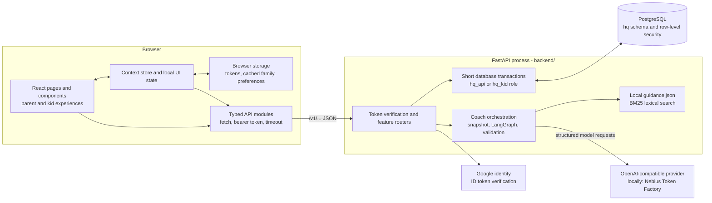
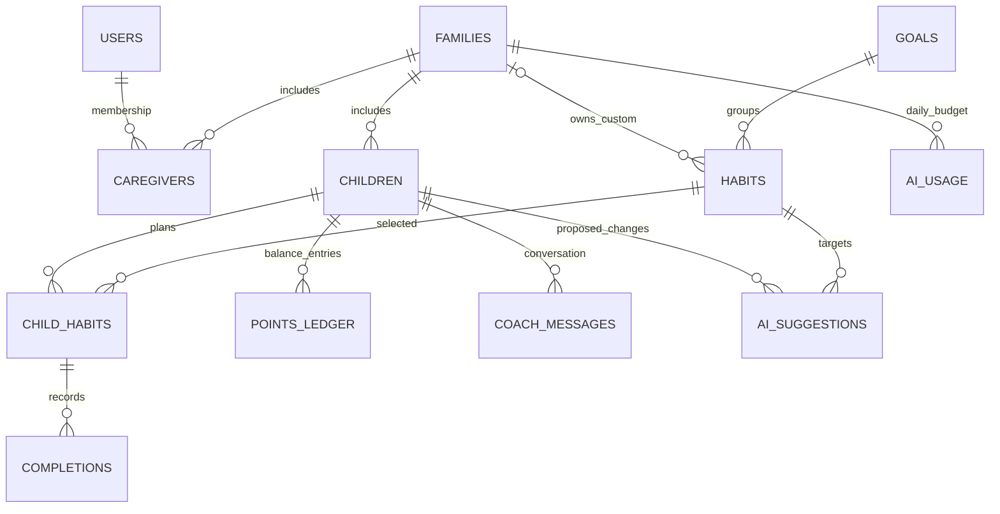
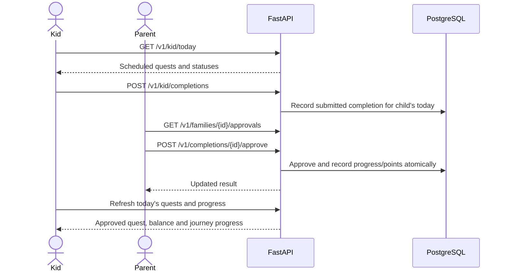

# Current HabitQuest system design

Reviewed **2026-11-03** at `831f4617acd5b36e67b1e431089a5f381f9dfd7e` plus local bootstrap and response-timer changes.
See the [documentation index](README.md) for scope and the [HabitCoach investigation](habitcoach-investigation.md)
for defects and performance evidence.

## Runtime architecture

HabitQuest is one repository with two applications. The React app calls the FastAPI service directly over JSON
HTTP; FastAPI owns the business rules and PostgreSQL data. The coach runs inside the API process and calls an
external model provider. A root `npm run dev` starts the frontend only; the API needs its own process.



The local guidance search uses bundled text and BM25, not an embedding API or a separate vector database.
The current coach request is synchronous from the browser's perspective: one POST waits for all work and returns
the complete JSON response. There is no streamed response or background-job status API for this flow.
Sources: [main.py](../backend/src/habitquest_backend/main.py#L80),
[guidance.py](../backend/src/habitquest_backend/guidance.py#L1),
[API client](../frontend/src/lib/api/client.ts#L105).

## Frontend structure and state

| Area | Responsibility and entry point |
|---|---|
| App shell | Hash routes and access gates in [App.tsx](../frontend/src/App.tsx#L1) and [router.ts](../frontend/src/lib/router.ts) |
| Shared state | [store.tsx](../frontend/src/lib/store.tsx#L57) loads the account, first linked family and children; exposes sign-in, family state and PIN prompts |
| Server synchronization | [sync.ts](../frontend/src/lib/sync.ts) reconciles API data with the browser's saved family representation |
| Feature calls | [lib/api/](../frontend/src/lib/api/) has typed endpoint modules over one [request helper](../frontend/src/lib/api/client.ts#L105) |
| Parent screens | Dashboard, Habit coach, quest library, rewards and family settings in [pages/](../frontend/src/pages/) |
| Kid screens | Today's quests, worlds, shop and journal; calls use the child-scoped token |
| Coach state | [Coach.tsx](../frontend/src/components/Coach.tsx#L25) holds messages, pending text and suggestion cards locally; the API persists the thread |

After sign-in, the store saves the caregiver token, requests `/v1/me`, then loads the selected family and children
concurrently. A family with no children enters setup. Screen-level data is fetched separately as needed.
The current store chooses `me.families[0]`; a general multi-family switcher is not part of this boot sequence.

Caregiver tokens and independently signed-in kid state use local storage. Shared-device kid mode/session uses
session storage. Family snapshots and UI preferences are also cached locally. These caches do not replace the
backend's persisted plan, completion, balance or authorization decisions.
Sources: [store.tsx](../frontend/src/lib/store.tsx#L107),
[storage.ts](../frontend/src/lib/storage.ts#L16), [sync.ts](../frontend/src/lib/sync.ts#L17).

The coach and dashboard's planner/review helpers show elapsed response seconds. The shared
[response timer](../frontend/src/components/AiParts.tsx#L26) measures the actual API promise, including network,
server work and any client retries. It excludes PIN dialogs, initial chat reset and later refresh work. Coach
durations attach to individual replies during the current mounted session; older loaded messages have no invented
timings. Errors show time to failure. These browser measurements complement server-stage instrumentation rather
than replacing it.

## Identity and database access

Google sign-in exchanges a verified Google ID token for the API's HS256 bearer token. Local development can use
`POST /v1/auth/token` when enabled. A caregiver token identifies a user; a kid token identifies one child and is
refused on caregiver endpoints. Kids enter through a caregiver's shared-device session or family code and kid PIN.
The optional family PIN provides an additional check for protected parent actions; PINs are stored as salted
scrypt hashes. These mechanisms are implemented in [auth.py](../backend/src/habitquest_backend/auth.py#L1) and
[accounts.py](../backend/src/habitquest_backend/accounts.py).

```mermaid
sequenceDiagram
    participant UI as React screen
    participant Client as API request helper
    participant Router as FastAPI feature router
    participant Tx as db.transaction
    participant PG as PostgreSQL
    UI->>Client: Read or mutate a feature
    Client->>Router: /v1/... with bearer token
    Router->>Router: Verify signature, expiry and caller role
    Router->>Tx: Open scoped transaction
    Tx->>PG: SET LOCAL ROLE hq_api or hq_kid
    Tx->>PG: Set app.user_id and app.child_id
    Tx->>PG: Query or update under RLS policies
    PG-->>Tx: Authorized rows
    Tx-->>Router: Result; commit on success
    Router-->>Client: JSON or HTTP error
    Client-->>UI: Typed result or ApiError
```

[db.py](../backend/src/habitquest_backend/db.py#L21) opens a connection for each transaction, with a 3-second
connection timeout and 10-second statement timeout. RLS policies constrain family and child data independently
of frontend access gates. Ordinary operations use a short transaction. The coach deliberately uses two, with all
model work between them, so a database transaction is not held open while waiting on the provider.

## Persistent data and business rules



This is a logical subset; the schema also includes pain points, child goals, reports, check-ins, reward requests,
surprises, child extras and family settings. See [schema.md](../backend/docs/schema.md) and the
[migrations](../backend/db/migrations/).

| Concept | Current rule |
|---|---|
| Catalog vs custom habit | Shared catalog habits have `family_id IS NULL`; custom habits belong to one family. The quest library can display more than the coach is allowed to recommend. |
| Plan | Up to six non-removed habits per child. Active **and paused** entries occupy slots; removed entries do not. Paused habits can be resumed rather than suggested as new additions. |
| Eligibility | New coach additions come from active catalog habits under active goals, within the child's age range and unlocked tier. Family custom habits are excluded from this candidate list. |
| Unlocks | Approved progress determines the journey/world tier unless a caregiver sets a tier override. |
| Daily date | The database's `hq.child_today` uses the family's time zone; the server or workstation calendar is not authoritative. |
| Sparks | Approved quest progress unlocks levels/worlds and tiers; Sparks are not spent. |
| Points | Approvals and rewards use an append-only ledger. Reward requests hold points; rejection refunds them. A database trigger prevents negative balances. |
| AI decisions | Suggestions are proposals. Accepting them rechecks authorization, optional family PIN and applicable plan constraints before mutation. |

Sources: [catalog candidates](../backend/src/habitquest_backend/onboarding.py#L107),
[progress](../backend/src/habitquest_backend/journey.py#L163),
[suggestion application](../backend/src/habitquest_backend/coach.py#L418),
[daily loop](../backend/src/habitquest_backend/daily.py),
[points trigger](../backend/db/migrations/202610310004_redemptions.sql).

## Daily quest loop



The API and database validate ownership, dates, status transitions and duplicate approvals. The browser renders
the result and celebrations. Reward and customization flows build on the same persisted progress and balance.

## AI features and HabitCoach

| Feature | Implementation |
|---|---|
| Onboarding pain point mapping | [ai.py](../backend/src/habitquest_backend/ai.py): safety screen, structured goal mapping, catalog validation and keyword fallback |
| HabitCoach | [coach.py](../backend/src/habitquest_backend/coach.py) coordinates a conversation; [crew.py](../backend/src/habitquest_backend/crew.py) implements the locally selected workflow |
| Quest planner and weekly review | [insights.py](../backend/src/habitquest_backend/insights.py) produces reports/proposed changes |
| Buddy lines and child text safety | [insights.py](../backend/src/habitquest_backend/insights.py) and [safety.py](../backend/src/habitquest_backend/safety.py) validate child-facing text with built-in fallbacks |

A coach turn takes a snapshot of eligible habits, current plan, recent approvals/check-ins, previously shown habits
and recent conversation. It runs the parent risk screen, triage, parallel guidance/progress work, planner and
parallel fit/safety review. A failed review can trigger one revision. The API then saves the parent message,
reply and proposals in a second transaction and returns the thread. The complete graph and its timing are in the
[investigation](habitcoach-investigation.md#why-a-response-takes-so-long).

Names of known children are replaced with labels before model calls, and custom habit titles in the plan snapshot
are replaced with goal-based labels. These are limited transformations, not a general personal-data scrubber.
The review found a separate accepted-suggestion note path that can reintroduce a raw custom habit title into later
model history; see the [additional findings](habitcoach-investigation.md#additional-findings). The initial
model-backed risk check also sends the redacted parent text to the provider before deciding whether it is risky.
Word-list detection happens before that call. Risk-guidance replies do not save the submitted conversation message.

## Local runtime and configuration

| Location or setting | Current local use |
|---|---|
| `frontend/.env.local` | Public `VITE_API_URL=http://127.0.0.1:8000`, Google client ID and development-login flag |
| `backend/.env` | Database URLs, auth secrets, development credentials and model-provider configuration |
| Browser | `http://localhost:5180`; origin allowed by API CORS |
| API | `http://127.0.0.1:8000`; Swagger UI at `/docs`, machine contract at `/openapi.json` |
| PostgreSQL | Port 5432; separate `habitquest` and `habitquest_test` databases |
| AI mode/engine | `AI_MODE=openai`, `COACH_ENGINE=crew` |
| Provider | `OPENAI_BASE_URL=https://api.tokenfactory.us-north1.nebius.com/v1/` |
| Primary model | `OPENAI_MODEL=deepseek-ai/DeepSeek-V4.1-Flash-1017` |
| Role models | `OPENAI_SMALL_MODEL` and `OPENAI_SAFETY_MODEL` unset; every role therefore uses the primary model |
| Budgets | Model HTTP timeout 30 seconds; local coach graph timeout 65 seconds; browser AI request timeout 75 seconds |
| Tracing | `TRACE_COACH=false`; historical per-stage outcomes are unavailable |

`Settings` reads `.env` relative to the process working directory. Start the API **from `backend/`**; restart the
relevant process after changing its environment file. `OPENAI_*` settings name an OpenAI-compatible protocol and
do not imply that OpenAI hosts the selected model. Secrets belong only in the backend environment, never in a
`VITE_*` variable.

The code defaults differ from this workstation: `AI_MODE=fake`, `COACH_ENGINE=agent` and a 50-second coach timeout.
The crew is selected here by configuration. See [config.py](../backend/src/habitquest_backend/config.py#L24)
and [llm.py](../backend/src/habitquest_backend/llm.py#L26).

Apply schema changes through [setup_db.py](../backend/scripts/setup_db.py), which tracks migration hashes and
upserts the catalog seed. Plain `uvicorn` does not apply migrations; the hosted
[start script](../backend/scripts/render_start.sh) explicitly does so. Startup instructions remain in the
[root README](../README.md#run-both-locally) and [local setup guide](../backend/docs/localsetup.md).

## Checks and operational limits

Backend tests exercise API rules, PostgreSQL policies and AI behavior with mocked providers. Frontend tests cover
logic and selected screens; Playwright covers the daily loop against a real API/database. Real-provider coach
evaluations are separate from deterministic CI. The frontend survey found no dedicated coach screen/browser test.

`/health/live` checks process liveness; `/health/ready` checks a database query. Neither validates the provider key,
model availability or recommendation quality. In-memory sign-in/PIN attempt limiters are process-local. A coach deadline
returns a fallback but does not stop an already running model thread. Concurrent sends/reset operations have no
turn-wide per-child lock. These limitations matter when diagnosing the coach; see the
[remediation plan](habitcoach-investigation.md#proposed-plan-of-action).
